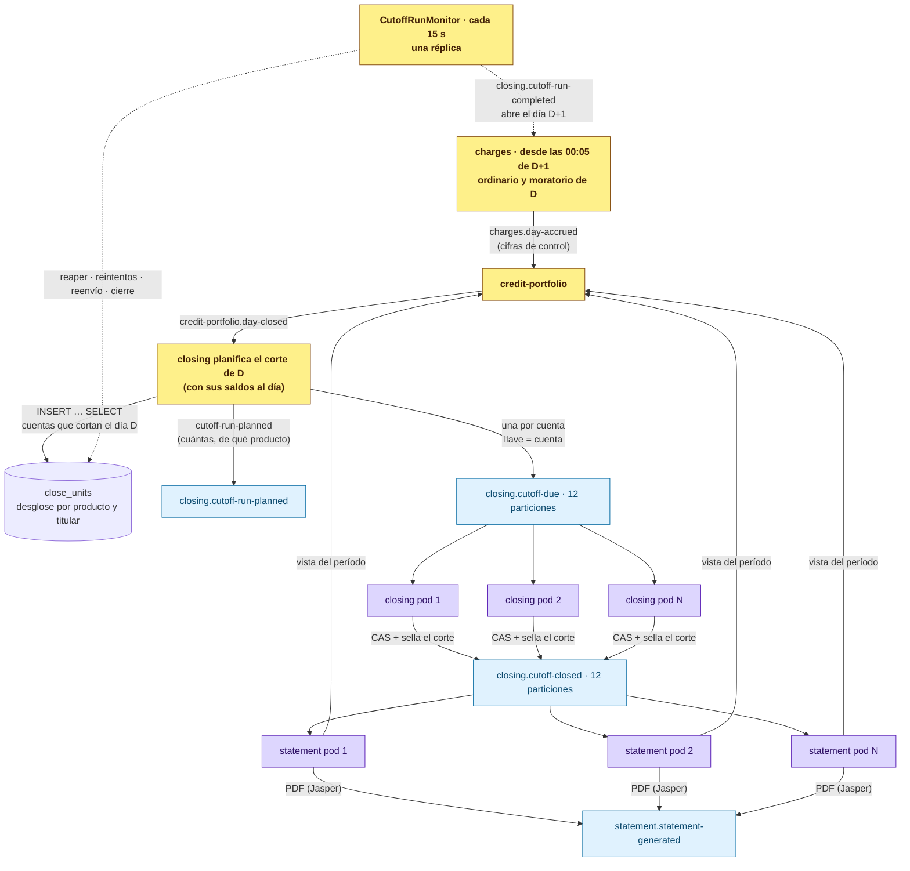

# El corte y los estados de cuenta, repartidos por cliente y distribuidora

> Análisis y diseño, **2026-10-31**. Cada afirmación sobre el «antes» se verificó en el código y en la
> base del ambiente local.

## La pregunta

> *«Un servicio que genere los documentos cada que se genere el corte para un cliente/distribuidor: se
> notifica a un tópico y se escucha para generar el estado de cuenta usando Jasper Reports. El corte
> tiene que correr similar: se ejecuta el job, se ve cuántos clientes están envueltos en el corte y qué
> producto, y se manda ejecutar. El estado de cuenta puede diferir por producto (un revolvente o un fijo
> no es igual). Tanto el corte como el estado de cuenta se ejecutan por cliente/distribuidor, y se puede
> distribuir el servicio para acelerar con más cómputo o pods.»*

## Cómo estaba

| # | Hallazgo | Evidencia |
|---|---|---|
| 1 | 🔴 **El corte nunca había corrido.** El motor estaba escrito y probado, pero nada lo disparaba: cero `@Scheduled`, cero endpoints | `closing.close_runs` vacía; 1 152 cortes `SCHEDULED` en `cutoff_schedules` |
| 2 | 🔴 **Materializaba una unidad por cada cuenta viva**, no por las que cortan ese día, y la fase de corte omitía al 97 % | `BusinessDayRunner.materialize` → `findActiveForClosing(…, 100_000)`; `CutoffPhaseProcessor` → `UnitSkipped("no le toca corte")` |
| 3 | 🟡 **El reparto entre pods estaba a medias.** Todos los hilos leían la misma página (`offset 0`) y competían por el candado de las mismas filas | `BusinessDayRunner.workUntilDrained` → `workBatch(…, 0)` |
| 4 | 🟡 **Los tópicos nacían con una partición**: el techo de paralelismo era 1, sin importar cuántos pods hubiera | `KAFKA_AUTO_CREATE_TOPICS_ENABLE`, sin `num.partitions` ni `NewTopic` |
| 5 | 🔴 **No existía nada de estados de cuenta**: ni vista, ni plantilla, ni librería de PDF, ni almacén, ni evento | `WalletView.applyStatementGenerated` esperaba un evento que nadie publica |
| 6 | 🟡 **`cutoff-closed` no decía lo que un estado de cuenta necesita**: ni el inicio del período, ni el comportamiento del producto, ni si el titular es distribuidora | `CutoffClosedPayload` |

## Cómo queda

### El corte (closing-service)

0. **El día se procesa cuando terminó, en serie y con compuertas.** El cierre del 10 de noviembre empieza
   el 11 a las 00:05: cargos devenga el ordinario y el moratorio del 10 y avisa (`charges.day-accrued`, con
   cifras de control); cartera calcula la mora al 11 —la mora corre desde las 00:00— y avisa
   (`credit-portfolio.day-closed`); closing corta el 10 y avisa (`closing.cutoff-run-completed`); con eso
   cargos puede devengar el 11. La hora sólo despierta a los jobs; lo que decide cada paso son sus
   compuertas, y se revisan venga el disparo de donde venga (aviso, reanudación cada 15 minutos,
   operación a mano, soporte de pruebas). Ver [El orden del cierre](#el-orden-del-cierre).
1. **Planificar es una sentencia.** Closing toma, en orden, cada día que cartera cerró y hace un
   `INSERT … SELECT` de las cuentas que cortan ese día. Medido: **5 000 cuentas planificadas y despachadas
   en 0.2 s**.
2. **Se ve quién entra.** El desglose por producto y por titular (`CUSTOMER` / `DISTRIBUTOR`) se congela en
   la corrida y sale en `closing.cutoff-run-planned`: *«Corte del 30-nov: 83 cuentas [CUSTOMER/PERSONAL_LOAN=71,
   DISTRIBUTOR/DISTRIBUTOR_LINE=12]»*.
3. **Se manda por cuenta.** Un mensaje por cuenta a `closing.cutoff-due`, con la cuenta como llave. Una
   unidad sólo se marca despachada cuando el broker confirmó el envío.
4. **Cada pod corta las de sus particiones.** El consumidor toma la unidad con el mismo CAS de siempre
   (`UPDATE … WHERE status='PENDING'`) y su fencing token: un mensaje repetido encuentra la unidad
   tomada y sigue de largo. Sella el corte y publica `closing.cutoff-closed`, ahora con la corrida, el
   inicio del período, el comportamiento del producto y el tipo de titular.
5. **El monitor cierra.** Cada 15 s, en una réplica: devuelve lo que un pod muerto dejó tomado,
   reintenta las fallidas hasta 3 veces, reenvía lo que nunca salió y, cuando ya no queda nada en vuelo,
   **sella** la corrida —o la deja `FAILED` con el detalle de cada cuenta— y publica
   `closing.cutoff-run-completed`.

Operación: `POST /api/v1/closing/cutoff-runs?businessDate=` (idempotente), `GET …/{fecha}` (avance,
desglose y fallidas), `POST …/{fecha}/retry`. Un corte de un día que no ha terminado se rechaza con 409.

### El estado de cuenta (statement-service)

Escucha `closing.cutoff-closed`: un mensaje es un documento. Registra por `(cuenta, ciclo)`, reclama con un
`UPDATE … RETURNING`, pide la vista del período a cartera y llena **la plantilla de su producto**: hay una
por cada producto del catálogo (préstamo personal, nómina, grupal, microcrédito, PyME, tarjeta, línea
revolvente, línea empresarial, distribuidora), cada una con su título, su recuadro y su tabla. Un
producto sin plantilla no sale con una genérica: queda `FAILED` con la causa. Ver el
[README del servicio](../services/statement-service/README.md).

**Qué comparten los productos de una familia** (los datos que llena el ensamblador; la plantilla es de cada producto):

| | Plazo fijo | Revolvente | Distribuidora |
|---|---|---|---|
| El exigible | La **cuota del plan** que vence | **Pago mínimo** (% del saldo, de la política del producto) y **pago para no generar intereses** | La **suma de las cuotas de sus clientes** que vencen hasta la fecha límite |
| El detalle | Plan de pagos y avance | Movimientos del periodo | Colocaciones por cliente |
| El saldo | Capital por amortizar | Saldo anterior → saldo al corte | Saldo de la línea |

### La vista (credit-portfolio)

`GET /api/v1/portfolio/accounts/{id}/statement-view?from&to&dueUntil`. Es una **lectura de cartera, no
una copia ni una vista SQL compartida**: cartera es dueña del libro, el plan y las disposiciones, y otro
servicio leyendo sus tablas rompería el aislamiento del que depende el resto de la plataforma.

* El devengo es diario —un mes son ~60 renglones de interés e IVA—, así que llega **sumado** por concepto;
  lo que el cliente reconoce como un hecho (disposición, pago, comisión, castigo) se lista.
* El período va por **fecha valor** (`balance_events.value_date`): el día de negocio al que pertenece cada
  movimiento. Un pago de las 19:00 del día del corte es de ese período aunque en UTC ya sea el día
  siguiente, y el devengo del día del corte —que se aplica a las 00:05 del siguiente— también.
* Índice `(credit_account_id, value_date, applied_at)` en `balance_events`: el corte pide el libro de miles
  de cuentas a la vez.

## El orden del cierre

El interés de D tiene que estar en cartera **y** en la proyección de closing antes del corte de D, y el
corte no puede depender de la hora a la que corra. Cada paso tiene una compuerta y una bitácora por día
que dice, si no ha corrido, por qué.

| Paso | Bitácora | Compuertas |
|---|---|---|
| **Cartera** toma la **foto de D** | `credit_portfolio.day_snapshots` (día) y `account_day_snapshots` (cuenta) | D terminó · D-1 cerrado en cartera · cartera consumió pagos y cargos. La pide cargos (`POST /api/v1/portfolio/day-snapshots/D`) |
| **Cargos** devenga D | `charges.accrual_days` (día) y `charges.accrual_units` (cuenta) | Son las 00:05 de D+1 · D-1 cerrado aquí · cartera cerró D-1 · closing terminó el corte de D-1 · cargos consumió los saldos y la mora de cartera · **la foto de D existe y se copió completa** |
| **Cartera** cierra D | `credit_portfolio.day_closes` | Cargos avisó D · D-1 cerrado · **la foto de D existe** · cartera consumió todos los cargos · **las cifras cuadran**, sin las cuentas que cargos dejó fuera: intereses ordinarios y moratorios del lote del cierre de D aplicados (más los rechazados) = los que cargos dijo, en número e importe |
| **Closing** corta D | `closing.portfolio_day_closes` | Cartera cerró D · closing consumió saldos, mora y altas · días en orden · las cuentas fuera del lote nacen retenidas |

**Por cuenta.** Las compuertas son del día; el trabajo es por cuenta. Cargos reparte el día en unidades
por cuenta (`charges.accrual-due`, 12 particiones) y cualquier pod las devenga. Una cuenta que no puede
devengar agota sus intentos y queda **en cuarentena** con su error; el día cierra con las demás y avisa
las cuentas que quedaron fuera. Cartera cuadra sin ellas y closing **retiene su corte** (`HELD`); el
resto corta normal. Sus días siguientes nacen retenidos en cargos: el interés de una cuenta nunca se
adelanta a uno que le falta. Corregido el dato y reintentada la cuenta, la cadena se repite en pequeño:
cargos avisa `charges.account-accrued` con las cifras de esa cuenta → cartera las cuadra y avisa
`credit-portfolio.account-day-closed` → closing corta la cuenta con su saldo al cierre de su día. Más
cuarentenas que el 1 % de las cuentas del día (mínimo 10) es una falla general y el día no cierra.

**La foto diaria por cuenta (cierre preliminar).** Antes de que nadie devengue D, cartera —dueña de los
saldos y las cuotas— escribe cómo quedó cada cuenta **al terminar D**: capital, interés, IVA, mora, capital
vencido, cuota más vieja sin pagar y días de atraso al día D. Lo aplicado después con fecha valor posterior
(un pago de las 00:03) se resta, así que la foto da lo mismo tomada a las 00:05 o a las 03:00. Es un solo
`INSERT … SELECT` (5 000 cuentas en 79 ms) y los demás la **copian**, no la consultan en línea: cargos jala
las páginas antes de repartir el día y congela en cada unidad la base sobre la que devenga
(`accrual_units.basis_*`); closing copia a cada unidad de corte los días de atraso y el capital al día. Con
eso el interés de D y los días de atraso del corte de D no dependen de a qué hora corrió el proceso ni de
si la cuenta se recuperó tarde: **cada día tiene su foto**, y una cuenta en cuarentena el 10 que paga el 13
devenga el 10, 11 y 12 con sus fotos y el 13 ya sale sana. Es también el hilo de la trazabilidad: `foto(D).capital ×
tasa / 360` es el interés de D en cargos (el cargo guarda su base) y `foto(D).capital` es el capital que closing
sella; si no coincide, la unidad falla y la cuenta aparece en problemas. Una cuenta activa en cargos que la foto
no trae nace en cuarentena («cartera no la incluyó»). La historia de una cuenta, día por día:
`GET /api/v1/portfolio/accounts/{id}/day-snapshots?from&to`; lo que cargos hizo con ella un día:
`GET /api/v1/charges/day-close/{date}/accounts/{id}`.

**«Consumió todo» es una foto de offsets.** Quien avisa publica —y el broker confirma— todo lo suyo antes
del aviso: cargos espera la confirmación de cada `charge-applied`, y cartera hace `flush()` antes de
`day-closed`. Quien recibe el aviso toma una foto del final de cada partición y espera a que su grupo de
consumo la alcance (`ConsumerCatchUp`, en `shared`). Lo publicado después no cuenta.

**Las cifras de control** detectan lo que la foto no ve: un mensaje que el consumidor descartó después de
sus reintentos. Cuentan **el lote** del cierre —cada cargo lleva `dayCloseDate`, en cargos y en cartera—
y no la fecha valor: en la base local había 24 761 intereses con fecha valor del 31 de octubre que no
salieron de ningún cierre (siembras fechadas por su hora de aplicación), y comparar por fecha nunca
habría cuadrado. El día espera; si cartera no confirma en 30 minutos, cargos vuelve a avisar y reenvía los
cargos del día con su mismo id (cartera ignora los que ya tenía).

**El saldo al cierre de D.** El corte no sella el saldo del momento en que corre sino el de la proyección
menos los movimientos con fecha valor posterior a D (`closing.balance_movements`, alimentada por el
`valueDate` de `balance-updated`). La cuenta que se liquidó el 11 sí corta el 10 (`terminal_since`).

**Ningún respaldo se salta una compuerta.** Las reanudaciones (cargos 00:05 y cada 15 min, cartera
`:10/15`, closing `:15/15`) sólo reintentan lo que ya está en su bitácora. Cartera nunca cierra un día que
cargos no avisó; closing nunca corta un día que cartera no cerró; el corte a mano responde 409 con el
motivo. Si cargos estuvo caído tres días, al volver cierra los tres en orden, y cada uno espera a que el
anterior termine en cartera y en closing.

**Laboratorio** (`tools/lab`): la cadena completa sobre una copia de la base, con el reloj de negocio desplazable
(`/internal/test-support/clock`, sólo con el soporte de pruebas). Corrió del 1 de noviembre al 31 de diciembre de 2026
en 261 s (4.3 s por día), con cortes semanales, quincenales y mensuales y 172 estados de cuenta; la base de cada
cargo y el capital de cada corte coinciden con la foto en el 100 % de los casos.

Medido con Postgres y broker reales: cargos 2 000 cuentas repartidas en 3.7 s (537 cuentas/s, un pod con 4
hilos), con cada cargo confirmado; cartera
~300 cuentas en 0.5 s con compuertas; closing 1 000 cuentas con movimientos posteriores sellados al cierre
del día en 2.6 s.

## Correr el ciclo completo: `tools/ciclo-credito`

El laboratorio (`tools/lab`) copiaba una base y corría la cadena sobre ella. Desde el 2 de noviembre
hay algo más directo contra el stack local: **el reloj de negocio de los 14 servicios que sellan hechos
se desplaza** (`/internal/test-support/clock`, sólo con `TEST_SUPPORT_ENABLED`) y el día simulado corre
entero: altas por la app, pagos por el canal de pagos, compras por wallet, cobranza por el backoffice,
y cada noche la cadena de arriba, por sus compuertas. Dos usos, dos objetivos:

- **Pruebas E2E** (`python3 tools/ciclo-credito/corre.py simular`): sólo configuración sembrada; 20
  escenarios escritos (`escenarios.py`) desde el 16 de marzo de 2026, deterministas; entrega por
  escenario los estados de cuenta PDF, las pólizas, el libro, la foto diaria, los cargos, los cortes y
  la vista paso a paso que los ata, más la balanza por período y la conciliación de la cadena
  (`concilia.sql`). Ver `tools/ciclo-credito/README.md`.
- **Demo** (`scripts/reinicia-y-siembra.sh`): la misma máquina con un plan aleatorio de semilla fija
  sobre la cartera sembrada, originada meses atrás. Ver `docs/SIEMBRA_DEMO.md`.

## Escalar: las tres palancas

`paralelismo = min(particiones, réplicas × hilos por réplica)`

| Palanca | Corte | Estados de cuenta |
|---|---|---|
| Particiones | `CLOSING_CUTOFF_PARTITIONS` = 12 | `STATEMENT_PARTITIONS` = 12 (el mismo `cutoff-closed`) |
| Hilos por pod | `CLOSING_CUTOFF_CONCURRENCY` = 4 | `STATEMENT_CONCURRENCY` = 4 |
| Réplicas | `--scale closing-service=N`* | `--scale statement-service=N` |

El devengo del cierre escala igual: `CHARGES_ACCRUAL_PARTITIONS` = 12, `CHARGES_ACCRUAL_CONCURRENCY` = 4 y
`--scale charges-service=N` (cargos no publica puerto en el host).

\* closing publica su puerto en el host (8103) para operación; en Kubernetes no aplica.

Con 12 particiones y 4 hilos, la tercera réplica llena el techo; una cuarta sólo sirve si se suben
particiones. `KafkaAdmin` agrega las particiones que falten al arrancar.

Medido en las pruebas (un pod, Postgres y Kafka reales): **corte ≈ 480 cuentas/s con 4 hilos**; **PDF ≈ 200/s
con 4 hilos** con la cartera simulada (≈ 6–10 ms por documento en un hilo).

## Qué queda fuera

| | |
|---|---|
| ⏳ | **Almacén de objetos** para los PDF (hoy `bytea`, como el resto de los documentos) |
| ⏳ | **Avisar al cliente** con `statement-generated` (notifications) y **exponer** los documentos en app y backoffice |
| ✅ | ~~Los avisos de la cadena no esperaban a los consumidores~~: cada paso espera a que su grupo consuma lo publicado antes del aviso, y cartera cuadra el interés con las cifras de control. Ver [El orden del cierre](#el-orden-del-cierre) |
| ✅ | ~~Un pago entre las 00:00 y el corte entraba al saldo sellado~~: el corte sella el saldo al cierre de D por fecha valor |
| ✅ | ~~Un calendario que falla detiene la cadena~~ (pasó la primera noche: tres IVA de 0.00 detuvieron el 31 de octubre): el cierre es por cuenta; la cuenta queda en cuarentena, su corte retenido, y el resto sigue. Ver [El orden del cierre](#el-orden-del-cierre) |
| ✅ | ~~Una cuenta recuperada tarde devengaba con su saldo de ese momento~~: cada día tiene su foto en cartera y cargos devenga sobre la base congelada en la unidad, se recupere cuando se recupere. Ver [El orden del cierre](#el-orden-del-cierre) |
| ✅ | ~~El libro de cartera y sus saldos no cuadraban~~ (106 de 123 cuentas, $6.38 M). Causa raíz, dos defectos del motor: **(1) el alta no asentaba**: `CreditAccount.activate()` ponía el capital sin `balance_event`, así que el libro de cada préstamo empezaba después de prestar el dinero (100 préstamos, $6,384,000); **(2) escritura sin candado**: `balance_version` es un contador, no un bloqueo, y el 31 de octubre los intentos de devengo solapados del esquema viejo se pisaron: 113 intereses (con su IVA) entraron al libro y su actualización de saldo se perdió ($3,003). Corregido: asiento `ACTIVATION_DISBURSEMENT` al activar, `SELECT … FOR UPDATE` en `apply()`, y la foto diaria calcula `ledger_gap` por cuenta y avisa si alguna no cuadra. Reparación de datos ensayada en el laboratorio (`tools/lab/repair-ledger.sql`): libro = saldos en el 100 % y los estados de cuenta cuadran contra el libro |
| ✅ | ~~Una línea revolvente nacía sin calendario de devengo~~ (hallazgo de la primera corrida limpia del 2 de noviembre): la comisión de apertura se calculaba sobre el monto dispuesto, que en una línea es cero; cargos publicaba `charge-applied` por $0.00 y después fallaba al confirmar (check `amount > 0`), Kafka reintentaba la activación y nunca la consumía, así que la cuenta no devengaba nunca y cartera se quedaba con 20 asientos de $0.00 sin cargo detrás. Corregido: sin comisión cuando redondea a cero, IVA sólo si hay comisión, y los eventos salen **después** del commit |
| ✅ | ~~El primer día de la cadena era «el primero que se haya cerrado»~~: en un entorno recién levantado el cron cierra «ayer» (vacío) en minutos, y una simulación que arranca meses atrás se quedaba esperando el día anterior a su inicio. Cargos ahora pide el día anterior sólo cuando hay algún día cerrado **antes** del que cierra (como ya hacía cartera), y el motor descarta los cierres vacíos posteriores al inicio |
| ✅ | ~~El candado de `apply()` no servía cuando la misma transacción ya había leído la cuenta~~ (segunda corrida limpia, 26 de mayo simulado: una devolución y un pago aplicado llegaron con 44 ms de diferencia; los dos entraron al libro y los saldos se quedaron sólo con el segundo). `onPaymentApplied` lee la cuenta antes de `apply()` para comprobar el sobrepago; `apply()` tomaba el candado, pero `findById` devolvía la copia ya cargada, leída antes del candado. Ahora `lockAndLoad` bloquea y **recarga** en un solo paso (`PESSIMISTIC_WRITE` + `refresh`) |
| ✅ | ~~El excedente de un sobrepago salía como `payment-returned`~~ y cartera lo sumaba a la deuda como mora: la distribuidora E14, que pagaba el exigible de cada corte, terminó debiendo la suma de sus propios reembolsos ($1.03 M en el libro). El excedente no es un hecho de saldo: queda en la orden (`requested_amount`) para que tesorería lo devuelva, y no se publica |
| ✅ | ~~Ningún pago pasaba de `PENDING`~~: payments esperaba una confirmación que nadie mandaba (y sin `CONFIRMED` no hay devolución posible). `balance-updated` lleva ahora `sourceEventId` (el id de la orden) y payments confirma al recibirlo con `PAYMENT_APPLIED` |
| ✅ | ~~Los pagos sólo bajaban las cuotas del calendario de la cuenta~~, nunca las de las colocaciones ni las de una compra a meses: una tarjeta que pagaba cada corte acumulaba cuotas vencidas, mora y días de atraso, y el exigible de la distribuidora crecía con lo ya pagado. El pago se aplica ahora a la cuota más vieja de **todos** los calendarios de la cuenta (el suyo y los de sus disposiciones) |
| ✅ | ~~En las revolventes se cobraba moratorio a quien pagaba a tiempo~~ (tercera corrida limpia: tarjeta, tarjeta a meses, línea empresarial y distribuidora, todas puntuales, con 146, 12, 16 y 61 cargos moratorios). Dos causas: **(1)** las cuotas de los planes (colocaciones, meses sin intereses, compras a plazo) vencían en su propia fecha, antes de la fecha límite del estado que las cobra; **(2)** la cuota del ciclo era la suma de las compras, así que quien pagaba el mínimo quedaba «vencido» por el resto (y una compra ya pagada antes del corte se facturaba igual). Ahora, en un producto que se cobra por estado de cuenta, **cada cuota la factura un solo estado y vence en su fecha límite** (`installments.billed_cycle`, migración 034; la fecha original queda en `original_due_date`), la cuota del ciclo es **el mínimo** (tope: lo revolvente = saldo − lo que deben los planes), y la foto y el job de mora sólo cuentan cuotas facturadas, incluidas las `PARTIAL` (el job contaba sólo `PENDING` y no miraba la cuota del ciclo) |
| ✅ | ~~El exigible de la distribuidora cobraba dos veces las mismas cuotas~~: el corte quincenal con 15 días para pagar hacía que el estado N volviera a pedir lo que el N−1 había cobrado y aún no vencía; quien pagaba el exigible adelantaba cuotas (la distribuidora que «deja de pagar» liquidó todo antes de dejar de pagar). La vista pide lo vencido al corte y lo que vence hasta su fecha límite, pero no lo que cobró un estado anterior y sigue en su plazo |
| ✅ | ~~El mínimo impreso de una tarjeta con meses sin intereses no sumaba la mensualidad~~: el estado imprime el mínimo del ciclo más las mensualidades que factura, y el «pago para no generar intereses» ya no adelanta el plan (saldo − lo que deben los planes + lo facturado). Es la misma regla con la que cartera arma la obligación |
| ✅ | ~~La mora se medía por el estatus de la cuota~~ (cuarta corrida limpia: la distribuidora al corriente terminó con 34 días de atraso y 56 moratorios sobre $60 de deuda). La cuota de una colocación lleva el interés del plan y la cuenta devenga el real; cuando el pago se topa al adeudo, las últimas cuotas quedan `PARTIAL` para siempre y «vencidas». Ahora la mora se mide **por capital**: capital vencido = mín(capital de cuotas vencidas, capital a la fecha − capital de cuotas por vencer), y los días se cuentan desde la cuota vencida más vieja que ese capital alcanza, de la más nueva a la más vieja (los pagos cubren primero lo más viejo). Misma regla en la foto y en el job de mora. Corrige de paso la sobreestimación documentada de las `PARTIAL` |
| ✅ | ~~El exigible podía pedir más que el saldo~~ (estado 15 de la distribuidora: pedía 4,412 con saldo de 761): el exigible de un préstamo y de una distribuidora tiene tope en el saldo al corte |
| ✅ | ~~Un pago a una tarjeta marcaba como pagadas mensualidades de una compra a meses que ningún estado había cobrado~~ (el pago se repartía entre las cuotas de los planes por antigüedad; el siguiente estado pedía adelantar la compra a meses para no generar intereses y dejaba su mensualidad fuera del mínimo). En un producto que se cobra por estado, **los pagos acumulados cubren los estados del más viejo al más nuevo**: un estado cubierto liquida su obligación y las mensualidades que facturó; las que ningún estado facturó sólo se liquidan al pagar todo el adeudo. Se recalcula con cada pago y cada devolución |
| ✅ | ~~El candado de `apply()` no bastaba: otros seis escritores guardaban la cuenta completa sin él~~ (décima corrida: la comisión de apertura de un préstamo quedó en el libro y no en los saldos, $208.80, y sus 5 estados de cuenta no cuadraron). El alta y las disposiciones, la ejecución de convenios, el sello de sucursal (evento y API), el job de mora —que además guardaba una copia leída al empezar la corrida— y el programa de apoyo leían sin candado y, si otro escritor confirmaba entre su lectura y su `save`, devolvían los saldos que habían leído. Ahora **todo escritor de una cuenta la bloquea y la relee** (`lockAndLoad`) antes de tocarla; la prueba de concurrencia corre cargos junto con el job de mora y el sello de sucursal |
| ✅ | ~~El estado 2 de las distribuidoras volvía a cobrar las cuotas del estado 1~~ (corrida del 2 de noviembre, E14 y E15: $27,629.89 en vez de $9,621.30). En un entorno nuevo, cartera se suscribía a `closing.cutoff-closed` antes de que closing lo creara: el broker lo autocreaba con 1 partición, closing lo subía a 12 y cartera no veía las nuevas hasta su refresco de metadatos (5 min). Los primeros cortes se facturaron un minuto tarde y statement armó el estado 2 con las cuotas del ciclo 1 aún sin facturar. `scripts/reinicia-entorno.sh` crea ahora los tópicos con particiones antes de levantar los servicios (en producción los provisiona la infraestructura), y la conciliación compara lo que cada estado pidió de los planes con lo que cartera facturó en ese ciclo |
| ✅ | ~~Los estados de cuenta no llevaban la marca~~: salían con DejaVu, un azul ajeno y un acento distinto por producto. Las nueve plantillas se generan ahora con `tools/estados-de-cuenta/gen_plantillas.py` sobre el design system de Kredius (logotipo, azul `#0D47A1`, verde `#00B894` como único acento, Inter embebida en el PDF). Logo y paleta son configurables (`fintech.statement.branding`) y el servicio los sustituye al compilar, así que el JRXML sigue siendo editable. `POST /api/v1/statements/regenerate` vuelve a producir lo ya emitido desde la foto guardada (que ahora lleva la fecha de emisión en tiempo de negocio) sin volver a cortar ni notificar; con él se regeneraron los 141 del E2E y los 605 de la demo |
| ✅ | ~~La compra a meses sin intereses causaba interés~~ (corrida del 2 de noviembre, E11: la base del devengo subió de 3,000 a 9,000 el día que se difirió la compra de 6,000, $9 diarios en vez de $3). La foto de cartera pasaba a cargos el capital completo. Ahora la foto trae además `interest_bearing_principal`: el capital menos las cuotas por vencer de las compras diferidas sin intereses; cargos lo copia y devenga sobre él. Una cuota sin intereses vencida y sin pagar vuelve a causar interés; un plan con tasa propia sigue con el devengo de la línea. La conciliación compara la base de cada unidad con la foto (`base del plan vs foto de cartera`) |
| ✅ | ~~El estado de cuenta no traía nombres ni la fecha de emisión del periodo~~: cartera guarda el prospecto como obligado, y statement buscaba el nombre por party («Titular de la cuenta», «Cliente 47004C63»); ahora busca por party y, lo que falte, por prospecto. La fecha de emisión sale del reloj de negocio |
| ✅ | ~~En un producto que se cobra por estado de cuenta, el atraso se medía contra el plan de cuotas~~ (séptima corrida: la distribuidora puntual pagó cada estado y aun así tuvo 22 días con moratorio de centavos, porque el pago cubre primero el interés devengado entre el corte y la fecha límite). Ahora tarjetas, líneas y distribuidoras **están al corriente si pagaron lo que pidieron sus estados**: cada corte registra en cartera la obligación del ciclo como cuota de la cuenta (tarjeta y línea: el mínimo, tope lo revolvente, más las mensualidades de planes que factura; distribuidora: capital de las cuotas que factura más lo que cargó el periodo), y el atraso es lo exigido acumulado menos lo pagado acumulado, cubriendo lo más viejo primero. Misma regla en la foto y en el job. El estado imprime esa obligación más lo atrasado de estados anteriores. Los préstamos a plazo siguen midiendo por capital contra su plan |
| ✅ | ~~La distribuidora que pagaba exacto el estado se rezagaba en capital~~ (sexta corrida: $232.75 de capital vencido y 22 moratorios de centavos). Las cuotas de las colocaciones traen el interés del plan para su fecha original; al facturarse por estado se pagan hasta dos semanas después y la línea devenga el interés real de esos días. El exigible de la distribuidora es ahora **capital de las cuotas del periodo + lo devengado al corte** (interés, IVA, moratorio, comisiones), con tope en el saldo; la columna por colocación dice «Capital a pagar» |
| ✅ | ~~Un quebranto consumido después de medianoche dejaba un hueco falso en la foto~~: la foto reconstruía el IVA de los movimientos posteriores sólo con los cargos de IVA; ahora usa el delta medido de cada asiento (importe − capital − interés − moratorio) |
| ⚠️ | **La fecha valor de un hecho asíncrono es la de su consumo.** Un pago, una compra o un quebranto que cartera consume después de medianoche queda con fecha del día siguiente. El simulador espera a que cartera los consuma antes de mover el reloj; en producción, los eventos deberían llevar la fecha de negocio del hecho y cartera usarla como fecha valor |
| ⚠️ | **Sin periodo de gracia en tarjetas.** Quien paga el «pago para no generar intereses» a tiempo sigue pagando el interés diario del saldo revolvente entre el corte y su pago: el devengo no se condona. Queda un residuo de centavos a pesos que baja cada mes. Falta decidir la regla del producto (condonar el interés del periodo si se pagó el total a tiempo) |
| ⚠️ | **Planes diferidos con tasa propia.** El calendario del plan trae su interés, pero cargos devenga sobre ese capital la tasa de la línea; el interés del plan no se carga como tal al facturarse la mensualidad |
| ⚠️ | **Dos exigibles para una revolvente con planes.** closing guarda en `cutoff_schedules` el exigible y el mínimo de su política; el estado de cuenta imprime el que suma las mensualidades de los planes (el que cartera cobra). Lo que muestren la app y el backoffice debe venir del estado de cuenta |
| ⚠️ | **El estado de cuenta no verifica que cuadre.** Nada comprueba que saldo anterior + cargos − pagos = saldo al corte, ni que el capital coincida con el plan; las muestras de las pruebas de plantilla no cuadran y nadie lo nota |
| ✅ | ~~La mora del corte era la de la proyección~~: los días de atraso del corte salen de la foto de D (D − cuota más vieja sin pagar), y el capital sellado se comprueba contra ella |
| ✅ | ~~Fantasmas del E2E en cartera~~ (136 712 cargos en 116 cuentas que cargos no tenía, producidos por `devengar_quincenas` al rebobinar toda la cartera con el aviso antes del commit). El 2 de noviembre el entorno local se reinició virgen (`scripts/reinicia-entorno.sh`) y las dos siembras dejaron de fabricar historia con `rewind-accrual-schedules`, `run-daily-accrual?date=`, `shift-due-date` y `age-schedule`: ahora **el reloj de negocio corre día por día** y la cadena nocturna real produce cada cargo. El ensayo de reparación por eventos queda en `tools/lab/repair-ledger.sql` por si un entorno real lo necesita |
| ✅ | ~~Los hechos de negocio se sellaban con el reloj del host~~: `activated_at`, `applied_at`, los `occurredAt` de los eventos, los cargos, los pagos y las pólizas usaban `Instant.now()`, así que desplazar el reloj de negocio movía las fechas valor y no los instantes (una cuenta activada «hoy» no entraba en la foto de un día simulado). Barrido del 2 de noviembre en 12 servicios: todo hecho de negocio se sella con `BusinessClock.current().now()`; sólo el tiempo de infraestructura que se compara con el `now()` de la base (redespacho de unidades) sigue en el reloj real |
| ⚠️ | **Las cuotas no guardan cuándo se pagaron.** La foto decide «vencida al día D» por el estado actual de la cuota: una pagada entre las 00:00 y la foto ya no cuenta como vencida al día anterior. Falta `paid_at` en `installments` |
| ⚠️ | **Retención de las fotos.** `account_day_snapshots` crece una fila por cuenta y día (12 k cuentas ≈ 650 MB/año) en cartera, y cargos guarda su copia. Falta la purga o el particionado por mes |
| ⚠️ | **Pagos por colocación.** Cartera aplica los pagos al calendario de la cuenta, no al de cada disposición: el avance *n/m* por colocación puede quedarse atrás aunque el total a pagar sea correcto |
| ⚠️ | **Sin outbox.** Como el resto de los servicios, el corte publica dentro de la transacción; si el envío de `cutoff-closed` se pierde, el estado de cuenta no se genera hasta que alguien reprocese. El despacho de `cutoff-due` sí se reintenta |
