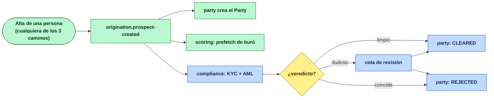

# KYC + AML al alta, para todos — propuesta para aprobar

> ## 📌 Documento **histórico** — superado el 2026-09-14
>
> Esto es la propuesta **tal como se presentó**, con sus diez decisiones todavía abiertas. Se
> aprobó, se decidió cada una, y varias **no salieron como se recomendaba aquí** — un PEP bloquea,
> y la ventana del re-cruce se asume en vez de detener desembolsos.
>
> **Para saber qué rige hoy, lee [`BRIEF_CONTROLES_KYC_AML.md`](BRIEF_CONTROLES_KYC_AML.md).**
> Aquí se conserva lo que se propuso y por qué, porque el día que alguien cuestione una de esas
> decisiones va a necesitar el contraargumento que se consideró antes de tomarla. Las tablas de
> «lo que hay que decidir» de este archivo **ya no son pendientes**: están resueltas en el brief.

> Diseño, no implementación.
> As-is verificado en [`ANALISIS_KYC_AML_POR_PERSONA.md`](ANALISIS_KYC_AML_POR_PERSONA.md).

## La regla, completa, en cuatro líneas

```
Toda persona que queda registrada pasa por KYC + AML — una vez, al alta.
El PRODUCTO decide si se intenta automático y con qué proveedor.
Lo que no resuelve el proveedor va a revisión humana. Siempre hay revisión humana.
Nada avanza sin veredicto.
```

No hay tres procesos. Hay **uno**, y el rol sólo cambia *cuándo* se dispara el alta:

| Caso | Cuándo se evalúa | A quién |
|---|---|---|
| **Self-use** | en el onboarding de la app | al titular |
| **Distribuidor** | en su onboarding | al **responsable del crédito** |
| **Beneficiaria de línea de distribuidor** | al dar de alta a la beneficiaria | a ella |

Y en los tres, idéntico: si el producto autoriza automático, se intenta con el proveedor
(Incode / Jumio); lo que no pase, a revisión.

---

## 1 · Por qué esto ya casi encaja: el disparador existe

`origination.prospect-created` **ya es** el evento «se registró una persona», y los tres caminos
pasan por él — el as-is lo confirmó: la app móvil, el alta de beneficiaria y el alta de distribuidor
llaman al mismo `POST /origination/prospects`.

Ese evento ya lo consumen cinco servicios. **`scoring` ya cuelga de ahí** con el prefetch de buró.
Lo que falta es que KYC/AML cuelgue del mismo sitio.



---

## 2 · Quién es dueño de qué

La decisión que ordena todo lo demás: **`party` es dueño del veredicto; `compliance` lo produce.**

| | Dueño | Por qué |
|---|---|---|
| La persona y su veredicto | **`party`** (D0) | Ya es dueño de `KycVerification`, de `PartyStatus` y de los roles. El veredicto es de la persona, no del producto ni del rol |
| Correr el KYC y el AML | **`compliance`** (D16) | Es quien habla con proveedores y quien tiene las listas. `party` **hoy no tiene un solo cliente saliente** —sólo persistencia y mensajería— y convertirlo en orquestador de terceros le cambia el carácter |
| Qué exige cada producto | **`credit-product`** | Ya resuelto en F3b: `Capabilities.kyc` |
| Las listas de gobierno | **`compliance`** (D16) | Ya construida la carga |

Es el mismo reparto que ya funciona en el carril del dinero: `disbursement` orquesta, `stp` conecta,
`banking` decide. Aquí `compliance` orquesta y conecta, `party` registra.

### El contrato entre los dos, por evento

```
origination.prospect-created  ──▶  compliance   (arranca la evaluación)
compliance.verification-completed  ──▶  party   (guarda el veredicto)
compliance.verification-completed  ──▶  audit   (bitácora regulatoria)
```

Por evento y no por llamada síncrona: el alta de una persona no puede depender de que un proveedor
externo conteste en ese instante. Si Incode está caído, el alta ocurre y el veredicto queda pendiente
—que es exactamente lo que debe pasar, porque pendiente **bloquea**.

---

## 3 · El veredicto: dos juicios, una compuerta

```
puede_avanzar  =  identidad = VERIFIED  ∧  listas = CLEARED
```

Se guardan **separados** porque no se resuelven igual:

| | KYC (identidad) | AML (listas) |
|---|---|---|
| Pregunta | ¿eres quien dices ser? | ¿estás en una lista? |
| Si falla, lo resuelve | **la persona**, con mejor evidencia | **cumplimiento** — la persona no puede hacer nada |
| Reintentable | sí | no: la lista no cambia porque insistas |
| Falso positivo típico | foto borrosa | **homonimia**, que es lo común |

Colapsarlos en una bandera «verificado» pierde la distinción que decide qué se le dice al cliente.

### Estados, y por qué tres y no dos en cada uno

| Campo nuevo en `party.parties` | Valores |
|---|---|
| `identity_status` | `PENDING` · `IN_REVIEW` · `VERIFIED` · `REJECTED` |
| `screening_status` | `PENDING` · `POTENTIAL_MATCH` · `CLEARED` · `CONFIRMED_MATCH` |

`IN_REVIEW` y `POTENTIAL_MATCH` **bloquean igual que un rechazo**, pero son resolubles por una
persona y dejan rastro de quién los resolvió. Sin ellos, el umbral del cruce por nombre tiene dos
salidas y las dos son malas: bajo bloquea a media cartera, alto vuelve decorativo el control.

> **No se toca `PartyStatus`.** `PROSPECT/ACTIVE/SUSPENDED/BLACKLISTED/CLOSED` es el ciclo de vida
> comercial de la parte; mezclarle el estado de verificación haría que «suspender a un cliente» y
> «no haber terminado de verificarlo» fueran el mismo hecho.

### Y todo veredicto lleva contra qué se emitió

`screening` guarda la **versión de lista** usada. Las listas cambian: alguien despejado hace seis
meses puede estar hoy. Un `CLEARED` sin versión no se puede auditar ni re-correr.

---

## 4 · Dónde se bloquea, por camino

| Camino | Qué se bloquea | Estado hoy |
|---|---|---|
| **Self-use** | `CreditApplicationService.start(...)` | 🔴 **no existe compuerta**: hoy sólo valida CURP/teléfono duplicados, aviso de privacidad y cooldown |
| **Distribuidor** | igual — su línea es una solicitud de crédito | 🔴 igual |
| **Beneficiaria** | `Placement.approve(...)` | 🟡 **ya bloquea por identidad**; falta la condición de listas y pasar a leer el veredicto de la persona |

La compuerta de la colocación ya está escrita y su comentario explica por qué está ahí: *«aprobar
dispara el depósito, y lo único que detiene un depósito es una identidad no comprobada — rebotar en
la disposición le daría a la distribuidora un fallo mudo en vez de un motivo»*. Con esta regla, lo
que detiene un depósito pasan a ser dos cosas y el argumento no cambia.

> **La decisión comercial sigue siendo del distribuidor.** La compuerta no decide por él: decide si
> *puede* decidir.
> `puede_colocar = distribuidor_acepta_el_riesgo ∧ identidad_verificada ∧ sin_coincidencia`

---

## 5 · Qué cambia en cada servicio

| Servicio | Cambio | Tamaño |
|---|---|---|
| **`origination`** | Campo `registration_purpose` (`SELF_USE` · `DISTRIBUTOR` · `DISTRIBUTOR_BENEFICIARY` · `GUARANTOR`) en `Prospect`, que viaja en el evento. **No condiciona el KYC** —se evalúa igual en los cuatro— sirve para trazar y para otorgar el `PartyRole` correcto, que hoy sólo hace un script | S |
| | Compuerta: no se inicia solicitud sin veredicto limpio | S |
| | Quitar `DISTRIBUTOR` de `ProspectType` (hoy revienta el listener de party, deuda 21) | S |
| **`party`** | `identity_status` + `screening_status` + versión de lista. Consume `verification-completed` | S |
| | Otorga el `PartyRole` según `registration_purpose` | S |
| **`compliance`** (D16) | Consume `prospect-created`, orquesta KYC + AML, publica veredicto | M |
| | **La consulta de listas**: cruce con tres estados y cola de adjudicación | M |
| | Recibe el **motor de umbrales y la cola de revisión** que hoy vive en `beneficiary` | M |
| | Adaptador de Incode/Jumio (hoy `UnavailableKycProviderAdapter`) — es la fase F5 | L |
| **`beneficiary`** | `Placement.identityDecision` pasa de verdad propia a **proyección** del veredicto de la persona | M |
| | La compuerta de `approve(...)` añade la condición de listas | S |
| **`channels`** | El control de lista negra **deja de fallar abierto** (deuda 20) | S |
| **`credit-product`** | Ninguno. F3b ya dejó `Capabilities.kyc` | — |
| **`scoring`** | **Ninguno.** Ya varía sólo por producto, y está bien | — |

### Lo que se mueve, y por qué no se tira

El motor de umbrales de `beneficiary` es bueno y está probado: degrada en todas las ramas, el motivo
siempre viaja, y ninguna rama rompe el flujo. **No se reescribe: se mueve.** Hoy sirve a un solo
camino porque está atado a la colocación; al lado de la persona sirve a los cuatro.

---

## 6 · El caso que hay que decidir: el distribuidor persona moral

Dijiste *«si es distributor, siempre evaluamos al responsable de crédito»*. Hoy **todos los
distribuidores se dan de alta como `INDIVIDUAL`** por el camino de la app móvil, así que el
responsable y el titular son la misma persona y no hay nada que decidir.

Pero `PartyType` admite `BUSINESS`, y `PartyRelationshipType.LEGAL_REPRESENTATIVE` ya existe. Si un
distribuidor puede ser persona moral, son **dos evaluaciones**:

```
persona moral  → KYB de la empresa (RFC, acta, listas)  +  KYC/AML del representante legal
```

Y entonces la compuerta exige las dos. **Necesito que confirmes si eso entra en el alcance ahora o
si por ahora todo distribuidor es persona física.**

---

## 7 · Orden de construcción

Cada paso deja el sistema mejor que antes y ninguno depende de tener proveedor.

| # | Qué | Por qué en ese orden |
|---|---|---|
| **1** | La **consulta** de listas en D16: cruce, tres estados, cola de adjudicación | Sin esto, `amlRequired` sigue siendo una bandera sin efecto (deuda 19) |
| **2** | `registration_purpose` en origination + rol automático en party | Es el dato que hoy no existe y que todo lo demás usa |
| **3** | D16 consume `prospect-created` y publica veredicto; `party` lo guarda | Aquí ya hay veredicto por persona, aunque todo caiga a manual |
| **4** | Las **compuertas**: origination (self-use y distribuidor) y `approve(...)` de la colocación | Es el momento en que la regla empieza a bloquear de verdad |
| **5** | Mover el motor de umbrales y la cola de `beneficiary` a D16 | Ya con veredicto central, la colocación pasa a proyectarlo |
| **6** | Adaptador de Incode/Jumio (F5) | Lo único que necesita contrato con un tercero |

Los pasos 1-5 **no requieren proveedor**: todo cae a revisión manual, que es el modo vigente y el que
el producto declara hoy en los nueve productos del catálogo.

### Y dos arreglos que no esperan a nada

| Deuda | Arreglo |
|---|---|
| **20** · el control de listas de `channels` falla abierto | Que la indisponibilidad **detenga** en vez de dejar pasar |
| **21** · `ProspectType.DISTRIBUTOR` revienta el listener de party, sin DLT | Quitarlo del enum y del `CHECK` |

---

## 8 · Lo que necesito que apruebes

| # | Decisión | Mi recomendación |
|---|---|---|
| 1 | **`compliance` (D16) orquesta, `party` registra** | Sí — `party` hoy no llama a nadie y convertirlo en orquestador de terceros le cambia el carácter |
| 2 | **Dos estados separados** (identidad y listas) en vez de una bandera | Sí — se resuelven por caminos distintos y el cliente recibe mensajes distintos |
| 3 | **El veredicto bloquea; pendiente = bloqueado** | Sí, es lo que dijiste. Implica que entre alta y veredicto la persona **no puede** solicitar |
| 4 | **El motor de umbrales se mueve de `beneficiary` a D16** | Sí — es bueno, está probado, y hoy sirve a un camino de cuatro |
| 5 | **¿Distribuidor persona moral entra ahora?** | **Abierto.** Hoy todos son persona física; si entra, son dos evaluaciones |
| 6 | **¿Se arregla ya el fallo-abierto de `channels`?** | Sí — es un control regulatorio invertido, y es media hora |

---

# Anexo · Qué es el screening, en concreto

> Añadido a petición: «me suena lo de los dos veredictos separados, sólo no entiendo qué tiene el
> screening».

## La diferencia en una línea

**El KYC mide. El screening busca.**

El KYC toma la evidencia que la persona entregó —su selfie, su INE, su prueba de vida— y la
**puntúa**. Es una medición, y una medición se compara contra un umbral.

El screening toma los datos de identidad de esa persona y **la busca en unas listas**. Es una
búsqueda, y una búsqueda devuelve candidatos, no un número.

De ahí sale todo lo demás.

## Lo que el KYC ya hace hoy, y que confirma lo que describiste

Los tres umbrales ya están configurados:

```yaml
thresholds:
  facialMatch:          0.90   # ¿la cara de la selfie es la de la INE?
  liveness:             0.90   # ¿había una persona viva, o una foto de una foto?
  documentAuthenticity: 0.85   # ¿la INE es auténtica o está alterada?
```

Y la degradación es exactamente la que describiste: proveedor caído, sin contrato, que lanza, que no
pudo validar un documento, o **cualquier umbral por debajo** → revisión humana. Además, una métrica
declarada que el proveedor **no reporta** cuenta como no alcanzada: si se pidió medir la prueba de
vida y no vino, no se sabe si pasó, y no saberlo es exactamente el caso que va a una persona.

> Eso ya está construido y probado en `beneficiary`. Lo que la propuesta hace con ello es moverlo al
> lado de la persona para que sirva a los cuatro caminos y no a uno.

## Lo que hace el screening, paso a paso

```
entrada:  nombre  +  fecha de nacimiento  +  CURP/RFC  +  país
              │
              ▼
   se busca en la versión ACTIVA de cada lista
              │
              ▼
   salen CANDIDATOS, cada uno con por qué coincidió
              │
              ▼
   veredicto:  sin candidatos            → CLEARED
               con candidatos            → POTENTIAL_MATCH  (lo mira una persona)
               una persona lo confirma   → CONFIRMED_MATCH
```

### Cómo se busca, de más fuerte a más débil

| Criterio | Qué significa | Fuerza |
|---|---|---|
| **CURP o RFC idénticos** | es un identificador: coincide la persona, no el nombre | 🟢 identificación |
| Nombre normalizado + fecha de nacimiento | dos coincidencias independientes a la vez | 🟢 muy fuerte |
| Nombre normalizado exacto (en cualquier orden) | los mismos tokens | 🟡 sospecha |
| Nombre parecido (difuso, por encima de umbral) | «GONZALES» vs «GONZÁLEZ», un apellido de menos | 🟠 candidato |

**La mayoría de las coincidencias serán del tercer y cuarto tipo**, porque las listas de gobierno
casi nunca traen CURP ni RFC. Y el nombre no identifica: «JUAN PÉREZ GARCÍA» coincide con decenas de
personas reales, ninguna de ellas sancionada.

### Qué guarda cada candidato — esto es «lo que tiene el screening»

| Campo | Para qué |
|---|---|
| a qué **entrada de lista** coincidió | el nombre tal como lo publicó el gobierno, su programa, su número de línea |
| **por qué** coincidió | `CURP_IDENTICO` · `NOMBRE_Y_FECHA` · `NOMBRE_EXACTO` · `NOMBRE_PARECIDO(0.87)` |
| qué **NO** coincidió | fecha de nacimiento distinta, país distinto, documento distinto |
| la **versión de lista** | contra qué se decidió, para poder explicarlo meses después |
| quién lo **despejó o confirmó**, cuándo y con qué nota | es el expediente ante una revisión |

El cuarto renglón es el que hace operable el control: **lo que descarta a un candidato no es el
parecido del nombre, son los discriminadores.** «Sí, se llama igual; no, nació en 1985 y el de la
lista en 1962, y el de la lista es sirio». Eso es lo que escribe el analista, y es lo que después
sustenta la decisión.

## Por qué la persona no puede hacer nada — y por eso es un veredicto aparte

| | KYC | Screening |
|---|---|---|
| Si sale mal, el cliente… | repite la selfie con mejor luz | **no puede hacer nada** |
| Quién lo resuelve | la persona, con mejor evidencia | **cumplimiento**, adjudicando |
| Reintentar sirve | sí | **no**: la lista no cambia porque insistas |
| El falso positivo típico | foto borrosa, INE gastada | **homonimia**, y es lo común, no la excepción |

Un mensaje de «no pudimos verificar tu identidad, vuelve a intentarlo» es correcto para el primero y
**absurdo** para el segundo: mandaría a alguien a repetir una selfie que no va a cambiar nada. Ésa es
la razón práctica de tener dos veredictos y no una bandera.

## 🔴 Y una distinción que hay que decidir: un PEP no es un sancionado

Dijiste *«no se encuentre en listas negras o persona políticamente expuesta»*, juntando las dos. En
cumplimiento son cosas distintas:

| | Qué significa | Qué obliga |
|---|---|---|
| **Sancionado** | prohibición de operar | **corta**. No hay decisión que tomar |
| **PEP** | persona con cargo público, o su familiar cercano | **diligencia reforzada**: más evidencia y aprobación de más alto nivel. **No prohíbe** |
| **Lista fiscal (69-B)** | hecho fiscal, no de identidad | pesa en la **decisión de crédito**, no en la de identidad |

Tratar a un PEP como sancionado significa **negarle servicio a un funcionario público por serlo**, y
eso no es cumplimiento: es un error, y además discriminatorio. Un diputado puede tener una tarjeta de
crédito; lo que cambia es que su expediente se revisa con más cuidado y lo autoriza alguien más
arriba.

> El código ya distingue los cuatro tipos (`WatchlistKind`: `SANCTIONS` · `PEP` · `TAX_BLACKLIST` ·
> `INTERNAL`). **Lo que falta es tu decisión de qué hace cada uno.**

## Y lo que un match confirmado obliga, más allá de rechazar

Una coincidencia confirmada contra listas **no termina en «rechazar al cliente»**: genera una
obligación de reporte. El repo ya tiene el agregado —`UIFReport` con sus tipos `INUSUAL`,
`RELEVANTE`, `INTERNO`, con `partyId` y `triggerEventType`— y **no tiene ningún escritor**: hoy sólo
se lee.

Un `CONFIRMED_MATCH` es precisamente el hecho que debería escribirlo. Sin eso, el control detiene la
operación y no deja constancia de por qué, que es la mitad que un revisor pide.

## Lo que hay que decidir de este anexo

| # | Decisión | Mi recomendación |
|---|---|---|
| 7 | **¿Un PEP bloquea o exige diligencia reforzada?** | **Reforzada, no bloqueo.** Bloquear es negar servicio por ser funcionario |
| 8 | **¿La lista fiscal (69-B) bloquea la identidad o pesa en el crédito?** | Pesa en el crédito: es un hecho fiscal, no de identidad |
| 9 | **¿Un `CONFIRMED_MATCH` escribe un `UIFReport`?** | Sí — el agregado ya existe y nadie lo escribe |

---

# Las nueve decisiones, juntas

> Consolida las tablas de §8 y del anexo. Es la lista canónica para aprobar.

## A · Ya las dijiste — sólo confirmarlas

| # | Decisión | Lo que entendí |
|---|---|---|
| **1** | **El KYC bloquea el flujo** | Nada avanza sin veredicto. Entre alta y veredicto la persona **no puede** solicitar |
| **2** | **Dos modos, y el fallback siempre es manual** | Automático (Incode/Jumio) → lo que no pase por umbral, o si el proveedor no responde, **a revisión**. Manual → todas a revisión |
| **3** | **Dos veredictos separados** (identidad y listas) | Dijiste que te sonaba. Van separados porque se resuelven por caminos distintos |

## B · Tienen recomendación — basta un sí o un no

| # | Decisión | Recomendación | Por qué |
|---|---|---|---|
| **4** | ¿**`compliance` (D16) orquesta y `party` registra**? | **Sí** | `party` hoy no tiene un solo cliente saliente; convertirlo en orquestador de terceros le cambia el carácter |
| **5** | ¿El **motor de umbrales y la cola de revisión** se mueven de `beneficiary` a D16? | **Sí** | Es bueno y está probado; hoy sirve a un camino de cuatro porque está atado a la colocación |
| **6** | ¿Se arregla ya el **fallo-abierto de `channels`**? | **Sí** | Un control regulatorio con la polaridad invertida. Media hora |
| **7** | ¿Un **`CONFIRMED_MATCH` escribe un `UIFReport`**? | **Sí** | El agregado ya existe y **no tiene escritor**. Sin él, el control detiene y no deja constancia |

## C · Genuinamente abiertas — necesito tu criterio

| # | Decisión | Las opciones | Qué cambia según elijas |
|---|---|---|---|
| **8** | **¿Qué hace un PEP?** | (a) bloquea igual que un sancionado · (b) **diligencia reforzada**: pasa, con más evidencia y aprobación de más alto nivel | Con (a) le niegas una tarjeta a un diputado por ser diputado. Con (b) hace falta un nivel de aprobación que hoy no existe |
| **9** | **¿El distribuidor puede ser persona moral?** | (a) por ahora todos son persona física · (b) sí, y entonces son **dos evaluaciones**: KYB de la empresa + KYC/AML del representante legal | Con (b) la compuerta exige las dos, y hace falta el vínculo `LEGAL_REPRESENTATIVE` — que ya existe en el modelo pero nadie puebla |

### Y una que descubrí escribiendo el anexo, que sumo a las abiertas

| # | Decisión | Las opciones |
|---|---|---|
| **10** | **¿La lista fiscal del SAT (69-B) bloquea la identidad, o pesa en el crédito?** | Mi lectura es que **pesa en el crédito**: es un hecho fiscal, no de identidad. Alguien en el 69-B no es un impostor ni un sancionado — es un contribuyente con operaciones presuntamente inexistentes, y eso es materia de **scoring**, no de compuerta de identidad |

> Son diez, no nueve: la del 69-B salió al escribir el anexo y no estaba en la cuenta original.
