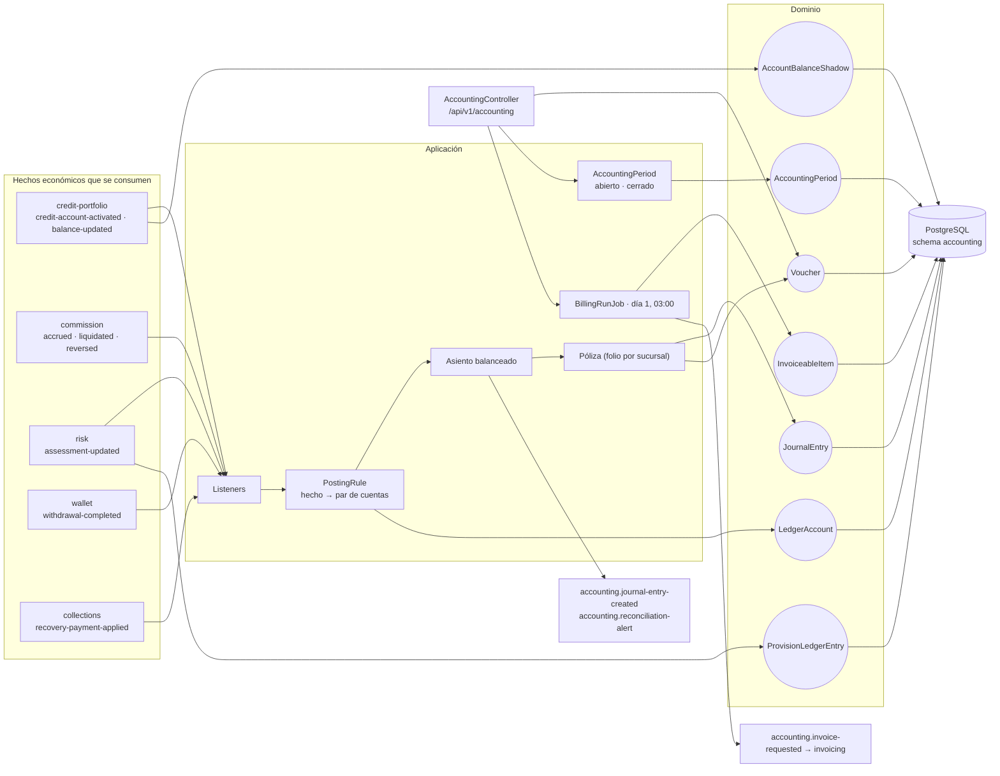
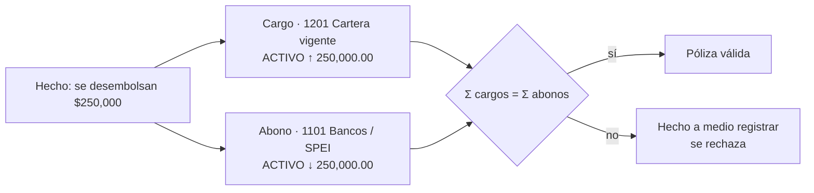

# accounting-service (T4)

Libro mayor por **partida doble** del core crediticio. No decide negocio: **proyecta** los hechos
económicos que emiten los demás dominios —saldos, comisiones, riesgo, retiros, pagos de cobranza— en
pólizas contables balanceadas, atribuidas a una **sucursal** y a un **préstamo**, y de ahí deriva la
balanza de comprobación, la estimación preventiva y los ítems facturables.

| | |
|---|---|
| **Puerto** | `8095` (bootRun) · `:8080` interno en Docker |
| **Schema** | `accounting` |
| **Arquitectura** | Hexagonal + Spring Modulith |
| **Régimen Kafka** | Reintentos 1, 2, 4, 8 y 16 s y después `<tópico>.DLT` (`DeadLetters`) |
| **Dominio** | [docs/dominios/T4_accounting_gl.md](../../docs/dominios/T4_accounting_gl.md) |

## Mapa del servicio



**La regla de oro del servicio:** accounting **no decide negocio**. Cada póliza es la proyección de
un hecho que otro dominio ya afirmó. Si un saldo está mal, se corrige en su dueño y la contabilidad
lo sigue; nunca al revés.

---

## 1 · El proceso contable, desde cero

Esta sección existe porque el resto del repo asume que quien lo lee sabe contabilidad, y no tiene por
qué. Sin entender qué es un cargo no se puede saber si una pantalla está mintiendo.

### 1.1 · Cargo y abono no significan «entra» y «sale»

Es el malentendido más caro. **Cargo** (débito) y **abono** (crédito) no son «más» y «menos»: son los
dos lados de una anotación, y lo que significan **depende de la naturaleza de la cuenta**.

| Naturaleza | Un **cargo** la… | Un **abono** la… | Ejemplos del catálogo |
|---|---|---|---|
| **Activo** — lo que la institución tiene o le deben | aumenta | disminuye | `1101` Bancos, `1201` Cartera vigente, `1203` Intereses por cobrar |
| **Pasivo** — lo que la institución debe | disminuye | aumenta | `2110` IVA por pagar, `2120` Comisiones por pagar |
| **Capital** — lo que es de los dueños | disminuye | aumenta | `3901` Saldo inicial por incorporación |
| **Ingreso** — lo que la institución gana | disminuye (reversa) | aumenta | `4101` Ingresos por intereses |
| **Gasto** — lo que la institución consume | aumenta | disminuye (reversa) | `5101` Gasto por estimación preventiva |
| **Contra-activo** — un activo de signo invertido | disminuye | aumenta | `1290` Estimación preventiva |
| **Orden** — compromisos que no son del balance | — | — | `7101` / `7201` Líneas autorizadas |

Por eso «cargo a Bancos» es que entró dinero, pero «cargo a IVA por pagar» es que se **pagó** el IVA
—la deuda bajó—. La misma palabra, efectos opuestos.

> **`1290` es contra-activo y esto importa.** La estimación preventiva es un activo de naturaleza
> **acreedora**: vive restando de la cartera. Con la fórmula `saldo = cargos − abonos` sale en
> negativo, que es aritméticamente correcto y contablemente ilegible. Por eso el tipo existe en el
> enum y la consola invierte el signo al presentar, sin tocar el dato.

### 1.2 · La partida doble

**Todo hecho económico se anota dos veces**, en dos cuentas distintas, por el mismo importe: una
recibe el cargo y otra el abono. No es redundancia contable, es una invariante: si la suma de cargos
no iguala la de abonos, hay un hecho a medio registrar.

Cuando el banco desembolsa $250,000:

```
Cargo   1201 Cartera de crédito vigente   250,000.00     ← ahora nos deben eso
   Abono   1101 Bancos / SPEI                250,000.00  ← salió de nuestra cuenta
```



El patrimonio no cambió: se convirtió efectivo en un derecho de cobro. Eso es lo que la partida
doble captura y una lista de movimientos sueltos no. (Simplificado: en la plataforma el dinero SPEI pasa
por una cuenta puente entre la fecha de cartera y la del banco; §3, paso 2.)

### 1.3 · Asiento y póliza no son lo mismo

Aquí se separan dos cosas que en el lenguaje común se confunden:

- Un **asiento** es una anotación: un cargo con su abono. En este servicio es una fila de
  `journal_entries`.
- Una **póliza** es el **documento** que agrupa todos los asientos de un mismo hecho económico. Lleva
  folio consecutivo, fecha, concepto y estatus. Es la unidad que se audita y la que se cita.

Un pago que liquida capital **e** intereses son dos asientos —caja contra capital, caja contra
intereses— bajo **una** póliza. Sin encabezado no habría forma de decir «esto fue un solo pago».

**Tres tipos**, que es la práctica mexicana:

| Tipo | Cuándo | Ejemplo |
|---|---|---|
| **Ingreso** | Entra dinero a caja | Un pago del cliente, una recuperación |
| **Egreso** | Sale dinero de caja | El desembolso del crédito, un retiro de wallet |
| **Diario** | Todo lo demás — la mayoría | El devengo, la estimación, las reversas |

El devengo es de **diario** y no de ingreso porque no entra un peso a la caja: se reconoce un derecho
de cobro que todavía nadie ha pagado.

### 1.4 · El folio es por sucursal, y por eso se ve raro

El consecutivo es por **(tipo, sucursal, período)**. La sucursal Culiacán tiene sus folios 1..N sin
huecos causados por el movimiento de otra plaza — que es lo que un auditor revisa primero.

La consecuencia: en una lista que mezcla sucursales aparecen dos `D-0072` seguidos que **no son
duplicados**, son el 72 de dos series distintas. Por eso la consola muestra la serie completa,
`D-LEO-0072`, que es además cómo se cita un folio.

### 1.5 · El período sale del hecho, no del reloj

El período (`YYYYMM`) se deriva de **cuándo ocurrió el hecho**, en zona `America/Mexico_City`, no de
cuándo se procesó. Un devengo del 31 procesado a las 00:03 del día 1 pertenece al 31.

Si ese período ya está **cerrado**, el asiento no se rechaza: va al primer período abierto marcado
como **extemporáneo**, conservando el mes al que pertenecía. Rechazarlo exigiría una bandeja de
asientos caídos y alguien que la trabaje; sin eso el hecho se pierde en un log, y perder el hecho es
peor que asentarlo tarde con la etiqueta puesta.

---

## 2 · Catálogo de cuentas

| Código | Nombre | Naturaleza | Para qué |
|---|---|---|---|
| `1101` | Bancos / SPEI | Activo | El efectivo. El dinero SPEI lo mueve **sólo el libro de caja de tesorería**, en la fecha de operación del banco; el fondeo, las comisiones pagadas y los pagos directos, por su propio hecho |
| `1103` | Remesas en camino: cobranza SPEI por acreditar | Activo | El cobro que cartera ya aplicó y el banco todavía no acredita: un pago de las 19:00 del 30 es de cartera el 30 y del banco el siguiente día hábil. Partida = el abono recibido |
| `1201` | Cartera de crédito vigente | Activo | El capital colocado que el acreditado debe |
| `1203` | Intereses y comisiones por cobrar | Activo | Lo devengado y todavía no cobrado |
| `1205` | Costos de originación por amortizar | Activo | La comisión al promotor por originar el crédito: costo de la transacción que se amortiza contra el interés en la vida del crédito (IFRS 9 B5.4.8) |
| `1210` | Cartera de crédito castigada | **Orden** | Memoria de lo dado de baja del balance |
| `1290` | Estimación preventiva | **Contra-activo** | La pérdida esperada; resta de la cartera |
| `2101` | Fondos de clientes por disponer | Pasivo | Dinero del cliente en la plataforma |
| `2102` | Saldos a favor de clientes | Pasivo | Lo que un abono dejó después de cubrir lo exigible, y la parte que un crédito rechazó: es del pagador y se aplica a su siguiente cuota |
| `2103` | Acreedores por liquidación de operaciones: SPEI por liquidar | Pasivo | La disposición que cartera ya registró y cuya orden SPEI el banco todavía no reporta. Partida = el crédito dispuesto |
| `2110` | IVA trasladado por pagar | Pasivo | El IVA cobrado que se le debe al SAT |
| `1140` | IVA acreditable pagado | Activo | El IVA de las comisiones ya pagadas: acreditable en flujo de efectivo |
| `1141` | IVA pendiente de acreditar | Activo | El IVA que la beneficiaria factura sobre la comisión, mientras no se le paga (y el que se le retuvo, hasta enterarlo) |
| `2111` | ISR retenido por enterar | Pasivo | El ISR retenido a una persona física por su comisión: se le debe al SAT |
| `2112` | IVA retenido por enterar | Pasivo | Las dos terceras partes del IVA de la comisión de una persona física: se le deben al SAT |
| `2120` | Comisiones por pagar | Pasivo | El bruto (comisión + IVA) que se le debe a cada distribuidora y promotor por producto. Partida = beneficiaria·producto (`COM:<id>:<producto>`) o el lote (`LOTE:<id>`) |
| `2201` | Préstamos bancarios y de otros organismos | Pasivo | Las líneas de fondeo dispuestas: pasivo a costo amortizado (IFRS 9) |
| `2202` | Intereses devengados por pagar de préstamos | Pasivo | Los intereses del fondeo devengados día por día y aún no pagados |
| `2209` | Costos de transacción por amortizar de préstamos | Pasivo (saldo deudor) | La comisión de apertura de una línea de fondeo: resta del pasivo y se amortiza a `5201` |
| `2150` | Comisiones de apertura por devengar | Pasivo | La comisión de apertura cobrada que todavía no es ingreso: se reconoce mes a mes en la vida del crédito |
| `3101` | Capital social pagado | Capital | Las aportaciones de los accionistas que acordó la asamblea (IAS 32) |
| `3201` | Resultado de ejercicios anteriores | Capital | El resultado de los años cerrados: el cierre del ejercicio (periodo 13) lo trae aquí |
| `3901` | Saldo inicial por incorporación | Capital | Sólo para una migración explícita de cartera; en operación normal queda en cero (la conciliación `10e` lo exige) |
| `4101` | Ingresos por intereses | Ingreso | El interés ordinario devengado |
| `4102` | Ingresos por intereses moratorios | Ingreso | El interés por mora |
| `4103` | Ingresos por comisiones | Ingreso | Administración, prepago, seguro: servicios del período |
| `4104` | Recuperación de cartera castigada | Ingreso | Lo que se recupera de lo ya quebrantado |
| `4106` | Ingresos por intereses: comisiones y costos de originación (tasa efectiva) | Ingreso | La parte del mes de la comisión de apertura (de `2150`) menos la del costo de originación (de `1205`). Es **interés**, no comisión: forma parte de la tasa efectiva |
| `5101` | Gasto por estimación preventiva | Gasto | El costo de constituir la reserva |
| `5102` | Gasto por quebranto / quita | Gasto | La pérdida que la reserva no alcanzó a cubrir |
| `5103` | Gasto por condonación | Gasto | Lo que se le perdona al cliente |
| `5104` | Gasto por comisiones | Gasto | La comisión devengada al canal |
| `5201` | Gastos por intereses de préstamos bancarios y de otros organismos | Gasto | El interés del fondeo y la amortización de su comisión de apertura (tasa efectiva) |
| `7101` / `7201` | Líneas autorizadas / por disponer | **Orden** | El compromiso de una línea; cuadran entre sí |
| `7301` | Control de cartera castigada | **Orden** | Contrapartida de `1210`; cuadran entre sí |
| `7401` / `7402` | Interés de etapa 3 no reconocido / su contrapartida | **Orden** | El interés contractual de un crédito deteriorado que no es ingreso (base neta) |

> **Las cuentas de orden no son del balance.** Registran que la institución se comprometió a prestar,
> no que haya prestado. Sumarlas al activo infla el balance con dinero que nunca salió, y por eso la
> balanza las presenta en una sección aparte que cuadra sola.

---

## 3 · El ciclo de vida de un préstamo, póliza por póliza

Un crédito de **$250,000** a 36 meses, tasa 32% anual, comisión de apertura 1%, colocado por la
Sucursal León (`S_LEO`). Cada bloque es **una póliza**.

### Paso 1 — Se autoriza la línea · `ACCOUNT_ACTIVATED`

```
Póliza D-LEO-0001 · Diario · «Alta de línea de crédito autorizada»
   Cargo   7101 Líneas de crédito autorizadas      250,000.00
      Abono   7201 Líneas autorizadas por disponer    250,000.00
```

**Por qué en cuentas de orden.** Autorizar no coloca capital. Cargar `1201` contra nada infla el
activo con dinero que no salió. Pero un crédito autorizado y no dispuesto **sí** es un compromiso
real de la institución, y antes no existía en ninguna parte de la contabilidad.

### Paso 2 — Se desembolsa · `DISPOSITION_AT_ORIGINATION`, y el banco lo reporta · `TREASURY_STP_ORDER`

Cada peso tiene **dos fechas**: la de cartera (cuándo se dispuso) y la del banco (la fecha de operación
SPEI: desde las 18:00, o en día inhábil, el siguiente día hábil). Un crédito dispuesto a las 18:30 del 30
de noviembre es de cartera el 30 y sale del banco el 1 de diciembre:

```
Póliza D-LEO-0001 · Diario · «Disposición del crédito al activar»         (30 nov, fecha de cartera)
   Cargo   1201 Cartera de crédito vigente         250,000.00
      Abono   2103 SPEI por liquidar                  250,000.00

Póliza E-0001 · Egreso · «Dispersión SPEI liquidada por el banco»          (1 dic, fecha de operación)
   Cargo   2103 SPEI por liquidar                  250,000.00
      Abono   1101 Bancos / SPEI                      250,000.00
```

Aquí nace la deuda. El efectivo se convirtió en derecho de cobro; el patrimonio no cambió. Al cierre de
noviembre `2103` muestra los $250,000 **como partida**: la orden de ese crédito, por liquidar. La segunda
póliza la asienta el libro de caja de tesorería (`banking.cash-movement-recorded`) con la clave de la
orden; `disbursement.accepted` dice qué crédito pagó esa orden (`payout_links`), así que la consulta de
pólizas del crédito muestra las dos.

### Paso 3 — Comisión de apertura y su IVA · `CHARGE_OPENING_FEE`, `CHARGE_IVA`

```
Póliza D-LEO-0002 · Diario · «Comisión de apertura 1%»
   Cargo   1203 Intereses y comisiones por cobrar    2,500.00
      Abono   2150 Comisiones de apertura por devengar  2,500.00

Póliza D-LEO-0003 · Diario · «IVA trasladado»
   Cargo   1203 Intereses y comisiones por cobrar      400.00
      Abono   2110 IVA trasladado por pagar              400.00
```

El IVA **no es ingreso**: es dinero del SAT que la institución cobra y retiene un rato. Por eso va a
pasivo y no a resultados.

La comisión tampoco es ingreso el día que se cobra: forma parte de la tasa efectiva (IFRS 9 B5.4.2) y
se reconoce en la vida del crédito. Cada cierre de mes pasa la parte del mes de `2150` a `4106`:

```
Póliza D-LEO-0031 · Diario · «Devengo mensual de la comisión de apertura (1/36)»
   Cargo   2150 Comisiones de apertura por devengar    69.44
      Abono   4106 Ingresos por intereses (tasa efectiva) 69.44
```

Si el crédito se liquida o se castiga antes, lo que quedaba se reconoce de una vez. La comisión que
se le paga al promotor por originar el crédito es el mismo concepto con el signo contrario: un costo
de la transacción (B5.4.8) que va a `1205` y se amortiza **contra** `4106`. La comisión del
distribuidor sobre el interés cobrado, en cambio, paga un servicio del período y va a gasto (`5104`).

### Paso 4 — Devengo, día tras día · `CHARGE_ORDINARY_INTEREST`

**Éste es el corazón del asunto.** El interés no se gana el día que se cobra: se gana **con el paso
del tiempo**, un día a la vez. A eso se le llama devengar.

Un día de interés sobre $250,000 al 32% anual son ~$222.22:

```
Póliza D-LEO-0004 · Diario · «Devengamiento de interés ordinario»
   Cargo   1203 Intereses y comisiones por cobrar      222.22    ← nos lo deben
      Abono   4101 Ingresos por intereses                222.22  ← ya lo ganamos
```

Al día siguiente, otra póliza igual. Y otra. **El movimiento de la póliza es siempre el mismo; lo que
cambia es que `1203` crece y el ingreso se acumula.** Treinta días son treinta pólizas y ~$6,666 de
ingreso reconocido, sin que haya entrado un solo peso a la caja.

Ahí está la diferencia entre lo **devengado** y lo **cobrado**, y es la razón de que una institución
pueda reportar utilidad y no tener efectivo.

Si el crédito cae en mora, se suma el moratorio con la misma forma, contra `4102`.

### Paso 5 — El cliente paga · `PAYMENT_APPLIED`, y el banco lo acredita · `TREASURY_SPEI_CREDIT`

Paga $10,000 por SPEI a su CLABE de cobro a las 19:00 del 30 de noviembre: cartera lo aplica en ese momento
(el 30; a las 00:05 del 1 ya sería del 1) y STP le da fecha de operación 1 de diciembre. $6,666 cubren el
interés devengado y $3,334 abonan a capital:

```
Póliza D-LEO-0010 · Diario · «Pago recibido»                               (30 nov, fecha de cartera)
   Cargo   1103 Cobranza SPEI por acreditar        10,000.00
      Abono   1203 Intereses y comisiones por cobrar    6,666.00
      Abono   1201 Cartera de crédito vigente           3,334.00

Póliza I-0001 · Ingreso · «Abono SPEI acreditado por el banco»             (1 dic, fecha de operación)
   Cargo   1101 Bancos / SPEI                       10,000.00
      Abono   1103 Cobranza SPEI por acreditar        10,000.00
```

La cartera y su mora se miden con la fecha de cartera; Bancos con la del banco, como su estado de cuenta.
El pago del 30 no «desaparece» entre las dos: al cierre de noviembre está en `1103`, como partida con su
abono, su clave de rastreo y el día en que el banco lo acredita. De dónde vino el dinero lo dice payments
(`fundingSource`): un abono SPEI pasa por `1103`, el saldo a favor sale de `2102` y un pago directo llega a
`1101` al momento.

**El saldo a favor.** Si el abono trae más de lo exigible, lo que sobra es del pagador:

```
Póliza D-0002 · Diario · «Abono sin deuda que cubrir: queda a favor del cliente»  (fecha de cartera)
   Cargo   1103 Cobranza SPEI por acreditar         2,000.00
      Abono   2102 Saldos a favor de clientes          2,000.00
```

Y cuando vence su siguiente cuota, payments aplica el saldo y cartera lo asienta como un pago más,
`2102 → 1201 / 1203`. Si un crédito rechaza su parte de un abono, esa parte también queda a favor.

**Tres renglones, una póliza.** El desglose no es cosmético: si todo se abonara a capital —que es lo
que hacía la regla original— `1203` crecería indefinidamente aunque los clientes pagaran sus
intereses, y con unos meses de operación la balanza dejaría de ser presentable.

### Paso 6 — Se estima la pérdida · `PROVISION_EPR`

```
Póliza D-LEO-0005 · Diario · «Estimación preventiva — deterioro»
   Cargo   5101 Gasto por estimación preventiva      18,500.00
      Abono   1290 Estimación preventiva                18,500.00
```

Se reconoce como **gasto** que probablemente no se cobre todo. La cartera sigue valiendo $250,000 en
`1201`; lo que baja es su valor neto, porque `1290` resta.

Se asienta **por delta**: riesgo publica el monto absoluto cada noche y aquí sólo se anota el cambio.
Si el crédito mejora, el asiento va al revés y libera reserva.

### Paso 7 — Se castiga · `WRITE_OFF`

Si el crédito se declara irrecuperable con $47,420 de saldo y $38,000 de reserva constituida:

```
Póliza D-LEO-0006 · Diario · «Quebranto de cartera»
   Cargo   1290 Estimación preventiva               38,000.00   ← se consume la reserva
   Cargo   5102 Gasto por quebranto                  9,420.00   ← lo que no alcanzó
      Abono   1201 Cartera de crédito vigente          47,420.00
```

**Primero se consume la reserva, y sólo el excedente golpea resultados.** Si todo fuera a gasto, se
reconocería dos veces la misma pérdida: una al provisionar y otra al castigar.

### Paso 8 — Se recupera algo · `RECOVERY_PAYMENT`

```
Póliza D-LEO-0012 · Diario · «Recuperación de cartera castigada»
   Cargo   1103 Cobranza SPEI por acreditar          3,500.00
      Abono   4104 Recuperación de cartera castigada    3,500.00
```

Ingreso extraordinario, no reversa: la pérdida ya se reconoció y esto es dinero nuevo. La cuenta del
cargo sale del origen del dinero, como en un pago: cobranza recibe de payments el `fundingSource` y el
abono que la pagó y los pasa a contabilidad.

### El fondeo · `banking.funding-movement-recorded`

El dinero que se presta viene de algún lado, y los libros lo dicen. Tesorería (banking) registra las aportaciones de
capital y las líneas de fondeo; aquí se asientan:

| Movimiento | Cargo | Abono |
|---|---|---|
| Aportación de capital | `1101` Bancos | `3101` Capital social pagado |
| Disposición de una línea | `1101` | `2201` Préstamos bancarios y de otros organismos |
| Comisión de apertura de la línea | `2209` Costos de transacción por amortizar | `1101` (se amortiza cada mes a `5201`) |
| Intereses devengados (cada día, días reales / 360) | `5201` Gasto por intereses | `2202` Intereses por pagar |
| Pago de intereses | `2202` | `1101` |
| Pago de capital | `2201` | `1101` |

Sin esto, `1101` corría en negativo por todo lo desembolsado (−5.8 M en el primer mes de la demo): salía dinero que
los libros nunca vieron entrar. Las pólizas del fondeo no nombran crédito ni sucursal: son de la institución.

### Otros hechos

| Hecho | Cargo | Abono |
|---|---|---|
| `CHARGE_WAIVED` — condonación | `5103` Gasto por condonación | `1203` |
| `CHARGE_REVERSED` — reversa de cargo | `4103` Ingresos por comisiones | `1203` |
| `PAYMENT_RETURNED` — pago devuelto | `1201` | `1101` |
| `WALLET_WITHDRAWAL` — retiro | `2101` Fondos de clientes | `1101` |
| `COMMISSION_ACCRUED` — comisión al canal | `5104` Gasto por comisiones · `1141` su IVA | `2120` (bruto) |
| `COMMISSION_REVERSED` — un pago devuelto se la lleva | `2120` | `5104` · `1141` |
| `COMMISSION_LOT_PAYOUT` — SPEI del lote solicitado | `2120` (bruto) · `1140` IVA pagado | `2103` neto · `2111` ISR retenido · `2112` IVA retenido · `1141` |
| `COMMISSION_LOT_PAYOUT_FAILED` — su SPEI no se pagó | `2103` · `2111` · `2112` · `1141` | `2120` · `1140` |
| `COMMISSION_ACCRUED` neteada (`settlement = NETTED`) — la distribuidora la descuenta de su entrega | `5104` | `2120` (sin IVA, sin hecho de lote) |
| `COMMISSION_NETTED` (de cartera) — la comisión paga el estado: interés primero, capital después | `2120` | `1203` · `1201` |
| `COMMISSION_NETTED_REVERSED` — su pago se devolvió | `1203` · `1201` | `2120` |
| `DISPOSITION_FAILED` / `DISPOSITION_RETURNED` — el desembolso no se hizo o lo devolvió el banco receptor (D63) | `2103` | `1201` |
| `ACCOUNT_CANCELLED` — crédito cancelado sin disponer (D63) | `7201` Líneas por disponer | `7101` Líneas autorizadas |

> **Un crédito cancelado porque su desembolso no se hizo** (D63) se deshace sin dejar rastro en resultados:
> la reversa de la disposición salda 2103 contra 1201, cargos reversa la comisión, su IVA y lo devengado
> (`CHARGE_REVERSED`), y `CancellationPostingService`, al oír `credit-portfolio.credit-account-cancelled`,
> reversa una sola vez la línea de las cuentas de orden (`ACCOUNT_CANCELLED:<crédito>`) y cancela sus
> partidas facturables pendientes: no se timbra un CFDI de una comisión que nunca se cobró (una ya
> facturada queda advertida en el log). La reversa de una disposición no abre la vida contable del
> crédito: espera su alta, como cualquier cargo (changeset 025).

> **Ningún crédito se incorpora.** Toda cuenta nace en la plataforma y contabilidad la asienta desde su
> activación. El alta (`credit-account-activated`) y los cargos (`balance-updated`) viajan por dos tópicos
> que se consumen en paralelo: si un cargo llega antes que el alta, **espera** —el listener lo reintenta
> (1, 2, 4, 8 y 16 s) y, si el alta nunca llega, va a `credit-portfolio.balance-updated.DLT`, donde el
> registro de fallas lo guarda para reprocesarlo—. Antes se tomaba por un crédito «a media vida» y se
> asentaba contra `3901`: la comisión de apertura acababa como «moratorios incorporados» (E2E 3-nov,
> $245 en dos cuentas). `3901` queda en el catálogo para una migración explícita, nunca para inferirla.

---

## 4 · Dónde entra IFRS 9

La NIIF 9 gobierna tres cosas de este libro: cómo se **clasifica** el activo, cómo se **reconoce el
ingreso** y cómo se **estima la pérdida**.

### 4.1 · Costo amortizado

Un crédito de este negocio se mantiene para cobrar principal e intereses, así que se mide a **costo
amortizado**. Su valor en libros es:

```
Cartera bruta (1201 + 1203)  −  Estimación preventiva (1290)  =  valor neto en libros
```

### 4.2 · Las tres etapas y la pérdida esperada

IFRS 9 abandonó el modelo de pérdida incurrida —provisionar cuando ya pasó algo— por el de **pérdida
crediticia esperada** (ECL): se provisiona desde el día uno, antes de que nadie deje de pagar.

| Etapa | Cuándo | Reserva que se constituye |
|---|---|---|
| **Stage 1** | Riesgo sin aumento significativo (≤30 días) | ECL a **12 meses** |
| **Stage 2** | Aumento significativo del riesgo — SICR (31-90 días) | ECL de **toda la vida** |
| **Stage 3** | Deterioro crediticio (90+ días) | ECL de toda la vida, con interés sobre el **neto** |

`risk-service` calcula la etapa y el monto; este servicio **sólo lo asienta**. El paso de Stage 1 a
Stage 2 se ve aquí como un cargo grande a `5101`: la reserva salta de cubrir doce meses a cubrir la
vida entera del crédito.

### 4.3 · Baja del activo y recuperación

Se castiga cuando **no hay expectativa razonable de recuperación**. El asiento del paso 7 es
exactamente eso: se consume la reserva ya constituida y sólo el faltante va a resultados. Una
recuperación posterior es ingreso del período en que llega — no se reversa el castigo.

### 4.4 · Lo que ya cumple y lo que todavía no

Esto se dice aquí en vez de dejarlo implícito, porque un README que declare cumplimiento sin tenerlo
es peor que uno que no lo mencione.

| Requisito | Qué hace este servicio |
|---|---|
| **Tasa de interés efectiva** (B5.4.1-B5.4.8): comisiones y costos de originación en la vida del crédito | ✓ La comisión de apertura va a `2150` y cada cierre pasa su parte del mes a **interés** (`4106`); la comisión al promotor por originar va a `1205` y se amortiza contra el mismo `4106`. El reparto es lineal por mes: para estos plazos difiere en centavos del reparto a tasa efectiva exacta |
| **Interés de Stage 3 sobre el costo amortizado** (§5.4.1(b)) | ✓ El cargo completo va al por cobrar; es ingreso sólo la parte del neto, y el resto va a la estimación (`1290`) con memoria en `7401`/`7402` |
| **Pérdida esperada medida a la fecha de reporte** (§5.5) | ✓ Riesgo la mide cada noche al cierre del día y aquí se asienta el delta; el cierre de mes exige que esté medida al último día |
| **Baja del activo** (§5.4.4) | ✓ El castigo consume la reserva y deja memoria en cuentas de orden |
| **Descuento a valor presente** de la ECL | Asienta el monto que publica riesgo, sin descontar: depende de que riesgo ya lo haga |
| **Pérdida por modificación** (§5.4.3) en reestructuras y programas de apoyo | Pendiente: se reconoce el nuevo plan sin recalcular el valor presente a la tasa original |
| **Fondeo** (IAS 32, IFRS 9 4.2.1) | ✓ El capital aportado es patrimonio (`3101`); las líneas de fondeo, pasivo a costo amortizado (`2201`) con su interés devengado cada día (`5201`/`2202`) y su comisión de apertura como costo de la transacción (`2209`) |
| **Bancos** `1101` contra tesorería | ✓ Tesorería lleva su libro de caja con sus propios hechos (órdenes STP liquidadas, fondeo, pagos de clientes, devoluciones y rechazos, comisiones pagadas); el cierre exige que `1101` y el libro digan lo mismo, por tipo y en el saldo. Contra el **estado de cuenta de STP** cruza tesorería (`banking`, tres pasadas, ahora también por sentido) |
| **Cierre del ejercicio** | ✓ Al conciliar diciembre, la póliza de cierre lleva ingresos y gastos a cero contra `3201` en el periodo 13 (`AAAA13`), como la balanza de cierre del ejercicio del SAT (Anexo 24) |

### 4.5 · El cierre de mes: conciliar antes de publicar

Todo cargo y todo abono se asienta **al momento**, cada uno en el período de su hecho. Al terminar el
mes, el cierre (`POST /periods/{p}/close`) hace lo que le toca al mes como un todo y sólo publica el
mes si concilia:

1. **Asienta lo del mes**: atribuye a su producto lo que se asentó antes de conocerlo (el lado banco de una orden o
   de un abono cuya partida llegó después: §4.6), y la parte del mes de las comisiones de apertura y de los costos de
   originación (tasa efectiva), fechada en su último instante.
2. **Comprueba que los auxiliares estén completos**: cartera cerró el último día del mes con todas
   sus cuentas devengadas (`credit-portfolio.day-closed` / `account-day-closed`), y riesgo midió la
   pérdida esperada de cada crédito con saldo **a esa fecha** (IFRS 9 §5.5).
3. **Concilia el mayor con los auxiliares, crédito por crédito**: capital (`1201` contra el saldo de
   cartera), intereses, comisiones e IVA por cobrar (`1203`), estimación (`1290` contra las reservas
   medidas), comisiones por devengar (`2150`) y costos por amortizar (`1205`) contra sus calendarios.
   Y sus propias invariantes: pólizas cuadradas, cuentas de orden en pares, nada contra capital
   (`3901`), todo en centavos.
   El fondeo: intereses de cada línea devengados al último día, capital (`3101`), préstamos (`2201`) e intereses por
   pagar (`2202`) iguales a los de tesorería, la comisión de las líneas (`2209`) contra su calendario, y **Bancos
   (`1101`) sin saldo negativo**: un saldo negativo es dinero que salió sin que los libros lo vieran entrar.
   **Bancos (`1101`) contra el libro de caja de tesorería** (`BANCOS_1101`): tesorería (banking) guarda cada
   movimiento de la cuenta con sus propios hechos y lo anuncia (`banking.cash-movement-recorded`); contabilidad lo
   guarda en `treasury_cash_book`. El mes cierra sólo si, por día de negocio, ambos dicen lo mismo por tipo
   (disposiciones, pagos, devoluciones, fondeo, comisiones) y en el saldo. Un pago que cartera rechazó entró y se
   devolvió: el par se deja fuera porque nunca llegó a los libros. Y la balanza (`BALANZA_CUADRA`: saldos deudores =
   acreedores, cargos = abonos) y la ecuación contable (`ECUACION_CONTABLE`: activo = pasivo + capital + resultado).
   **Las cuentas puente, partida por partida.** Cada póliza que mueve `1103` o `2103` nombra su partida
   (`vouchers.clearing_ref`): el abono recibido, o la orden SPEI. Al cierre, el saldo tiene que ser la lista de
   partidas abiertas, cada una con sus dos fechas:
   - `TRANSITO_COBRANZA_1103`: los abonos que cartera aplicó y el banco acredita después del último día. Bloquea
     una partida que el banco ya acreditó dentro del mes por otro importe, un abono aplicado que el banco nunca
     reportó, o un movimiento sin abono.
   - `TRANSITO_DISPERSION_2103`: las disposiciones cuya orden el banco liquida después del último día (o sigue en
     vuelo). Bloquea una orden sin crédito (`disbursement.accepted` nunca la ligó) y un crédito pagado de más.
   - `SALDOS_A_FAVOR_2102`: `2102` contra los movimientos de saldo a favor de payments
     (`payments.customer-balance-moved`); ningún cliente en negativo.
   - `COMISIONES_2120`: `2120` por beneficiaria y producto contra lo que commission reportó (devengos, reversas,
     lotes cuyo SPEI se pidió o falló: `accounting.commission_facts`). Bloquea un movimiento de `2120` sin
     beneficiaria y una beneficiaria·producto que no cuadra; una beneficiaria que debe comisiones ya pagadas (una
     recuperación mayor que lo devengado después) se informa sin bloquear.
   Los lotes de comisiones también son partidas de `2103` (`LOTE:<id>`): el SPEI del lote abona el neto y el reporte
   del banco de su orden (ligada por `disbursement.accepted`, `payout_links.item_ref`) lo liquida.
   **Por producto** (informativas, §4.6): `CAPITAL_1201_POR_PRODUCTO`, `POR_COBRAR_1203_POR_PRODUCTO` y
   `RESERVA_1290_POR_PRODUCTO` comparan el mayor, por el producto estampado en sus asientos, contra cartera y riesgo
   por el producto del crédito.
4. **Publica**: si todo lo que bloquea concilia, cierra el mes y guarda la balanza que publicó, completa y **por
   producto y sucursal** (`accounting.period_closes.trial_balance` y `trial_balance_by_product`). Si algo no concilia, responde **409** con el reporte, el mes sigue
   abierto y el reporte dice qué no cuadra, por cuánto y en qué créditos.
5. **Diciembre cierra el ejercicio**: conciliado diciembre, la póliza de cierre (`YEAR_END_CLOSE`, una por unidad y
   producto, fechada el 31 a las 23:59:59) lleva cada cuenta de ingresos y gastos del año a cero contra **`3201` Resultado de
   ejercicios anteriores**, en el **periodo 13** (`AAAA13`). Es la «balanza de cierre del ejercicio» que el SAT recibe
   como mes 13 (Anexo 24): la balanza de diciembre conserva los resultados del año; la de enero arranca ingresos y
   gastos en cero y el capital muestra el resultado del año. Ningún hecho pertenece al periodo 13 y ninguna
   extemporánea cae en él (no es un `accounting_periods`). La consola lo muestra en la balanza de diciembre
   («Cierre del ejercicio (periodo 13)»).

Las extemporáneas recibidas y el **requisito de SOFOM** (LGOAAC 87-B: cartera ≥ 70 % de los activos e ingresos por
crédito ≥ 70 % de los ingresos del año) se **informan** pero no bloquean. La
conciliación se puede ver antes de cerrar (`GET /periods/{p}/reconciliation`, una corrida en seco
que no asienta nada) y, de un mes cerrado, es la que corrió su cierre. Cerrar dos veces devuelve el
cierre ya hecho. La consola la muestra en la pestaña **Balanza**.

**Un mes que no ha terminado se concilia a la fecha.** Antes la corrida en seco medía al último día del
mes y el 4 de noviembre decía «diferencias» porque cartera no había cerrado el 30, la reserva no estaba
medida al 30 y el fondeo no había devengado al 30: cosas que todavía no podían pasar. Ahora lo que se
puede comprobar hoy se comprueba al último día cerrado (ayer); cartera cerrada se titula «Cartera cerró
el día anterior». Lo que se mide el último día (`RESERVA_MEDIDA`, `FONDEO_DEVENGADO`) sale `pending` («se
mide al cierre del 30 de noviembre»). El resultado es `IN_PROGRESS` («En curso: en orden a la fecha»). Una
diferencia real sigue diciendo `DIFFERENCES`: lo pendiente no la tapa. Un cierre guardado antes de que
existiera `pending` se lee igual. El cierre de verdad no cambia: sólo cierra un mes terminado y conciliado.

### 4.6 · La balanza por producto

Cada póliza y cada asiento llevan **el producto de su hecho** (`product_type`), como llevan la sucursal. Lo resuelve
un solo lugar, `ProductDimension`, en el momento de asentar:

1. el producto que el hecho nombra: una comisión y su lote saben el suyo;
2. el del crédito, que cartera publica en la activación y el shadow sella una vez (§5);
3. sin crédito, el de la partida que la póliza mueve: el lado banco de una orden es el producto del crédito o del lote
   que pagó (`payout_links`); el de un abono, el único producto al que cartera lo aplicó;
4. si no, ninguno: es de la **institución** (el fondeo y sus intereses), y así se pide (`INSTITUCION`).

El lado banco puede llegar antes que su partida (el banco reporta la orden antes que disbursement la ligue). Esa
póliza nace sin producto y el **barrido** (`ProductAttributionService`, al empezar cada cierre y en
`POST /products/sweep`) se lo pone en cuanto se conoce, **sólo en meses abiertos**: un mes cerrado conserva lo que
mostró al cerrar, y su balanza por producto y sucursal queda guardada en el cierre.

```
Mayo 2026, préstamo personal: la balanza del producto cuadra sola
   1201 Cartera vigente          10,000.00   (DISPOSITION_AT_ORIGINATION)
   2103 SPEI por liquidar             0.00   (−10,000 al disponer, +10,000 cuando el banco liquida la orden)
   1101 Bancos                  −10,000.00   (TREASURY_STP_ORDER, atribuida por la liga orden → crédito)
   7101/7201 Línea autorizada    ±10,000.00   (ACCOUNT_ACTIVATED)
```

La suma de las balanzas de todos los productos y la de la institución es la balanza completa, cuenta por cuenta, y
cada una cuadra por construcción (cada asiento es un par de un solo producto). El cierre del ejercicio lleva el
resultado **de cada producto** a `3201`, así que enero arranca en cero para todos.

El **esquema contable** de un producto (`GET /products/{p}/scheme`) es lo que el mayor asentó para él: cada concepto
(el tipo de hecho) con los pares de cuentas que mueve, cuántos asientos y cuánto. No es una regla escrita a mano que
pueda desalinearse del código: es lo que las reglas de posteo hicieron.

Las comprobaciones por producto del cierre son **informativas** mientras se ven estables: dicen si el mayor está
atribuido al producto correcto (un asiento de un crédito cargado a otro producto cuadra crédito por crédito y aquí se
ve).

> **Por qué el mayor contra el shadow es una conciliación y no una tautología.** El mayor suma los
> asientos que las reglas de posteo hicieron de cada hecho; el shadow guarda los saldos **absolutos**
> que cartera manda con cada hecho. Si una regla asienta mal (la cuenta equivocada, un monto
> redondeado, un hecho perdido), la suma deja de coincidir con el saldo y el cierre lo encuentra en
> el crédito exacto. Así se encontró `D27`: cargos asentados contra `3901`.

**Ya corregido (changeset `010`):** *cartera castigada fuera del balance*. `1210` existía y ninguna
regla la usaba —el quebranto abonaba directo a `1201`— así que lo castigado desaparecía del mayor.
Ahora el castigo emite una segunda póliza en **cuentas de orden**:

```
Póliza D-LEO-0007 · Diario · «Registro en cuentas de orden de la cartera castigada»
   Cargo   1210 Cartera de crédito castigada        47,420.00
      Abono   7301 Control de cartera castigada        47,420.00
```

`1210` dejó de ser activo y pasó a ser de orden: registrarlo como activo devolvería al balance
justamente lo que la baja pretende sacar. Dar de baja el activo **no extingue el derecho de cobro**
(IFRS 9 §5.4.4), y de ahí que una recuperación posterior tenga contra qué contrastarse.

---

## 5 · Dominio

| Agregado | Rol |
|---|---|
| `Voucher` | **Póliza**: encabezado con folio por (tipo, sucursal, período). Cuadre garantizado por restricción de base |
| `JournalEntry` | Asiento de partida doble; inmutable, cuelga de una póliza |
| `LedgerAccount` | Cuenta del catálogo, con su naturaleza |
| `PostingRule` | Regla que traduce un evento de dominio en cargo/abono. **Dato, no código** |
| `AccountingPeriod` | El mes contable y si acepta asientos |
| `AccountBalanceShadow` | Réplica local del saldo y de la **sucursal sellada** del crédito |
| `ProvisionLedgerEntry` | Lo ya provisionado por cuenta, para asentar sólo el delta |
| `InvoiceableItem` | Ítem facturable acumulado que dispara `accounting.invoice-requested` |

### La sucursal se sella una vez

La sucursal de origen viaja en `credit-portfolio.credit-account-activated` y se recuerda en el
shadow. **No se recalcula**: si se derivara del ejecutivo que lleva al cliente hoy, reasignar una
cartera reescribiría la contabilidad de los meses anteriores y la balanza de marzo daría otro número
en agosto.

### El producto, también

El producto viaja en la misma activación (`productType`) y el shadow lo sella la primera vez que lo conoce: una
entrega posterior no mueve las pólizas pasadas a otro producto. `ProductDimension` lo pone en cada póliza (§4.6).

---

## 6 · API REST — `/api/v1/accounting`

| Método | Ruta | Descripción |
|---|---|---|
| `GET` | `/vouchers` | Libro de pólizas paginado; filtra por período, `unitCodes`, tipo, crédito, party |
| `GET` | `/vouchers/{id}` | Una póliza con sus renglones de un solo lado |
| `GET` | `/summary` | Cuadre, devengo, comisiones, provisión y desglose por sucursal |
| `GET` | `/units` | Movimiento por sucursal, agregado **en SQL** |
| `GET` | `/trial-balance` | Balanza de comprobación por cuenta: **saldo inicial, cargos, abonos y saldo final** (`openingBalance`, `totalDebit`, `totalCredit`, `closingBalance`; `balance` es el movimiento neto del período). Acotable por sucursal (`unitCodes`) y por producto (`productTypes`; `INSTITUCION` es lo que no es de ningún producto) |
| `GET` | `/products` | Movimiento por producto del período, como el de cada sucursal: lo que ofrece el selector «Producto» |
| `GET` | `/products/{p}/scheme` | Esquema contable de un producto (`from`/`to` opcionales): sus conceptos y las cuentas que mueve cada uno, como los asentó el mayor |
| `POST` | `/products/sweep` | Atribuye a su producto lo asentado antes de conocerlo, en meses abiertos (ADMIN/FINANCE) |
| `GET` | `/accounts/{id}/ledger` | Ficha contable de un préstamo: saldos y sus pólizas |
| `GET` | `/periods` | Períodos con su estatus |
| `POST` | `/periods/{p}/close` | Cierre de mes **conciliado** (§4.5): 200 con la conciliación si cerró, 409 con el reporte si no concilia |
| `GET` | `/periods/{p}/reconciliation` | La conciliación del mes: la de su cierre, o con el mes abierto una corrida en seco |
| `POST` | `/periods/{p}/reopen` | Reabre el mes |
| `POST` | `/accounts/{id}/org-unit` | Atribuye a una sucursal las pólizas de un crédito sellado a posteriori |
| `POST` | `/billing-runs` | Corrida de facturación → `invoice-requested` |

El alcance por subárbol llega **resuelto**: el BFF pregunta a sales-org una vez y manda los códigos.
Contabilidad no conoce el árbol comercial ni tiene por qué.

---

## 7 · Eventos Kafka

**Consume:** `credit-portfolio.credit-account-activated` (con la sucursal y el producto del crédito), `credit-portfolio.balance-updated`,
`credit-portfolio.day-closed` y `credit-portfolio.account-day-closed` (los días que cartera cerró: el
cierre de mes los exige), `commission.commission-accrued` / `-reversed` / `lot-payout-requested` /
`lot-payout-failed` (las comisiones con su IVA y el SPEI de cada lote),
`risk.assessment-updated`, `wallet.withdrawal-completed`, `collections.recovery-payment-applied`,
`banking.funding-movement-recorded` (el fondeo), `banking.cash-movement-recorded` (el libro de caja de tesorería,
contra el que se concilia `1101` y que asienta el lado banco del dinero SPEI), `payments.customer-balance-moved`
(los saldos a favor) y `disbursement.accepted` (qué crédito o qué lote de comisiones paga cada orden SPEI).
Los hechos de comisiones traen su fecha (`accrualDate` / `occurredOn`): la póliza va al período del
hecho, no al del momento en que contabilidad la lee.

**Produce:** `accounting.invoice-requested`, `accounting.journal-entry-created`,
`accounting.reconciliation-alert`.

**Reintentos:** 1, 2, 4, 8 y 16 s y después `<tópico>.DLT` (`DeadLetters`), donde el registro de
fallas lo guarda para reprocesarlo. Los consumidores son idempotentes por `sourceEventId`. Ver [README raíz §5.4](../../README.md#54-política-de-reintentos-y-dlt-kafka).

---

## 8 · Migraciones

Liquibase, 24 changesets bajo `src/main/resources/db/changelog/accounting/`. Entre ellos: la póliza
(`007`), las cuentas de orden y el desglose del pago (`008`), la baja del activo por quebranto
(`010`), el interés de etapa 3 en base neta (`014`), la comisión de apertura diferida (`015`), el
cierre de mes conciliado (`016`: días cerrados por cartera, fecha de medición de la reserva y el
registro de cada cierre) la tasa efectiva (`017`: `1205`, `4106` y el tipo de cada diferimiento) el fondeo (`018`: `3101`, `2201`, `2202`,
`2209`, `5201` y los saldos de cada fuente), el libro de caja de tesorería (`020`), el cierre del ejercicio (`021`:
`3201`) y el tránsito SPEI (`022`: `1103`, `2102`, `2103`, las dos fechas del libro de caja, la partida de cada
póliza, los movimientos de saldo a favor y el vínculo orden → crédito), las comisiones con impuestos y pago por el
carril (`023`: `1140`, `1141`, `2111`, `2112`, los hechos de comisiones y el vínculo orden → lote) y la dimensión
producto (`024`: el producto en el shadow, la póliza y el asiento, y la balanza por producto y sucursal de cada
cierre).

## 9 · Build & test

```bash
./gradlew :accounting-service:test
```

Las que conviene no romper: el pago se desglosa entre capital e intereses, el quebranto consume la
reserva antes que resultados, un cargo que llega antes que el alta de su cuenta espera en vez de asentarse
(`chargeBeforeTheAccountsBirth_waitsForIt_andPostsNothing`), y la balanza trae el saldo inicial y final
de cada cuenta (`ac4b_trialBalance_carriesOpeningAndClosingBalances`). Todos los listeners reintentan y
terminan en `<tópico>.DLT` (`DeadLetters`), no en una línea de log. El cierre de mes:
`PeriodCloseServiceTest` (cierra sólo si concilia, el mes que no concilia sigue abierto, cerrar dos
veces no asienta dos veces) y `PeriodCloseIT` (el SQL de la conciliación contra Postgres: un mes que
pasa de «no se puede cerrar» a cerrado, un error de posteo encontrado en su crédito, y 5,000 créditos
conciliados en menos de un segundo).

---

## Convención de idioma

**Todo el código de este servicio se escribe en inglés** — clases, métodos, campos, enums, pruebas,
claves de configuración y comentarios. Los logs y los mensajes al usuario (el reporte del cierre,
por ejemplo) van en español. Hay comentarios anteriores en español que se traducen al tocarlos.

Excepciones: los nombres que viajan en el contrato de un proveedor externo, y los términos
regulatorios sin equivalente (`CLABE`, `CURP`, `RFC`, `CEP`). Detalle y guía de migración en
[`docs/CONVENCION_IDIOMA.md`](../../docs/CONVENCION_IDIOMA.md).
