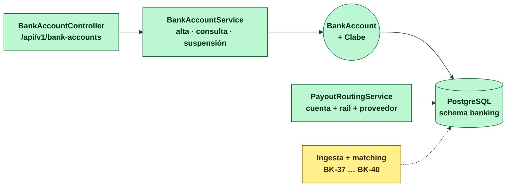

# banking-service (D15)

**Tesorería.** Nuestras cuentas en instituciones financieras, **de cuál sale cada pago**, por qué
rail y con qué proveedor, y **qué dice el banco que pasó**. No conoce el dominio de crédito: recibe
una petición de pago con su referencia opaca y responde por dónde sale.

> **Servicio interno.** No recibe tráfico de internet y **no está publicado en el gateway**.

| | |
|---|---|
| **Puerto** | `8104` (bootRun) · `:8080` interno en Docker |
| **Schema** | `banking` · paquete `com.fintech.banking` |
| **Dominio** | [docs/dominios/15_banking_domain.md](../../docs/dominios/15_banking_domain.md) |
| **Estado** | Fases 1 y 2 (BK-03 … BK-10) y fondeo (`009`). La conciliación contra el estado de cuenta del banco espera su ingesta (BK-37) |

---

## Mapa del servicio



🟩 implementado · 🟨 esquema listo, código pendiente.

## Qué hay en el esquema

| Tabla | Qué guarda | ¿Tiene código? |
|---|---|---|
| `bank_accounts` | Nuestras cuentas: institución, CLABE, titular, **tres** cuentas del mayor | ✅ |
| `payout_routes` | (empresa, rail, monto) → **cuenta + rail + proveedor** | ✅ |
| `bank_statement_lines` | El movimiento tal como lo reporta el banco. Dato externo: crudo, sin corregir | ⏳ BK-37 |
| `bank_matches` | El cruce, con **método y confianza** | ⏳ BK-38 |
| `suspense_entries` | Lo no identificado, como **partida en conciliación** | ⏳ BK-39 |
| `bank_close_seals` | El sello del día/mes por cuenta | ⏳ BK-40 |

Las cinco últimas vivían en `closing` y se mudaron aquí (BK-04). No tenían **ni una clase Java** que
las tocara, así que la mudanza costó cero migración.

## Las tres cuentas del mayor

Cada cuenta propia declara tres, y las tres hacen falta para que el sello cuadre:

| Campo | Default | Para qué |
|---|---|---|
| `ledger_account` | `1101` Bancos | Contra la que se concilia el saldo |
| `suspense_credit_account` | `2109` Depósitos por identificar | **Pasivo**: llegó dinero y no sabemos de quién |
| `suspense_debit_account` | `1109` Cargos bancarios por aclarar | **Activo**: el banco cargó y no sabemos por qué |

Son dos puentes y no una porque las dos direcciones tienen naturaleza opuesta. Ver
[§4 del doc de dominio](../../docs/dominios/15_banking_domain.md).

## API

| Verbo | Ruta | Rol |
|---|---|---|
| `POST` | `/api/v1/bank-accounts` | `ADMIN` |
| `GET` | `/api/v1/bank-accounts/{id}` | `ADMIN` · `OPS_SUPERVISOR` · `AUDITOR` |
| `GET` | `/api/v1/bank-accounts?companyId=` | idem |
| `POST` | `/api/v1/bank-accounts/{id}/suspend` | `ADMIN` |
| `POST` | `/api/v1/bank-accounts/{id}/reactivate` | `ADMIN` |
| `POST` | `/api/v1/payouts/route` | `SERVICE` · `ADMIN` |
| `POST` | `/api/v1/payout-routes` | `ADMIN` |
| `GET` | `/api/v1/payout-routes` | `ADMIN` · `OPS_SUPERVISOR` · `AUDITOR` |
| `DELETE` | `/api/v1/payout-routes/{id}` | `ADMIN` |
| `GET` | `/api/v1/traces/...` | la cadena de cada pago: por crédito, pago, clave, línea, póliza; `incomplete` |
| `GET` | `/api/v1/treasury/self-checks` | autoverificación de tesorería |

`POST /payouts/route` es **el único sitio donde la CLABE sale completa**: el conector la necesita
para armar la cadena original. Por eso pide rol `SERVICE` y no uno de consulta.

### Cómo se elige la ruta

Gana la de menor `priority`; a igual prioridad, la **específica de empresa** sobre la genérica; a
igual todo, **la más antigua**. Ese último desempate no es cosmético: `findAllEnabled()` no garantiza
orden, y sin él dos rutas empatadas harían que el pago saliera un día por una cuenta y al siguiente
por otra sin que nadie cambiara nada.

Una ruta cuya cuenta está `SUSPENDED` **se salta** y gana la siguiente. Si no se filtrara aquí,
suspender una cuenta no sacaría nada del ruteo: la ruta seguiría ganando y el pago fallaría en el
proveedor, que es donde ya no se puede corregir.

**El alta es `ADMIN` y nada menos.** Quien puede dar de alta una CLABE ordenante puede, en el
siguiente paso, apuntarle una ruta y hacer que el dinero salga por ella. Es el permiso más sensible
del servicio, por encima de consultar cualquier saldo.

**La CLABE nunca sale completa** — ni en la respuesta, ni en la bitácora, ni en el mensaje de un
error de duplicado.

```bash
curl -X POST localhost:8104/api/v1/bank-accounts \
  -H 'X-User-Id: ops' -H 'X-Roles: ADMIN' -H 'Content-Type: application/json' \
  -d '{"institutionName":"BBVA","clabe":"012180001234567890","holderName":"FINTECH SA DE CV"}'
```

## Fondeo: de dónde viene el dinero que se presta

Una SOFOM ENR **no capta recursos del público** (LIC arts. 2 y 103; LGOAAC 87-B): presta su capital y lo que le
prestan instituciones financieras u otras entidades por contrato privado. Ésas son las dos clases de fuente:

| Fuente | Documento | Contraparte | Contabilidad |
|---|---|---|---|
| **Aportación de capital** (`CAPITAL`) | Acta de asamblea que acuerda el capital | Accionistas, con RFC | `1101` / `3101` Capital social pagado (IAS 32) |
| **Línea de fondeo** (`CREDIT_LINE`) | Contrato de crédito: monto, tasa, comisión y vencimiento | Banco, banca de desarrollo, otra entidad o accionista, con RFC | Pasivo a costo amortizado (IFRS 9): disposición `1101` / `2201`, intereses `5201` / `2202` cada día, pago `2202` / `1101`, capital `2201` / `1101`. La comisión de apertura es costo de la transacción: `2209` / `1101`, amortizada a `5201` |

Cada fuente identifica a su contraparte con RFC y su documento (el origen de los recursos se conoce, PLD) y se
recibe en una cuenta propia dada de alta. Reglas que el dominio impone:

- una aportación no excede el capital que acordó la asamblea; un aumento requiere otro acuerdo;
- una línea se dispone dentro de su monto y antes de su vencimiento, y su comisión de apertura se paga una vez;
- los intereses se devengan **día por día** sobre lo dispuesto (días reales / 360, a la tasa del contrato). Antes de
  que cambie el capital (una disposición o un pago) se devenga hasta el día anterior, y antes de pagar intereses
  hasta el día del pago; `POST /funding/accruals?through=` devenga todas las líneas hasta un día (el cierre de mes);
- cada movimiento va con su **fecha valor**, nunca posterior a hoy, y una instrucción repetida (misma fuente, tipo y
  referencia) es el mismo movimiento;
- una línea pagada por completo sigue vigente hasta su vencimiento: se puede volver a disponer.

Cada movimiento se publica en `banking.funding-movement-recorded` **después del commit** (clave: la fuente, para que
lleguen en orden) con los saldos que dejó; contabilidad lo asienta y el cierre de mes concilia `3101`, `2201` y
`2202` contra esos saldos y exige los intereses devengados al último día. Lo que mueve dinero se proyecta en el
libro de caja (`internal_movements`, tipo `FUNDING`).

| Verbo | Ruta | Rol |
|---|---|---|
| `GET` | `/api/v1/funding/sources` | `ADMIN` · `FINANCE` · `OPS_SUPERVISOR` · `AUDITOR` |
| `GET` | `/api/v1/funding/sources/{id}/movements` | idem |
| `POST` | `/api/v1/funding/sources/capital` · `/credit-lines` | `ADMIN` · `FINANCE` |
| `POST` | `/api/v1/funding/sources/{id}/movements` | `ADMIN` · `FINANCE` |
| `POST` | `/api/v1/funding/accruals?through=` | `ADMIN` · `FINANCE` · `SERVICE` |

En el backoffice: **Bancos y tesorería → Fondeo** (capacidad `treasury.funding` para registrar).

## Libro de caja: cada movimiento de la cuenta, una vez

`internal_movements` es el libro de caja de tesorería: lo que la plataforma dice que pasó en la cuenta, cada hecho
una vez (por el evento que lo trajo), con su **fecha de negocio** (la del banco: la fecha de operación SPEI), su
**sentido** (`CREDIT` entra, `DEBIT` sale), su **fecha de cartera** (`portfolio_date`: cuándo se recibió el abono o se
registró la orden) y la clave de rastreo. Un abono de las 19:00 del 30 de noviembre entra con fecha de cartera 30 y
fecha de negocio 1 de diciembre; contabilidad asienta su lado banco en la segunda.

| Tipo | Sentido | Hecho que lo trae |
|---|---|---|
| `STP_ORDER` | sale | `stp.order-settled`: la orden de la plataforma liquidada (disposiciones y lotes de comisiones), con su fecha de operación y el día en que se registró (`registeredOn`) |
| `FUNDING` | entra / sale | el fondeo: aportaciones y disposiciones entran; comisión, intereses y capital pagados salen |
| `CLIENT_PAYMENT` | entra | `stp.credit-received`: el abono SPEI que llegó a una CLABE de cobro (fuente `CREDIT:<abono>`); y `payments.payment-applied` sólo para un pago directo (`fundingSource = DIRECT`): la parte de un abono o el saldo a favor no traen dinero nuevo |
| `PAYMENT_RETURN` | sale | el abono devuelto al ordenante en el mismo día de operación (`CREDIT-RETURNED:<abono>`), `payments.payment-returned` (el banco del pagador lo devolvió) y `credit-portfolio.payment-rejected` de un pago directo (cartera no lo tomó: entró y se devuelve). La parte de un abono que un crédito rechaza no sale: queda a favor del pagador |

Cada movimiento se anuncia en `banking.cash-movement-recorded` después del commit, y **cada vez que su hecho se ve**,
no sólo la primera: si el anuncio falló después de guardar, la reentrega lo vuelve a anunciar; contabilidad lo guarda
una vez por su id. Contabilidad cierra el mes sólo si `1101` dice lo mismo que este libro (`BANCOS_1101`).

**La traza de cada pago** (`movement_trace`) sigue el carril: `disbursement.stp-requested` (ruteado),
`disbursement.accepted` (despachado, con clave de rastreo), `stp.order-settled` (liquidado), y termina
`FAILED` con su motivo en `disbursement.failed` o `RETURNED` en `disbursement.returned`. Antes nadie le avisaba de un
fallo ni de una devolución (D61): un pago rechazado quedaba «despachado» para siempre y se contaba como traza a medias.

### Autoverificación

Tesorería se revisa a sí misma con sus propios datos (`GET /api/v1/treasury/self-checks`, mismo contrato que el cierre
contable):

| Comprobación | Debe cumplirse | Qué compara |
|---|---|---|
| `FONDEO_CUADRA` | sí | aportado, capital dispuesto e intereses por pagar de cada fuente contra la suma de sus movimientos |
| `INTERES_DEL_FONDEO` | sí | cada devengo contra su tasa (días reales sobre 360, ventana inclusiva) y cada día devengado una sola vez |
| `PAGOS_EN_CAJA_Y_TRAZA` | sí | cada orden liquidada en el libro de caja y en su traza, por el mismo importe; una que el banco receptor devolvió antes de liquidarse no salió y no se busca en caja (D63), una devuelta ya liquidada sí |
| `CAJA_NO_NEGATIVA` | sí | el saldo del libro de caja al cierre de cada día |
| `TRAZAS_SIN_DESENLACE` | informa | pagos ruteados o despachados hace más de dos días (de su fecha de operación) sin desenlace |

Contra el **estado de cuenta del banco** cruza la conciliación de tres pasadas: clave de rastreo, importe y fecha
con un solo candidato, y lo demás a la cuenta puente para que lo decida una persona. Un movimiento sólo cruza con una
línea **del mismo sentido**: con los pagos de clientes en el libro, un abono de 500 y una orden de 500 el mismo día son
dos candidatos y sólo uno es esa línea.

## Configuración

| Propiedad | Default | Qué hace |
|---|---|---|
| `fintech.banking.base-currency` | `MXN` | Moneda de las cuentas propias |

**Sin ruta aplicable el pago no sale, y eso no es configurable.** No hay cuenta de respaldo a la que
caer: un default silencioso es exactamente lo que hacía el `is_default` del conector, y es el defecto
que este servicio existe para corregir.

## Correr

```bash
./gradlew :banking-service:bootRun          # 8104
./gradlew :banking-service:test             # 39 pruebas
docker compose up banking-service           # 8104 → 8080
```

Las pruebas de integración usan el arnés compartido (`AbstractIntegrationTest`): Postgres y Redis
reales, un contenedor por JVM.

---

## Convención de idioma

**Todo el código de este servicio se escribe en inglés** — clases, métodos, campos, enums, pruebas
y claves de configuración. Los **comentarios van en español**, que es donde vive el razonamiento.

Excepciones: los nombres que viajan en el contrato de un proveedor externo, y los términos
regulatorios sin equivalente (`CLABE`, `CURP`, `RFC`, `CEP`). Detalle y guía de migración en
[`docs/CONVENCION_IDIOMA.md`](../../docs/CONVENCION_IDIOMA.md).
