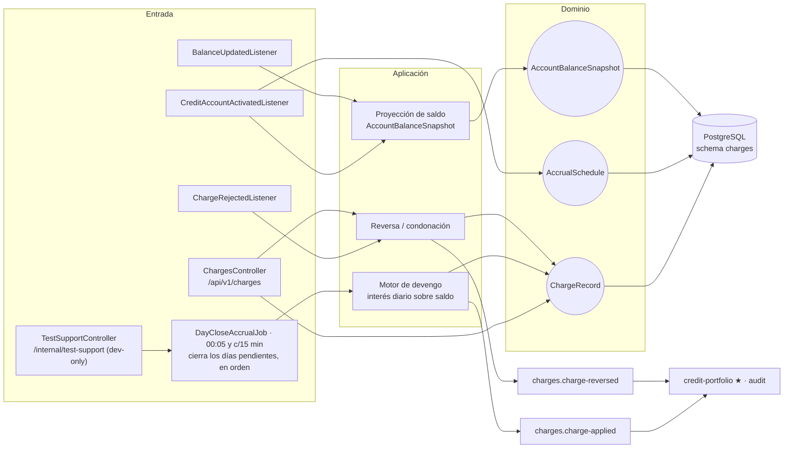
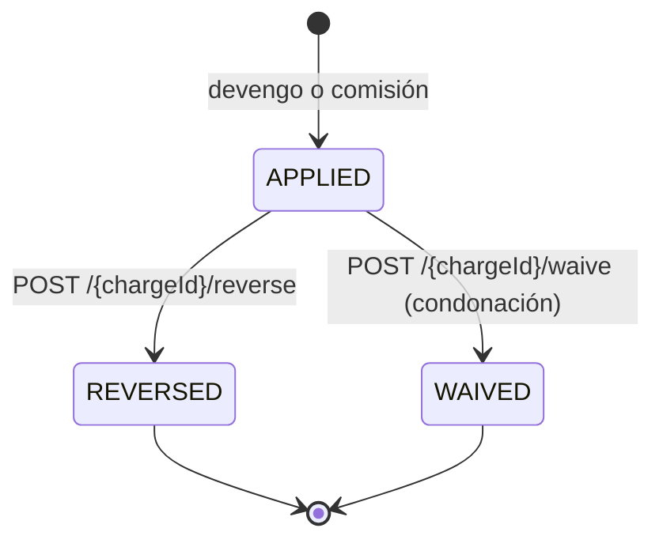
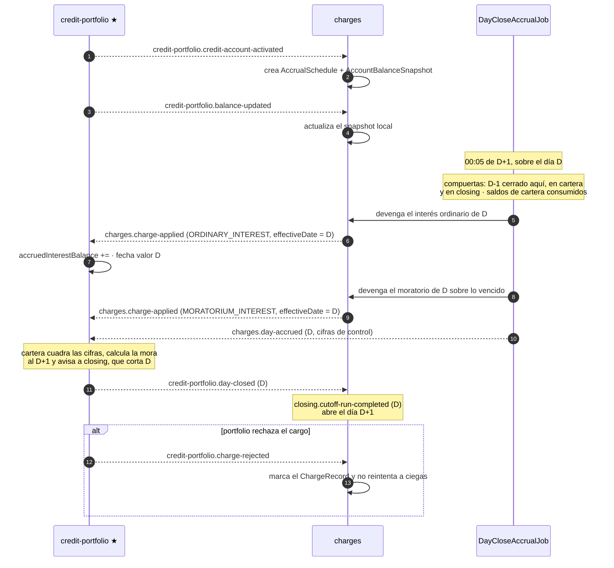
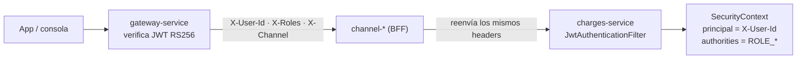

# charges-service (D5)

**Devengamiento y cargos sobre la cuenta viva.** Calcula, programa y registra todo lo que se le
carga a un crédito activo: interés ordinario, interés moratorio, comisión de apertura, comisión de
administración, comisión por prepago, prima de seguro e IVA.

**No escribe saldos.** Es la mitad "calcula" del patrón de ADR-001: charges emite el hecho
(`charge-applied`), y [credit-portfolio](../credit-portfolio-service/README.md) lo aplica sobre la
fuente de verdad. Si portfolio lo rechaza, se entera por `charge-rejected` y corrige.

| | |
|---|---|
| **Puerto** | `8088` (bootRun) · `:8080` interno en Docker |
| **Schema** | `charges` |
| **Auth** | **Header-trust** — no valida JWT (ver §5) |
| **Régimen Kafka** | Por defecto (sin DLT) |
| **Dominio** | [docs/dominios/05_charges_domain.md](../../docs/dominios/05_charges_domain.md) |

---


**IVA del interés por periodo.** Una cuenta que cobra el interés por periodo (la línea de distribuidora) cobra en cada
corte el interés de las cuotas que vencen ese día y su IVA tal como lo fija cada cuota (`scheduled_tax` de la foto de
cartera), redondeado como lo paga cada cliente. El 16 % del interés total redondeado una vez quedaba a un centavo o dos
de la suma de las cuotas (90.17 contra 20.02 + 6.81 + 58.11 + 5.24 = 90.18) y el estado de cuenta no sumaba su total.

## 1. Mapa del servicio



---

## 2. Dominio

| Agregado | Rol |
|---|---|
| `ChargeRecord` | Un cargo concreto aplicado a la cuenta. Estados: `APPLIED` · `REVERSED` · `WAIVED` |
| `AccrualSchedule` | Calendario de devengo por cuenta: desde dónde y hasta dónde se ha devengado |
| `AccountBalanceSnapshot` | Proyección local del saldo, alimentada por `balance-updated`. Evita llamar a portfolio para devengar |

**`ChargeType`:** `ORDINARY_INTEREST` · `MORATORIUM_INTEREST` · `OPENING_FEE` · `ADMIN_FEE` ·
`PREPAYMENT_FEE` · `INSURANCE_PREMIUM` · `IVA`.



Tanto `REVERSED` como `WAIVED` publican `charges.charge-reversed`: para el saldo son el mismo
efecto, pero se distinguen en el registro porque contable y comercialmente no son lo mismo.

---

## 3. Ciclo de devengo diario



### El cierre del día empieza aquí, a las 00:05

El día se procesa **cuando terminó**: el cierre del 10 de noviembre corre el 11 a partir de las 00:05.
Antes el ordinario corría a las 23:00 y el moratorio a las 23:30 del mismo día, y lo que pasaba en la
última hora —un pago, una disposición— no movía el interés de ese día.

**La hora sólo despierta al job; lo que decide son las compuertas.** `DayCloseAccrualJob` (una réplica,
ShedLock) corre a las 00:05 y cada 15 minutos (`0 5/15 * * * *`, `CHARGES_DAY_CLOSE_CRON`). Cada vuelta
toma los días pendientes **en orden y sin huecos** —el último cerrado más uno, hasta ayer— y se detiene en
el primero que no pueda cerrar. Sin pendientes no hace nada. Un día D cierra sólo si:

| Compuerta | Por qué |
|---|---|
| Son las 00:05 de D+1 o más tarde | El día terminó y los pagos del último segundo ya entraron |
| D-1 está cerrado aquí | Los días no se saltan. Si cargos estuvo caído tres días, al volver cierra los tres, uno tras otro |
| Cartera cerró D-1 (`credit-portfolio.day-closed`) | El moratorio de D se cobra sobre la mora que mide ese cierre |
| Closing terminó el corte de D-1 (`closing.cutoff-run-completed`) | La cadena va en serie: cargos D → cartera D → corte D → cargos D+1 |
| Cargos consumió todo lo que cartera publicó (`balance-updated`, `delinquency-status-updated`) | Es lo que cierra calendarios liquidados antes de repartir |
| **Cartera tomó la foto de D** y cargos la copió completa (`charges.account_day_snapshots`) | Es la base de todo el devengo de D: sin foto no se reparte nada |

Las esperas se hacen en línea hasta `gate-wait` (10 min). Si una compuerta no abre, el día queda `WAITING`
en `charges.accrual_days` con el motivo escrito, y la siguiente vuelta lo retoma. El primer día que cierra
el servicio no tiene anterior que esperar.

Al pasar, **el día se reparte por cuenta**:

1. Cargos pide a cartera la **foto del día** (`POST /api/v1/portfolio/day-snapshots/D`: cartera la toma una
   vez, quien sea que la pida) y la copia por páginas. Si cartera todavía no puede tomarla, el día queda
   `WAITING` con su motivo.
2. Un `INSERT … SELECT` crea una unidad por cuenta que debe devengar ese día (`charges.accrual_units`):
   calendarios activos, con ordinario o moratorio pendiente, de cuentas que ya existían al terminar el día,
   **con la base congelada de la foto**: `basis_principal` (capital al cierre de D), `basis_overdue_principal`
   y `basis_oldest_due_date` (deciden el moratorio junto con la gracia del producto). Un calendario activo que
   la foto no trae nace en **cuarentena** («cartera no la incluyó»): alguien tiene que verlo.
3. Cada cuenta sale al tópico `charges.accrual-due` (12 particiones, llave = cuenta). Cualquier pod del grupo
   `charges-accrual-workers` la toma con CAS y token de *fencing* y devenga **ordinario y moratorio de esa
   cuenta en una transacción**. Si dos pods la trabajan —uno quedó lento y el monitor la dio por perdida—,
   sólo el token vigente la marca; el otro deshace su devengo.
4. **Una cuenta que falla no detiene el día.** Se reintenta (`max-attempts` 3, con `retry-backoff`); agotados
   los intentos queda en **cuarentena** con su error escrito, y el día cierra con las demás.
5. **El orden se cumple por cuenta.** Si una cuenta tiene un día anterior sin cerrar (en cuarentena o
   retenido), su unidad de hoy nace **retenida** (`HELD`): su interés nunca se adelanta a uno que le falta.
6. Cuando no queda nada en vuelo, **avisa `charges.day-accrued`** con las cifras de control del lote y las
   cuentas que quedaron fuera (`heldAccounts`). Cartera cuadra sin ellas y closing retiene su corte; el
   resto corta normal.
7. **Recuperación.** Corregido el dato, se reintenta la cuenta (endpoint abajo). Devenga tarde, con
   `dayCloseDate` de su día, y avisa **`charges.account-accrued`** con sus cifras. Cartera cuadra esa cuenta
   y avisa `credit-portfolio.account-day-closed`; closing corta la cuenta. Sus días retenidos se sueltan
   solos, uno tras otro.
8. **Falla general.** Si las cuarentenas de un día rebasan el mayor entre `min-quarantined-allowed` (10) y
   `max-quarantined-ratio` (1 %) de sus cuentas, no es un dato malo sino un error que tocó a todas: el día
   **no cierra** y queda escrito por qué.

El job (una réplica, ShedLock) planea y espera en línea hasta `unit-wait` (10 min); lo que quede lo termina
`AccrualDayMonitor` (cada 15 s, una réplica): recupera lo que un pod muerto dejó tomado, reintenta, pone en
cuarentena, suelta retenidas, reenvía lo que no salió, cierra el día y avisa los devengos tardíos. Cada paso
es condicional: el día lo cierra y lo avisa una sola llamada aunque el job y el monitor coincidan.

**Más rápido con más pods.** `docker compose up -d --scale charges-service=3`: el paralelismo es
`min(particiones, réplicas × concurrency)`. Con 12 particiones y 4 hilos, el tercer pod llena el techo.

**Saber qué cuentas están en problemas:** `GET /api/v1/charges/day-close/accounts-in-trouble`, el detalle
del día en `GET /api/v1/charges/day-close/{date}`, la métrica `charges_day_close_accounts{status}` y un
WARN por cada cuenta que entra a cuarentena.

**Las cifras son del lote, no del día.** Cada cargo que genera el cierre de D lleva `dayCloseDate = D`
(`charge_records.day_close_date`, y viaja en `charge-applied`). Por fecha valor no cuadraría: hay cargos
del mismo día que no salieron del cierre —siembras, el soporte de pruebas, historia que la fecha valor
fechó por su hora de aplicación—.

**Lo que no se guarda no sale; lo guardado espera al broker.** `charges.charge-applied` sale **después
del commit** del cargo y espera la confirmación del broker. Antes salía dentro de la transacción: el 31 de
octubre la tabla rechazó tres IVA al guardar, los cargos se deshicieron, pero sus mensajes ya habían
salido y cartera aplicó 24 cargos que cargos no tiene. Las cifras de control lo atraparon y cartera no
cerró. Ahora, si el envío falla después del commit, el calendario cuenta como error, el día no se avisa
y el cargo guardado se reenvía con su mismo id (ver abajo). Un faltante se recupera solo; un fantasma no.
Antes del aviso del día, `flush()`: todo lo enviado queda confirmado antes de que cartera tome su foto de
offsets.

**Si cartera no confirma.** Un día avisado que cartera no confirma en `reannounce-after` (30 min) se
vuelve a avisar; a la segunda, antes se reenvían sus cargos con el mismo id —cartera ignora los que ya
tenía—. Es lo que destraba un día cuyas cifras no cuadran porque un mensaje se descartó en el camino.

Cada cargo viaja con `effectiveDate = D`: cartera lo asienta con **fecha valor D** aunque lo aplique el
11, y el estado de cuenta lo cuenta en el periodo correcto.

**Centavos.** Un interés que redondea a 0.00 no genera cargo, y un IVA que redondea a 0.00 tampoco: el
interés va solo. El día queda devengado igual. `charge_records` exige `amount > 0`, y un cargo en cero
tumbaba al calendario y detenía la cadena (pasó el 31 de octubre: tres líneas con $29 al 20 % dan 0.02
de interés y 0.0032 de IVA).

Medido (`DayCloseChainIT`, Postgres y broker reales, un pod con 4 hilos): **2 000 cuentas en 3.7 s
(537 cuentas/s)**, cada cargo confirmado por el broker. Antes, en serie en un pod: 300 en 0.9 s.

**La base es la de la foto, no la del momento.** El devengo del cierre (`accrueInterestOnBasis`,
`accrueMoratoriumOnBasis`) usa lo que la unidad congeló al repartir; el saldo vivo del calendario sólo lo
usan el soporte de pruebas y los rellenos. Una cuenta recuperada días después devenga cada día con la foto
de ese día, y el moratorio corre si la foto trae capital vencido y la cuota más vieja más la gracia ya pasó,
diga lo que diga la bandera viva. El cargo guarda su base: `basis × rate / 360` es el interés, hoy y en una
auditoría. `GET /api/v1/charges/day-close/{date}/accounts/{id}` muestra foto, unidad y cargos de una cuenta
en un día.

---

## 4. API REST

**Base:** `/api/v1/charges`

| Método | Ruta | Descripción |
|---|---|---|
| `GET` | `/accounts/{creditAccountId}` | Cargos de la cuenta |
| `GET` | `/accounts/{creditAccountId}/schedule` | Calendario de devengo |
| `GET` | `/accounts/{creditAccountId}/balance` | Snapshot de saldo que ve charges |
| `POST` | `/{chargeId}/reverse` | Reversa (error operativo) |
| `POST` | `/{chargeId}/waive` | Condonación (decisión comercial) |
| `GET` | `/day-close/{date}` | Cierre de un día: cuentas por estado, cifras de control y las que quedaron fuera |
| `GET` | `/day-close/accounts-in-trouble` | Cuentas en cuarentena o retenidas, de todos los días, con su motivo |
| `POST` | `/day-close/{date}/accounts/{accountId}/retry` | Reintenta una cuenta en cuarentena (después de corregir su dato) |
| `POST` | `/day-close/{date}/retry-quarantined` | Reintenta toda la cuarentena del día |
| `GET` | `/day-close/{date}/accounts/{accountId}` | Una cuenta en un día: la foto de cartera, su unidad con la base y los cargos que generó (la pista de auditoría) |

### Soporte (dev-only, `TEST_SUPPORT_ENABLED=true`)

| Método | Ruta | Para qué |
|---|---|---|
| `POST` | `/internal/test-support/run-day-close?date=` | La noche de un día, por las mismas compuertas que el cron: reparte por cuenta y responde `CLOSED` (con cuántas quedaron fuera), `WAITING` con el motivo o `IN_PROGRESS`. Para correr el reloj se llama día tras día; cada llamada espera a que el anterior termine en cartera y closing |
| `POST` | `/internal/test-support/retry-quarantined?date=&account=` | Reintenta la cuarentena de un día (una cuenta o todas) |
| `POST` | `/internal/test-support/republish-day?date=` | Reenvía los cargos del devengo de un día con su mismo id |
| `POST` | `/internal/test-support/run-daily-accrual` | Sólo el devengo ordinario de un día |
| `POST` | `/internal/test-support/run-moratorium-accrual` | Correr el devengo moratorio |
| `POST` | `/internal/test-support/rewind-accrual-schedules?date=&creditAccountId=` | Retroceder el calendario para simular días transcurridos; **con `creditAccountId`, sólo ese** (rebobinar toda la cartera volvía a devengar días que las demás ya tenían) |
| `POST`/`GET`/`DELETE` | `/internal/test-support/clock?today=` | Desplaza el reloj de negocio (de `shared`): «hoy» es esa fecha, con la hora corriendo. Para correr noches en un laboratorio |

El gateway **no** enruta `/internal/*`: no son alcanzables desde fuera.

---

## 5. Autenticación — modelo *header-trust*

charges **no valida JWT**. La firma RS256 ya se verificó en el gateway; el BFF reenvía la identidad
y charges confía en ella.



| Archivo | Responsabilidad |
|---|---|
| `JwtAuthenticationFilter.java` | Lee `X-User-Id` (→ *principal*) y `X-Roles` (→ `ROLE_<rol>`). Sin llave secreta |
| `ChargesProperties.java` | No tiene campo `jwtSecret` |
| `application.yml` | No define `jwt-secret` ni `JWT_SECRET` |

La red interna de Docker no publica este puerto al host: el único camino de entrada es el gateway.

---

## 6. Eventos Kafka

**Consume:** `credit-portfolio.credit-account-activated` · `credit-portfolio.balance-updated` ·
`credit-portfolio.delinquency-status-updated` · `credit-portfolio.charge-rejected` ·
`credit-portfolio.credit-account-cancelled` ·
`credit-portfolio.day-closed` · `closing.cutoff-run-completed` · `charges.accrual-due` (su propio tópico de
trabajo, grupo `charges-accrual-workers`).

**Produce:** `charges.charge-applied` · `charges.charge-reversed` (→ credit-portfolio, audit) ·
`charges.day-accrued` · `charges.account-accrued` (→ credit-portfolio) · `charges.accrual-due`.

> charges **no** consume `product-catalog.*`: la configuración del producto que necesita para
> devengar le llega dentro de `credit-account-activated`.

**Reintentos:** régimen por defecto de la plataforma, sin DLT.
Ver [README raíz §5.4](../../README.md#54-política-de-reintentos-y-dlt-kafka).

### Un crédito cancelado no se queda con ningún cargo (D63)

Cuando el único desembolso de un crédito a plazos no pudo hacerse, cartera lo cancela y publica
`credit-account-cancelled`. `CancellationCompensationService` reversa, uno por uno, los cargos todavía
aplicados (la comisión de apertura, su IVA y el interés devengado mientras tanto). Cada reversa sale en
`charge-reversed` con el id del cargo, y además se cierra el devengo. Un cargo ya reversado o condonado
no se toca, así que repetir el aviso no hace nada.

Un cargo que llega después de la cancelación lo rechaza cartera (`charge-rejected`), y este servicio lo
reversa en silencio. Si la compensación lo alcanzó antes del rechazo, cartera no asienta esa reversa
porque el cargo nunca entró. `AccountBalanceSnapshot.isChargeable` excluye `CANCELLED`.

### Cómo sale un cargo

`charge-applied` sale **después del commit** del cargo y espera al broker (30 s). Lo que no se guarda no
sale: si el commit falla, no hay mensaje. Si el envío falla después del commit, el cargo existe sin
mensaje; la cuenta cuenta como error, y el seguimiento del cierre reenvía los cargos del día con su mismo
id —cartera ignora los que ya tenía—. Un faltante se recupera solo; un fantasma no se recuperaba nunca, y
por eso el orden es éste. El outbox sigue siendo la solución general para el resto de los eventos
(`charge-reversed` todavía se manda sin esperar).

---

## 7. Persistencia — schema `charges`

5 changesets Liquibase bajo `db/changelog/charges/`.

```yaml
spring:
  liquibase:
    default-schema: charges      # las tablas del dominio
    liquibase-schema: public     # DATABASECHANGELOG
```

**Por qué `liquibase-schema: public`:** si se omite, Liquibase intenta crear `DATABASECHANGELOG`
dentro de `charges`, que en el primer arranque todavía no existe — y el bootstrap falla. La tabla de
control vive en `public`; las del dominio, en su schema.

---

## 8. Configuración

| Variable | Default | Nota |
|---|---|---|
| `SERVER_PORT` | `8088` | `8080` en Docker |
| `POSTGRES_USER` / `POSTGRES_PASSWORD` | `fintech` / `fintech` | |
| `KAFKA_BOOTSTRAP_SERVERS` | `localhost:9092` | |
| `SPRING_PROFILES_ACTIVE` | — | `docker` en Compose |
| `TEST_SUPPORT_ENABLED` | `false` | **Debe quedar en `false`** |
| `CHARGES_ACCRUAL_CONCURRENCY` | `4` | Hilos que devengan cuentas del cierre, por pod |
| `CHARGES_ACCRUAL_PARTITIONS` | `12` | Particiones de `charges.accrual-due`: techo de paralelismo entre pods |
| `CHARGES_ACCRUAL_MONITOR_INTERVAL` | `PT15S` | Cada cuánto corre el monitor del cierre |
| `CREDIT_PORTFOLIO_SERVICE_URL` | `http://localhost:8087` | De dónde se copia la foto diaria de cartera (`fintech.charges.portfolio-url`) |

En `fintech.day-close.units`: `max-attempts` (3), `retry-backoff` (1 min), `lease` (2 min),
`max-quarantined-ratio` (0.01) y `min-quarantined-allowed` (10).

Sin `JWT_SECRET`: el modelo es header-trust.

---

## 9. Tests y ejecución local

```bash
./gradlew :charges-service:test

docker compose up -d                 # plataforma completa
docker compose up -d charges-service # sólo este (requiere postgres, kafka, credit-portfolio)
```

---

## Convención de idioma

**Todo el código de este servicio se escribe en inglés** — clases, métodos, campos, enums, pruebas
y claves de configuración. Los **comentarios van en español**, que es donde vive el razonamiento.

Excepciones: los nombres que viajan en el contrato de un proveedor externo, y los términos
regulatorios sin equivalente (`CLABE`, `CURP`, `RFC`, `CEP`). Detalle y guía de migración en
[`docs/CONVENCION_IDIOMA.md`](../../docs/CONVENCION_IDIOMA.md).
