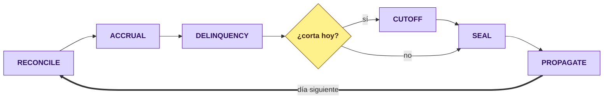

# closing-service (D14)

**El motor de cierres y cortes.** Corre el día contable cuenta por cuenta: devenga, envejece, corta
el ciclo del que lo tiene, sella lo que cuadró y **propaga de vuelta** lo que la cartera necesita
saber. Reparte el trabajo entre pods sin coordinador central.

> **Servicio interno.** No recibe tráfico de internet y **no está publicado en el gateway**.

| | |
|---|---|
| **Puerto** | `8103` (bootRun) · `:8080` interno en Docker |
| **Schema** | `closing` · paquete `com.fintech.closing` |
| **Dominio** | [docs/dominios/14_closing_domain.md](../../docs/dominios/14_closing_domain.md) |

---

## Por qué existe

El cierre vivía repartido en `@Scheduled` de tres servicios, cada uno con su reloj y su criterio de
qué día estaba procesando. Eso tiene dos consecuencias que sólo se ven cuando algo falla:

1. **Nadie podía decir si el día cerró.** Cada job dejaba su rastro por separado; no había una
   afirmación única de «el 15 de junio cuadró».
2. **Reprocesar un día era imposible sin efectos colaterales.** Los jobs se disparan por reloj, no
   por fecha de negocio: pedirle a uno que rehiciera el martes significaba esperar al martes.

Y el barrido competía por el pool de conexiones con la API de cartera. Sacarlo de ahí es **medio
motivo de que este servicio exista**.

## Las seis fases, en orden



El orden no es negociable: devengar antes de envejecer produce un DPD que ignora el cargo del día, y
sellar antes de cortar sella un saldo que el corte va a mover.

## Cómo reparte el trabajo

Cada cuenta es una **unidad de cierre** con su propio arrendamiento. Varios pods toman unidades del
mismo lote sin pisarse, y sin un coordinador que decida quién hace qué:

| Pieza | Qué resuelve |
|---|---|
| **Candado Redis** (`shared.lock`) | Que dos pods no tomen la misma unidad. Nunca `FOR UPDATE` en base — el barrido no puede bloquear la API |
| **Token de cercado** | Que un pod cuyo arrendamiento venció no escriba encima del que lo relevó |
| **CAS optimista** | `UPDATE … WHERE status='PENDING'`: quien pierde la carrera sigue a la unidad siguiente |
| **`LeaseReaper`** | Devuelve al lote lo que un pod muerto dejó tomado |

## El sello, que es el punto

Una corrida termina emitiendo un **sello**: la afirmación de que ese día, para esa cuenta, las
cifras cuadran. Su hash se calcula sobre los importes normalizados a escala 4 —la misma cifra da la
misma cadena venga de memoria o de la base—; sin esa normalización, **ningún sello releído se
verificaba íntegro**, que fue exactamente el defecto que TK-05 corrigió.

Si no cuadra, **no se sella**: sellar «con observaciones» convierte el sello en un trámite.

## Qué NO hace

| | |
|---|---|
| ❌ | **No calcula intereses.** Eso es de `charges`. El cierre lo dispara y consume el resultado |
| ❌ | **No concilia bancos.** Eso es de `banking` (D15), que emite su propio sello; el cierre lo consume como cifra de control |
| ❌ | **No decide el importe de una cuota.** Sale del plan de amortización, que es de cartera. Duplicar la aritmética crearía dos fuentes de verdad que divergen al primer redondeo |

## Entradas / Salidas

**Consume:** `credit-portfolio.credit-account-activated` (con **cadencia y plazo**, para derivar el
calendario de corte sin consultar cartera en línea) · `credit-portfolio.balance-updated` (los saldos
con los que se sella) · `credit-portfolio.delinquency-status-updated`.

> Esta línea **era falsa hasta hoy**: el README declaraba estos consumidores y
> `adapter/in/` estaba vacío — cero `@KafkaListener`. `AccountProjectionService` estaba escrito,
> probado y **sin un solo llamador de producción**, así que `account_close_profiles` se poblaba sólo
> desde las pruebas: en producción nacía vacía y el cierre diario no encontraba nada que cerrar.
> Lo cubre `PortfolioEventListener`.

**Produce:** `closing.unit-window-opened` · `closing.cutoff-closed` (que cartera proyecta de vuelta
como el exigible del ciclo) · `closing.day-sealed`.

## El ciclo de facturación lo fija el producto

**La periodicidad del corte es la que el producto configura**: semanal, quincenal o mensual. Está en
`credit_product.payment_frequencies` (con `CHECK` sobre los tres valores), viaja en
`credit-account-activated` y el cierre la guarda en el perfil al activar — **no la vuelve a
preguntar**, porque consultar cartera dentro de la ventana rompería su aislamiento.

| Regla de corte | De dónde sale la fecha | Periodicidad |
|---|---|---|
| `INSTALLMENT_DUE_DATE` | la cadencia del plan, anclada al alta | del producto |
| `CYCLE_FROM_ACTIVATION` | el **día** de la activación, avanzando por la cadencia | **del producto** |
| `DAY_OF_MONTH` | día fijo del mes, igual para todo el producto | mensual por construcción |
| `NONE` | el producto no corta | — |

> **Esto cambió.** `CYCLE_FROM_ACTIVATION` era `activatedOn.plusMonths(cycle)`: **mensual a fuerza**.
> Una línea configurada `WEEKLY` cortaba mensual y nada fallaba — el calendario se derivaba, se
> persistía y se sellaba con la periodicidad equivocada. El dato siempre estuvo ahí; sólo esa línea
> lo ignoraba.

**El horizonte se mide en años, no en número de cortes.** Un revolvente no tiene plazo, así que el
calendario se materializa por adelantado: dos años. Eran «24 cortes» —pensados como 24 meses— y sobre
un producto semanal esos 24 se agotan en cinco meses; ahora son `periodsPerYear() × 2`, o sea 24, 52
o 104 según la cadencia.

**«Sin configurar» no es «mensual».** `PaymentCadence.parse` devuelve vacío ante nulo o un valor
desconocido, y el derivador cae a mensual **diciéndolo en WARN**. Antes los dos casos daban el mismo
resultado en silencio, así que una tarjeta semanal sin el dato cortaba mensual y la única forma de
notarlo era comparar el catálogo con los cortes sellados a mano.

**Y el pago mínimo también es del producto.** `close_cycle_policies.minimum_payment_rate`, versionado
y con vigencia como el resto de la política. Era una constante del 5 % en `CutoffPhaseProcessor`:
el mismo mínimo para una tarjeta de nómina y una de consumo, y cambiarlo exigía un despliegue. `NULL`
significa «este producto no exige mínimo» —lo correcto para un producto a plazo, cuyo exigible sale
del plan— y el corte se sella sin mínimo, con un WARN si el producto es revolvente.

## Configuración

| Propiedad | Default | Qué hace |
|---|---|---|
| `fintech.closing.calendar-code` | `MX` | Qué calendario de días hábiles usar |
| `fintech.closing.node-id` | `$HOSTNAME` | Identidad del pod en el arrendamiento. En Kubernetes la inyecta la downward API |
| `fintech.closing.batch-size` | `500` | Unidades por lote |
| `fintech.closing.lease` | `5m` | Cuánto dura el arrendamiento antes de que el reaper lo recupere |
| `fintech.closing.workers` | `4` | Hilos por pod |
| `fintech.lock.wait-time` | `0s` | Cero a propósito: quien no gana el candado pasa a la unidad siguiente en vez de bloquear un hilo |

## Correr

```bash
./gradlew :closing-service:bootRun          # 8103
./gradlew :closing-service:test             # 63 pruebas
docker compose up closing-service           # 8103 → 8080
```

---

## Convención de idioma

**Todo el código de este servicio se escribe en inglés** — clases, métodos, campos, enums, pruebas
y claves de configuración. Los **comentarios van en español**, que es donde vive el razonamiento.

Excepciones: los nombres que viajan en el contrato de un proveedor externo, y los términos
regulatorios sin equivalente (`CLABE`, `CURP`, `RFC`, `CEP`). Detalle y guía de migración en
[`docs/CONVENCION_IDIOMA.md`](../../docs/CONVENCION_IDIOMA.md).
