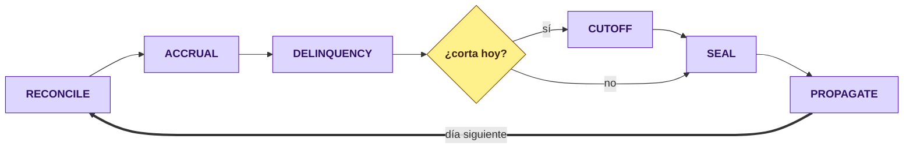

# closing-service (D14)

**El motor de cierres y cortes.** Corre el día contable cuenta por cuenta: devenga, envejece, corta
el ciclo del que lo tiene, sella lo que cuadró y **propaga de vuelta** lo que la cartera necesita
saber. Reparte el trabajo entre pods sin coordinador central.

> **Servicio interno.** No recibe tráfico de internet y **no está publicado en el gateway**.

| | |
|---|---|
| **Puerto** | `8103` (bootRun) · `:8080` interno en Docker |
| **Schema** | `closing` · paquete `com.fintech.closing` |
| **Dominio** | [docs/dominios/14_closing_domain.md](../../docs/dominios/14_closing_domain.md) |

---

## Por qué existe

El cierre vivía repartido en `@Scheduled` de tres servicios, cada uno con su reloj y su criterio de
qué día estaba procesando. Eso tiene dos consecuencias que sólo se ven cuando algo falla:

1. **Nadie podía decir si el día cerró.** Cada job dejaba su rastro por separado; no había una
   afirmación única de «el 15 de junio cuadró».
2. **Reprocesar un día era imposible sin efectos colaterales.** Los jobs se disparan por reloj, no
   por fecha de negocio: pedirle a uno que rehiciera el martes significaba esperar al martes.

Y el barrido competía por el pool de conexiones con la API de cartera. Sacarlo de ahí es **medio
motivo de que este servicio exista**.

## Las seis fases, en orden



El orden no es negociable: devengar antes de envejecer produce un DPD que ignora el cargo del día, y
sellar antes de cortar sella un saldo que el corte va a mover.

## Cómo reparte el trabajo

Cada cuenta es una **unidad de cierre** con su propio arrendamiento. Varios pods toman unidades del
mismo lote sin pisarse, y sin un coordinador que decida quién hace qué:

| Pieza | Qué resuelve |
|---|---|
| **Candado Redis** (`shared.lock`) | Que dos pods no tomen la misma unidad. Nunca `FOR UPDATE` en base — el barrido no puede bloquear la API |
| **Token de cercado** | Que un pod cuyo arrendamiento venció no escriba encima del que lo relevó |
| **CAS optimista** | `UPDATE … WHERE status='PENDING'`: quien pierde la carrera sigue a la unidad siguiente |
| **`LeaseReaper`** | Devuelve al lote lo que un pod muerto dejó tomado |

## El corte, repartido por cuenta

El corte es el último eslabón del **cierre del día**, que corre cuando el día terminó: el del 10 de
noviembre empieza el 11 a las 00:05. Cargos devenga el 10 y avisa; cartera cuadra el interés, calcula la
mora al 11 y avisa (`credit-portfolio.day-closed`); con ese aviso closing corta el 10, y al terminar avisa
`closing.cutoff-run-completed`, que es lo que espera cargos para devengar el 11. La cadena va **en serie**:
cada paso arranca cuando terminó el anterior, nunca por la hora.

**La compuerta del corte.** El corte de D se planifica sólo si:

| Compuerta | Por qué |
|---|---|
| Cartera cerró D (`portfolio_day_closes`) | Sin ese cierre el interés o la mora del día pueden faltar. **Ni la operación a mano lo salta**: `POST /cutoff-runs` responde 409 con el motivo |
| Closing consumió todo lo que cartera publicó antes del aviso (`balance-updated`, `delinquency-status-updated`, `credit-account-activated`) | El corte sella con su proyección; si va atrás, sellaría saldos incompletos |

**Cuentas retenidas.** Cargos cierra por cuenta: una cuenta que no pudo devengar viaja en `heldAccounts` del
aviso de cartera. Su unidad nace `HELD`: no se despacha y no cuenta como en vuelo, así que el corte del resto
termina y sella. Cuando cartera la suelta (`credit-portfolio.account-day-closed`), `CutoffHeldRelease` espera
a consumir sus saldos, la pasa a pendiente, reabre la corrida (`resumeHeld`, aunque estuviera sellada) y la
cuenta se corta con su saldo al cierre de su día. Si el aviso llega antes de planificar, queda en
`held_releases` y la cuenta nace pendiente. `cutoff-run-completed` lleva `heldUnits`.

Los días se cortan en orden. Si la compuerta no abre en `gate-wait` (10 min), el día queda esperando con
el motivo (`portfolio_day_closes.waiting_for`) y lo retoma la reanudación: `CutoffRunJob` cada 15 minutos
(`0 15/15 * * * *`, `CLOSING_CUTOFF_CRON`), que además vuelve a mandar los avisos de fin que no salieron y
avisa en el log de los días con cortes vivos que cartera no ha cerrado. **No los corta.**
(`require-daily-phases` sigue apagado: el orden lo da la cadena, no la barrera interna.)

**Los días de atraso y el capital, de la foto de cartera.** Al planificar la corrida, closing copia a cada
unidad lo que cartera fotografió al terminar D (`close_units.days_delinquent_at_day`, `principal_at_day`;
`POST /api/v1/portfolio/day-snapshots/D/accounts/lookup`, en lotes de 500); una unidad que llegue a sellar
sin su foto la pide sola. El corte sella **los días de atraso al día D** —una retenida que se suelta días
después imprime cómo estaba el día que cortó— y comprueba que el capital que closing rebobina a D es el
de la foto: si no coincide, la unidad falla con el motivo y la cuenta aparece entre las fallidas en vez de
sellar un corte equivocado.

**El saldo al cierre de D, no el de ahora.** La proyección guarda cada movimiento de saldo con su fecha
valor (`balance_movements`); el corte de D sella el saldo de la proyección menos lo que pertenece a días
posteriores. Un pago de las 00:07 de D+1 no entra al corte de D aunque ya haya llegado, y el corte da lo
mismo corra a las 00:06 o a las 03:00. Lo mismo con el estado: una cuenta liquidada el 11 sí corta el 10
(`terminal_since`), con el saldo de antes del pago.

| Paso | Quién | Qué |
|---|---|---|
| Planificar | aviso `credit-portfolio.day-closed` (reanudación: `CutoffRunJob` c/15 min), **una réplica**, con la compuerta abierta | `INSERT … SELECT` de las cuentas que cortan ese día. Congela el desglose por producto y titular y publica `closing.cutoff-run-planned` |
| Despachar | el mismo job | Un mensaje por cuenta a `closing.cutoff-due` (llave = cuenta, 12 particiones). Sólo se marca lo que el broker confirmó |
| Cortar | **cada pod** del grupo `closing-cutoff-workers` | CAS sobre la unidad, sella el corte, publica `closing.cutoff-closed` con corrida, inicio del período, comportamiento y titular |
| Cerrar | `CutoffRunMonitor` cada 15 s, **una réplica** | Reaper, reintentos (3), reenvío de lo que no salió; sin nada en vuelo, sella o deja `FAILED` y publica `closing.cutoff-run-completed`, esperando al broker (si no sale, lo reenvía la reanudación) |

Operación: `POST /api/v1/closing/cutoff-runs?businessDate=` · `GET /api/v1/closing/cutoff-runs/{fecha}`
· `POST /api/v1/closing/cutoff-runs/{fecha}/retry`. Un día que no ha terminado, o que cartera no ha
cerrado, se rechaza con 409 (lo primero salvo `allow-future-dates`, que sólo encienden las pruebas que
corren el reloj). Diseño completo y
mediciones en [docs/CORTE_Y_ESTADOS_DE_CUENTA.md](../../docs/CORTE_Y_ESTADOS_DE_CUENTA.md).

## El sello, que es el punto

Una corrida termina emitiendo un **sello**: la afirmación de que ese día, para esa cuenta, las
cifras cuadran. Su hash se calcula sobre los importes normalizados a escala 4 —la misma cifra da la
misma cadena venga de memoria o de la base—; sin esa normalización, **ningún sello releído se
verificaba íntegro**, que fue exactamente el defecto que TK-05 corrigió.

Si no cuadra, **no se sella**: sellar «con observaciones» convierte el sello en un trámite.

## Qué NO hace

| | |
|---|---|
| ❌ | **No calcula intereses.** Eso es de `charges`. El cierre lo dispara y consume el resultado |
| ❌ | **No concilia bancos.** Eso es de `banking` (D15), que emite su propio sello; el cierre lo consume como cifra de control |
| ❌ | **No decide el importe de una cuota.** Sale del plan de amortización, que es de cartera. Duplicar la aritmética crearía dos fuentes de verdad que divergen al primer redondeo |

## Entradas / Salidas

**Consume:** `credit-portfolio.credit-account-activated` (con **cadencia y plazo**, para derivar el
calendario de corte sin consultar cartera en línea) · `credit-portfolio.balance-updated` (los saldos
con los que se sella, con su fecha valor, y el estado: `SETTLED`, `WRITTEN_OFF`, `CLOSED` y `CANCELLED`
—el crédito cuyo desembolso no se hizo, D63— dejan de cortar desde su `terminalSince`) · `credit-portfolio.delinquency-status-updated` · `credit-portfolio.day-closed` (el
disparo del corte: cartera cerró el día).

> Esta línea **era falsa hasta hoy**: el README declaraba estos consumidores y
> `adapter/in/` estaba vacío — cero `@KafkaListener`. `AccountProjectionService` estaba escrito,
> probado y **sin un solo llamador de producción**, así que `account_close_profiles` se poblaba sólo
> desde las pruebas: en producción nacía vacía y el cierre diario no encontraba nada que cerrar.
> Lo cubre `PortfolioEventListener`.

**Produce:** `closing.unit-window-opened` · `closing.cutoff-closed` (que cartera proyecta de vuelta
como el exigible del ciclo y del que statement-service genera el estado de cuenta) · `closing.day-sealed`
· `closing.cutoff-due` (el reparto del corte, que consume el propio servicio) · `closing.cutoff-run-planned`
· `closing.cutoff-run-completed`.

## El ciclo de facturación lo fija el producto

**Todo el ciclo es del producto**, no sólo la periodicidad: la regla de corte, el día de corte, los días
para pagar, la gracia y el pago mínimo. El catálogo lo declara (`credit_product_definitions.billing_cycle`,
con un default por tipo de producto que reproduce lo que estas políticas aplicaban), lo publica en
`product-activated`, cartera lo fija a cada cuenta al activarla y lo republica en `credit-account-activated`
(`billingCycle`), y el cierre lo guarda en el perfil (`account_close_profiles.billing_*`) — **no lo vuelve a
preguntar**, porque consultar cartera dentro de la ventana rompería su aislamiento. Las cuentas abiertas antes
de que el producto lo declarara siguen derivando de `close_cycle_policies`, que queda como respaldo y sigue
dando el calendario de días hábiles.

| Regla de corte | De dónde sale la fecha | Periodicidad |
|---|---|---|
| `INSTALLMENT_DUE_DATE` | la cadencia del plan, anclada al alta | del producto |
| `CYCLE_FROM_ACTIVATION` | el **día** de la activación, avanzando por la cadencia | **del producto** |
| `DAY_OF_MONTH` | día fijo del mes, igual para todo el producto | mensual por construcción |
| `DAY_OF_WEEK` | día fijo de la semana (1 = lunes … 7 = domingo): el primero después del alta y luego cada periodo | semanal o quincenal, del producto |
| `SEMI_MONTHLY` | dos días fijos de cada mes (`cutoffDays`; la línea de distribuidora: el 6 y el 21; sin días, el 15 y el último), iguales para todas las cuentas del producto, el primero después del alta. **El corte no se recorre** por inhábil (el cierre nocturno corre todos los días); la fecha límite sí | dos por mes (línea de distribuidora) |
| `NONE` | el producto no corta | — |

Con `SEMI_MONTHLY` la línea de distribuidora corta el 6 y el 21, como el sistema de referencia. El estado del
6 se paga el 18 y el del 21 el 3 del mes siguiente (`paymentDueDays`), al día hábil siguiente si ese no lo es;
la gracia termina el 20 y el 5. `SemiMonthlyCalendar` hace la aritmética en O(1) (dos cortes por mes contados
desde el año 0) y cartera tiene su propia réplica, a propósito. credit-product valida que los días dejen al
menos 13 días entre cortes (la quincena más corta: del 21 de febrero al 6 de marzo) y que la fecha límite
caiga antes del corte siguiente. Corrida al día hábil, la fecha límite puede llegar al día del corte siguiente,
nunca después: el 18 de abril de 2025 es Viernes Santo y el estado del 6 se paga el lunes 21; el 3 de abril de
2026 también lo es y el del 21 de marzo se paga el lunes 6. No tiene mínimo: un ciclo que no lo declara no cae
al de la política. El estado pide los pagos de la quincena de sus colocaciones y los cargos del periodo.

Hasta ahora el evento del catálogo no traía ni la periodicidad: cartera la recibía nula y el cierre caía a
mensual con un WARN —las tres líneas de distribuidora del E2E cortan mensual por eso—. Ahora viajan la
periodicidad, la amortización, la comisión de apertura y el ciclo completo.

> **Esto cambió.** `CYCLE_FROM_ACTIVATION` era `activatedOn.plusMonths(cycle)`: **mensual a fuerza**.
> Una línea configurada `WEEKLY` cortaba mensual y nada fallaba — el calendario se derivaba, se
> persistía y se sellaba con la periodicidad equivocada. El dato siempre estuvo ahí; sólo esa línea
> lo ignoraba.

**El horizonte se mide en años, no en número de cortes.** Un revolvente no tiene plazo, así que el
calendario se materializa por adelantado: dos años. Eran «24 cortes» —pensados como 24 meses— y sobre
un producto semanal esos 24 se agotan en cinco meses; ahora son `periodsPerYear() × 2`, o sea 24, 52
o 104 según la cadencia.

**«Sin configurar» no es «mensual».** `PaymentCadence.parse` devuelve vacío ante nulo o un valor
desconocido, y el derivador cae a mensual **diciéndolo en WARN**. Antes los dos casos daban el mismo
resultado en silencio, así que una tarjeta semanal sin el dato cortaba mensual y la única forma de
notarlo era comparar el catálogo con los cortes sellados a mano.

**Y el pago mínimo también es del producto.** Primero el del ciclo fijado a la cuenta
(`billing_min_payment_rate`); si la cuenta no lo trae, `close_cycle_policies.minimum_payment_rate`, versionado
y con vigencia como el resto de la política. Era una constante del 5 % en `CutoffPhaseProcessor`:
el mismo mínimo para una tarjeta de nómina y una de consumo, y cambiarlo exigía un despliegue. `NULL`
significa «este producto no exige mínimo» —lo correcto para un producto a plazo, cuyo exigible sale
del plan— y el corte se sella sin mínimo, con un WARN si el producto es revolvente.

## Configuración

| Propiedad | Default | Qué hace |
|---|---|---|
| `fintech.closing.calendar-code` | `MX` | Qué calendario de días hábiles usar |
| `fintech.closing.node-id` | `$HOSTNAME` | Identidad del pod en el arrendamiento. En Kubernetes la inyecta la downward API |
| `fintech.closing.batch-size` | `500` | Unidades por lote |
| `fintech.closing.lease` | `5m` | Cuánto dura el arrendamiento antes de que el reaper lo recupere |
| `fintech.closing.workers` | `4` | Hilos por pod |
| `fintech.lock.wait-time` | `0s` | Cero a propósito: quien no gana el candado pasa a la unidad siguiente en vez de bloquear un hilo |
| `fintech.closing.cutoff.trigger-on-day-closed` | `true` | El corte de D arranca con el aviso de cartera de que cerró D |
| `fintech.closing.cutoff.cron` | `0 15/15 * * * *` | La reanudación: corta, por las mismas compuertas, los días que cartera cerró y quedaron esperando; reenvía avisos de fin |
| `fintech.closing.cutoff.gate-wait` | `PT10M` | Cuánto espera en línea a que closing consuma los saldos de cartera antes de dejar el día esperando |
| `fintech.closing.cutoff.movement-retention-days` | `62` | Días que se guardan los movimientos con fecha valor |
| `fintech.closing.cutoff.partitions` | `12` | Particiones de `cutoff-due` y `cutoff-closed`: el techo de paralelismo entre pods |
| `fintech.closing.cutoff.concurrency` | `4` | Hilos consumidores del corte por pod |
| `fintech.closing.cutoff.max-attempts` | `3` | Intentos por cuenta antes de dejarla `FAILED` |
| `fintech.closing.cutoff.distributor-product-types` | `DISTRIBUTOR_LINE` | Qué productos son de distribuidora: separa el corte por cliente y por distribuidora |

## Correr

```bash
./gradlew :closing-service:bootRun          # 8103
./gradlew :closing-service:test             # 95 pruebas
docker compose up closing-service           # 8103 → 8080
```

---

## Convención de idioma

**Todo el código de este servicio se escribe en inglés** — clases, métodos, campos, enums, pruebas
y claves de configuración. Los **comentarios van en español**, que es donde vive el razonamiento.

Excepciones: los nombres que viajan en el contrato de un proveedor externo, y los términos
regulatorios sin equivalente (`CLABE`, `CURP`, `RFC`, `CEP`). Detalle y guía de migración en
[`docs/CONVENCION_IDIOMA.md`](../../docs/CONVENCION_IDIOMA.md).
