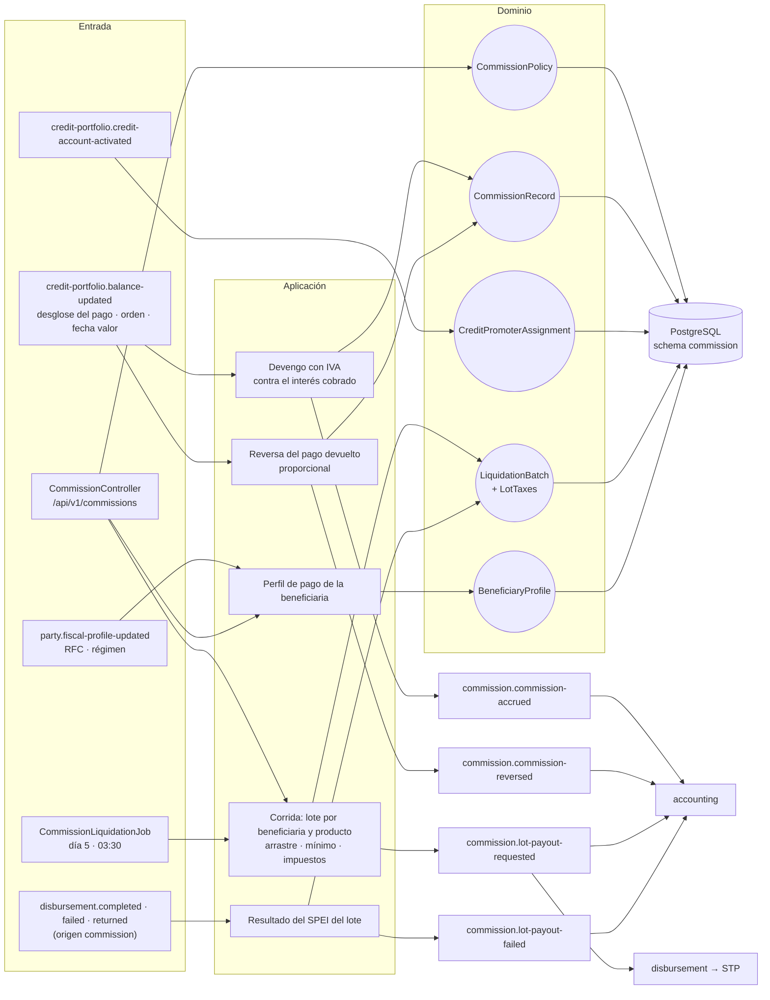
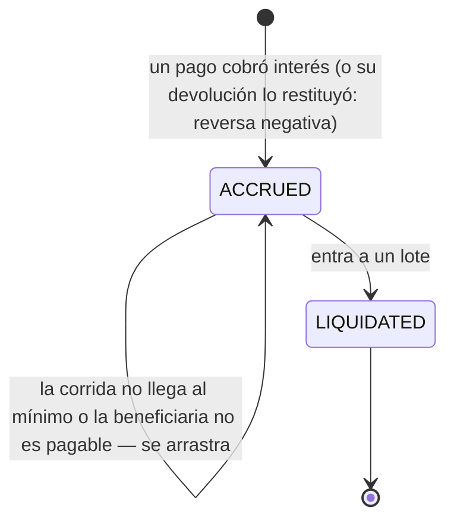

# commission-service (T6)

**Comisiones de la red comercial.** Devenga lo que cada crédito le genera al promotor o
distribuidor que lo originó, lo acumula y lo **liquida** en corridas, con reversa cuando el crédito
se cae. Es el consumidor natural de la resolución `promoterCode → distribuidor` que hace
originación.

| | |
|---|---|
| **Puerto** | `8097` (bootRun) · `:8080` interno en Docker |
| **Schema** | `commission` |
| **Arquitectura** | Hexagonal + Spring Modulith |
| **Régimen Kafka** | Por defecto (sin DLT) |
| **Dominio** | [docs/dominios/T6_commission.md](../../docs/dominios/T6_commission.md) |

---

## 1. Mapa del servicio



---

## 2. Dominio

| Agregado | Rol |
|---|---|
| `CommissionPolicy` | Regla de cálculo por producto/segmento — `DRAFT` · `ACTIVE` · `DEPRECATED` |
| `CommissionRecord` | Comisión de un pago, con su IVA, o la reversa (negativa) que un pago devuelto le hace — `ACCRUED` → `LIQUIDATED` |
| `CreditPromoterAssignment` | Vínculo crédito → promotor o distribuidor beneficiario, con el producto |
| `LiquidationBatch` | Lote: lo que se le debe a una beneficiaria por un producto, con sus impuestos y su SPEI — `PENDING` → `SENT` → `CONFIRMED` (un SPEI fallido lo regresa a `PENDING`) |
| `BeneficiaryProfile` | A quién se le paga: RFC y régimen (de party) y la CLABE de pago |
| `AccountBalanceShadow` | Saldo de interés por crédito: sólo para productores que no mandan el desglose del pago |

### Tipos de comisión

| `CommissionType` | Cuándo se devenga | Para quién |
|---|---|---|
| `DISTRIBUTOR_INTEREST_SHARE` | Por pago cobrado (*trailing*, contra cobranza) | Distribuidor B2B2C |
| `ORIGINATION_FEE` | Una sola vez, al activar | Promotor de red propia (B2C) |
| `COLLECTION_BONUS` | Por pago recuperado en un caso asignado | Gestor de cobranza |
| `RENEWAL_BONUS` | Al reactivar o renovar el producto | Promotor original |

> `DISTRIBUTOR_INTEREST_SHARE` se devenga **contra el interés efectivamente cobrado**, no contra el
> facturado: una comisión que se paga sobre lo que nadie cobró es un quebranto con otro nombre.



### Impuestos, arrastre y pago por el carril

- **Base.** El interés ordinario que cobró **ese** pago, del desglose que publica cartera (`interestDelta`). La resta
  de saldos entre entregas sólo queda para productores viejos: se rompía en cuanto dos hechos del crédito se cruzaban.
- **IVA.** La beneficiaria factura comisión + 16 % de IVA: el registro guarda los dos.
- **Reversa exacta.** La devolución nombra su orden de pago (`PAYMENT_RETURNED:<orden>`); se revierte la comisión de
  ese pago en proporción al interés restituido, como un registro negativo. Si el original ya se pagó, la reversa se
  descuenta del siguiente lote de la misma beneficiaria y producto. Antes se revertía «la más reciente» del crédito.
  Si el pago devengó más de una vez en el crédito (su interés se cobró en dos movimientos), el interés restituido se
  reparte del devengo más antiguo al más nuevo y se gasta una sola vez: con bases de 600 y 400, una devolución de 500
  revierte 150 del primero, no 150 + 120. Cada reversa lleva la llave `<evento>:<original>`, con la que también se
  reconoce una devolución reentregada.
- **Lote por beneficiaria y producto, con arrastre.** La corrida toma todo lo `ACCRUED` hasta el período; lo que no
  llega al mínimo ($500 de comisión, configurable) se queda y lo suma la siguiente. Antes tomaba sólo lo de su mes, y
  en el E2E se devengaron $4,294.96 en ocho meses sin abrir un solo lote.
- **Retenciones.** A una persona física (RFC de 13) se le retiene ISR (10 %, o 1.25 % en RESICO) y dos terceras partes
  del IVA; el SPEI paga el neto. Una beneficiaria sin RFC o sin CLABE de pago espera: su comisión se arrastra.
- **Pago por el carril.** El lote publica `commission.lot-payout-requested`; disbursement ordena el neto a la CLABE
  (origen `COMMISSION`, partida `LOTE:<id>`, una orden por intento). Liquidado, el lote queda `CONFIRMED`; rechazado o
  devuelto, vuelve a `PENDING` con el motivo y la siguiente corrida lo pide otra vez.
- **Bitácora de corridas.** Cada corrida queda en `liquidation_runs` (período, hora, lotes, arrastre, en espera,
  reintentos): es la que dice hasta qué período todo lo abierto tiene que tener razón.

### Comisión neteada (la línea de distribuidora)

La distribuidora no cobra su comisión por transferencia: **la descuenta de lo que entrega** contra cada estado de
cuenta, como lo hace el mercado de vales. La regla es del producto (`distributorCommission` en el catálogo: 18 % de
lo que pagan sus clientes si entrega a tiempo, 14 / 11 / 7 % uno, dos y tres días tarde, nada después, `NETTED`) y
la aplica **cartera** al pagar el estado: publica `balance-updated` con `triggerEvent = COMMISSION_NETTED` y el
bloque `commission` (ciclo, fecha límite, días tarde, tasa del escalón, base —lo que pagaron sus clientes ese
estado— e importe). Este servicio lo registra tal cual (`CommissionRecord.netted`): estatus **`COMPENSATED`** desde
que nace, `settlement = NETTED`, sin IVA (es un descuento sobre su entrega, no un pago que se le hace), con
`cycle_number`, `due_date` y `days_late`; publica `commission-accrued` para que contabilidad reconozca el gasto
(5104 → 2120) y el propio asiento de cartera lo compensa (2120 → 1203/1201). Nunca entra a un lote. El pago de una
línea neteada (`commissionSettlement = NETTED` en su `PAYMENT_APPLIED`) no devenga nada más; una devolución del pago
llega como `COMMISSION_NETTED_REVERSED` y produce la reversa negativa del mismo registro, una sola vez. La política
`DISTRIBUTOR_INTEREST_SHARE` del 18 % sigue para quien se pague por lote.

### Autoverificación

El servicio se revisa a sí mismo, con sus propios datos (`GET /self-checks?period=`, mismo contrato que el cierre
contable: código, en orden, bloquea, partidas, importe, detalle):

| Comprobación | Debe cumplirse | Qué compara |
|---|---|---|
| `LOTES_SUMAN_SUS_REGISTROS` | sí | comisión, IVA y número de registros de cada lote contra sus registros (las reversas descontadas cuentan con su signo) |
| `NETO_DE_CADA_LOTE` | sí | total = comisión + IVA; neto = total − ISR − IVA retenidos |
| `RETENCIONES_POR_REGIMEN` | sí | lo retenido contra lo que pide el régimen vigente de la beneficiaria (misma regla `LotTaxes`) |
| `REVERSAS_SIN_EXCESO` | sí | ninguna reversa toma más de lo que su devengo devengó (D57) |
| `ARRASTRE_EXPLICADO` | sí | lo que la última corrida dejó sin lote: bajo el mínimo, sin datos de pago, o con lote del período ya abierto |
| `LOTES_SIN_DESENLACE` | informa | lotes enviados hace más de dos días sin liquidar ni rechazar (lo que dejaron D58–D59 en la demo) |
| `LOTES_POR_REINTENTAR` | informa | lotes cuyo pago falló y esperan la siguiente corrida, con su motivo |

---

## 3. API REST — `/api/v1/commissions`

| Método | Ruta | Descripción |
|---|---|---|
| `GET` | `/accounts/{creditAccountId}` | Comisiones generadas por un crédito |
| `GET` | `/beneficiaries/{partyId}/pending` | Lo devengado pendiente de liquidar |
| `GET` | `/beneficiaries/{partyId}/profile` | Perfil de pago: RFC, régimen, si se le retiene, CLABE y qué le falta para pagarle |
| `PUT` | `/beneficiaries/{partyId}/payout-account` | Registra la CLABE de pago (`FINANCE`, `ADMIN`) |
| `GET` | `/lots?period=YYYYMM` | Lotes del período con impuestos, neto, intentos y estado del SPEI |
| `GET` | `/promoters/credits` | Créditos por promotor |
| `GET` · `POST` | `/policies` | Catálogo de políticas |
| `POST` | `/liquidation-runs` | Disparar una corrida a mano: lotes abiertos, grupos arrastrados, beneficiarias en espera, reintentos |
| `GET` | `/self-checks?period=YYYYMM` | Autoverificación: lotes, neto, retenciones, reversas y arrastre (sin período, todo) |

---

## 4. Jobs programados

| Job | Cron | Qué hace |
|---|---|---|
| `CommissionLiquidationJob` | `0 30 3 5 * *` | Día 5 de cada mes, 03:30 — liquida lo devengado hasta el mes anterior (arrastre incluido) y reintenta los SPEI fallidos |

---

## 5. Eventos Kafka

**Consume:** `credit-portfolio.credit-account-activated` (crea el vínculo) · `credit-portfolio.balance-updated`
(devenga contra el pago y revierte contra su devolución) · `party.fiscal-profile-updated` (RFC y régimen de la
beneficiaria) · `disbursement.completed` / `failed` / `returned` de origen `commission` (el SPEI del lote).

**Produce:** `commission.commission-accrued` · `commission.commission-reversed` (a **accounting**) ·
`commission.lot-payout-requested` (a **disbursement**, que ordena el SPEI, y a **accounting**) ·
`commission.lot-payout-failed` (a **accounting**). `commission.commission-liquidated` ya no existe: el dinero sale
con la orden STP, no con un aviso.

**Reintentos:** régimen por defecto, sin DLT.
Ver [README raíz §5.4](../../README.md#54-política-de-reintentos-y-dlt-kafka).

---

## 6. Persistencia y ejecución

Schema `commission`, 11 changesets Liquibase bajo `db/changelog/commission/` (011: bitácora de corridas).

```bash
./gradlew :commission-service:test
docker compose up -d commission-service
```

---

## Convención de idioma

**Todo el código de este servicio se escribe en inglés** — clases, métodos, campos, enums, pruebas
y claves de configuración. Los **comentarios van en español**, que es donde vive el razonamiento.

Excepciones: los nombres que viajan en el contrato de un proveedor externo, y los términos
regulatorios sin equivalente (`CLABE`, `CURP`, `RFC`, `CEP`). Detalle y guía de migración en
[`docs/CONVENCION_IDIOMA.md`](../../docs/CONVENCION_IDIOMA.md).
