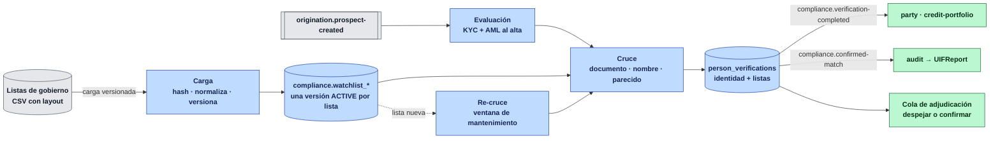
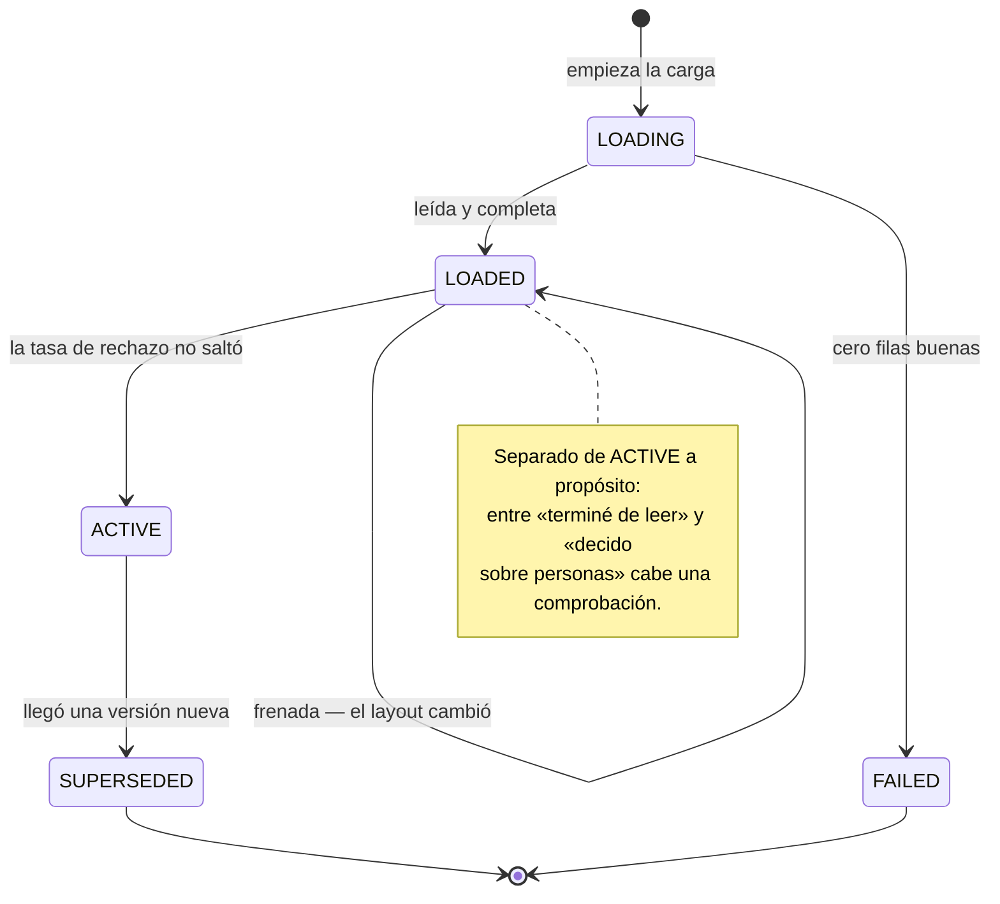
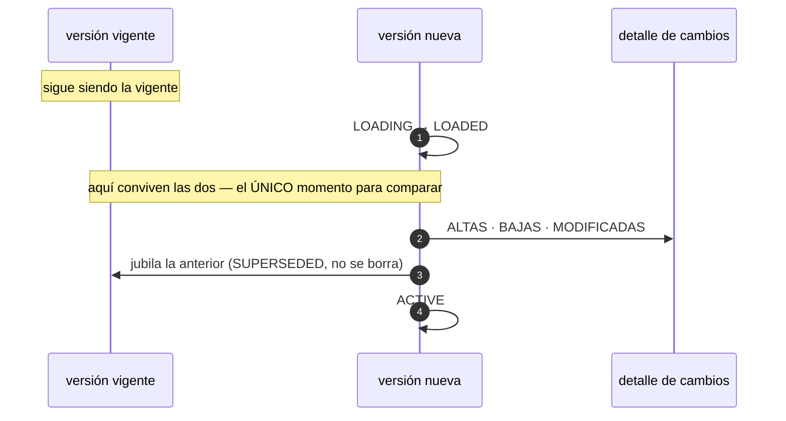
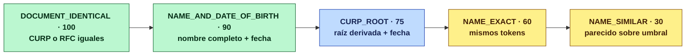
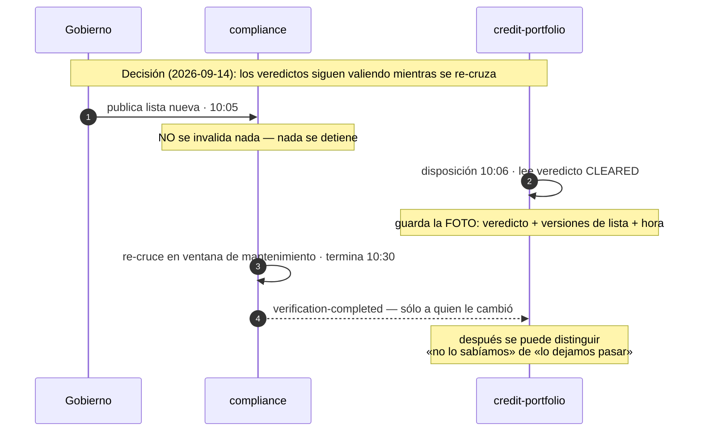

# compliance-service (D16)

> **Quién puede operar y quién no.** Corre KYC y AML sobre cada persona al darse de alta, mantiene
> las listas de gobierno cargadas y versionadas, y emite el veredicto que las compuertas consultan
> antes de originar crédito o dejar salir dinero. **Decide**; la constancia regulatoria la lleva
> `audit` (T3).

| | |
|---|---|
| **Puerto** | 8105 |
| **Schema** | `compliance` |
| **Consume** | `origination.prospect-created` |
| **Produce** | `compliance.verification-completed` · `compliance.confirmed-match` |
| **Régimen Kafka** | por defecto (sin DLT) |
| **Proveedor de KYC** | **no hay contrato** — toda identidad va a revisión manual |
| **Proveedor de listas** | mock determinista con archivos sucios |
| **Pruebas** | 81, de ellas 17 contra Postgres real |

## Mapa del servicio



## Por qué existe

Hasta ahora no había **nada** de AML en la plataforma. `PartyService.blacklistParty` recibe un
`sourceList`, lo publica y **nunca consulta ninguna lista**; el endpoint que marca a alguien no
tiene un solo llamador; `UIFReport` no tiene escritor. La bandera `amlRequired` del catálogo viaja
del producto al servicio que verifica y **muere ahí**. Es decir: hoy nadie es comprobado contra
ninguna lista al registrarse.

El análisis completo, con evidencia línea a línea, está en
[`docs/ANALISIS_KYC_AML_POR_PERSONA.md`](../../docs/ANALISIS_KYC_AML_POR_PERSONA.md).

## Las cinco reglas de cargar una lista bien

Cada una existe porque su ausencia produce un fallo **silencioso** — nada revienta, y el control
deja de controlar.

### 1 · Una carga es una versión, no una mutación

Cargar contra la tabla viva convierte cualquier fallo a mitad de archivo —red, formato, disco— en
una ventana donde quien todavía no se insertó **sale limpio**. Esa ventana no deja rastro.

Así que se carga en una versión que nadie consulta y sólo se activa cuando termina completa. La
anterior queda `SUPERSEDED` y **no se borra**: un veredicto emitido ayer tiene que poder explicarse
contra la lista que se usó ayer.



`LOADED` y `ACTIVE` están separados a propósito: terminar de leer y pasar a decidir sobre personas
son dos hechos distintos, y entre ellos cabe una comprobación.

### 2 · Idempotente por hash del contenido

Las sincronizaciones se reintentan, se solapan y alguien las dispara a mano cuando duda. El mismo
archivo dos veces tiene que no hacer nada — y la única forma de saber que es el mismo archivo es su
contenido: los publicadores renombran y refechan sin cambiar lo que dicen.

Está en dos sitios y hacen falta los dos. El servicio comprueba antes de escribir; el índice único
`uq_watchlist_version_hash` es lo que de verdad lo impide cuando **dos sincronizaciones se solapan**
y las dos leen antes de que la otra escriba.

### 3 · Se normaliza al CARGAR, no al consultar

Si cada consulta normaliza por su cuenta, dos servicios que llamen con el mismo nombre pueden
obtener resultados distintos. Y el día que cambie la normalización, los nombres guardados dejan de
corresponder con los que se buscan: el índice deja de servir **sin que nada falle**. Guardar la
forma normalizada convierte eso en una migración explícita —hay que recargar— en vez de una
degradación muda.

Se guardan dos formas y la segunda no es redundante:

| Campo | Para qué |
|---|---|
| `normalized_name` | mayúsculas, sin acentos, sin puntuación, espacios colapsados |
| `sorted_name` | los mismos tokens en orden alfabético |

El ordenado existe porque **las listas no coinciden en el orden**: unas traen «APELLIDO APELLIDO
NOMBRE», otras «NOMBRE APELLIDO APELLIDO», y algunas lo mezclan dentro del mismo archivo. Comparar
la cadena tal cual falla con la misma persona escrita al revés.

Y dos decisiones que van contra la intuición: **la Ñ se conserva como N** —es como la escriben los
sistemas que no la manejan, y son muchos— y **las partículas se conservan**: «DE LA CRUZ» no se
reduce a «CRUZ», porque quitarlas multiplica los falsos positivos.

### 4 · Una fila mala no tumba la carga; un archivo sin filas buenas sí

Los CSV de gobierno vienen sucios: campos vacíos, dos formatos de fecha en el mismo archivo, líneas
truncadas, comillas sin cerrar, relleno («---», «N/D»), duplicados. Abortar al primer defecto
significa **no tener lista**, y no tener lista significa que todo el mundo pasa.

Cada fila mala se rechaza con su **número de línea, su motivo y la línea cruda**, y la carga sigue.
Se guardan, no sólo se cuentan: «se rechazaron 812 filas» no permite arreglar nada; «la línea 4 417
no traía nombre» sí.

Lo que **no** se tolera es cero filas buenas. Una lista de sancionados vacía no existe: si lo
parece, fue la descarga o el layout. Activarla dejaría pasar a todo el mundo.

### 5 · Si la suciedad se dispara, no se activa

Se compara la tasa de rechazo con la de la carga anterior. **No el nivel, el salto**: hay listas que
siempre traen un 15 % de basura y está bien. Lo que delata un layout cambiado es que de pronto haya
muchos más.

Pasar del 2 % al 40 % no es una lista peor, es otra lista — y activarla dejaría fuera al 38 % de
quienes deberían estar dentro sin que nada fallara. La versión queda `LOADED` y alguien mira los
rechazos.

> El umbral son 20 puntos porcentuales. No es una cifra fina y no pretende serlo: separa «hoy vino
> algo más sucio» de «esto ya no es el mismo formato».

## El detalle por actualización — el rastro de la lista

Al activarse una versión se calcula **qué cambió** respecto a la anterior de la misma lista. Es el
rastro de la **fuente**, distinto del rastro de la **persona**: el veredicto dice qué se decidió
sobre alguien; esto dice qué decía la lista y desde cuándo.



Con esto, la pregunta que de verdad se hace tiene respuesta directa:

| Pregunta | Respuesta |
|---|---|
| ¿Por qué esta persona quedó señalada el 14? | su entrada se **añadió** en la versión publicada el 3 |
| ¿Por qué dejó de estarlo? | se **retiró** en la siguiente actualización |
| ¿Cambió algo de ella? | **modificada**: le corrigieron la fecha de nacimiento |

### Cómo se reconoce «la misma entrada» entre dos versiones

Las publicaciones de gobierno **casi nunca traen un identificador estable**, así que la identidad se
deriva del contenido y se calcula al cargar:

| Llave | Qué es | Para qué |
|---|---|---|
| `identity_key` | nombre normalizado + CURP + RFC | **quién es** |
| `content_hash` | todos los campos | **qué dice** |

Con las dos separadas, corregir una fecha de nacimiento sale como `MODIFIED` en vez de como una baja
y un alta — que es lo que pasaría comparando el contenido entero, y diría justo lo contrario de lo
ocurrido.

> **La contrapartida, dicha:** si el publicador corrige el **nombre**, cambia la identidad y sí se
> ve como baja + alta. No hay forma de evitarlo sin un identificador que el publicador no da.

**La primera carga de una lista no se detalla entrada por entrada**: serían cientos de miles de filas
diciendo «todo es nuevo». Se registra una sola fila `INITIAL_LOAD` con el total — es la línea base, y
lo que un revisor mira son los cambios contra ella.

## El layout es un dato, no código

Cada publicador entrega lo suyo: separador, encoding y nombres de columna. Escribir un parser por
lista significa un despliegue cada vez que una dependencia de gobierno cambia una cabecera — y
cambian sin avisar.

| Lista | Separador | Encoding | Columna de nombre |
|---|---|---|---|
| `OFAC-SDN` | `,` | ISO-8859-1 | `NOMBRE` |
| `PEP-MX` | `,` | UTF-8 | `NOMBRE COMPLETO` |
| `SAT-69B` | `\|` | ISO-8859-1 | `CONTRIBUYENTE` |

**El encoding se declara, no se detecta.** Leer Latin-1 como UTF-8 no revienta: produce «PEÑA» en
vez de «PEÑA», que normaliza a algo que no es de nadie. Hay una prueba que lo demuestra
(`DirtyCsvParsingTest#latin1MustBeDeclared`).

## El mock entrega archivos SUCIOS a propósito

Un mock que devuelve un CSV impecable hace pasar un parser que se rompería con el primer archivo
real. `MockGovernmentListAdapter` reproduce lo que de verdad llega: acentos inconsistentes, dos
formatos de fecha, líneas truncadas, relleno, duplicados y Latin-1.

Y es **determinista** —la semilla sale del código de la lista y de la fecha de publicación, no del
reloj—. Sin eso, cada llamada daría otro hash y la idempotencia no sería comprobable: la segunda
carga siempre parecería nueva.

Se registra con `@ConditionalOnMissingBean`: el día que exista el adaptador real, éste desaparece
sin tocar una línea de quien lo usa.

## El CURP, que es el único identificador que se puede reconstruir

**Siempre se cruza por CURP.** El problema es que las listas casi nunca lo traen — y ahí es donde
este servicio hace algo que ningún otro dato permite.

El CURP acompaña a una persona **desde que nace**, y sus diez primeros caracteres **no los asigna
nadie: se calculan** de los apellidos, el nombre y la fecha de nacimiento. Eso significa que se
pueden **derivar para las entradas de lista que no publican CURP**, que son la mayoría.

```
PEREZ GARCIA JUAN · 1985-03-12   →   PEGJ850312
│    │      │       │                ││││└─┴─┴── fecha AAMMDD
│    │      │       │                │││└─ inicial del nombre
│    │      │       └────────────────┘││
│    │      └── inicial del materno ──┘│
│    └── primera vocal interna ────────┘
└── inicial del paterno
```

### Qué gana sobre comparar nombres

Usa **iniciales**, no nombres completos, así que absorbe las variantes de escritura de forma
determinista y **sin umbral que calibrar**: `GONZÁLEZ` y `GONZALES` dan la misma raíz; `JOSÉ` y
`JOSE LUIS` también, porque sólo cuenta la inicial del primer nombre. Y a la vez es **más estricta**
que un nombre, porque lleva dentro la fecha de nacimiento exacta: dos homónimos nacidos en días
distintos dan raíces distintas.

Se guardan **dos** por entrada, una por cada orden de lectura, porque las listas mezclan
«APELLIDO APELLIDO NOMBRE» y «NOMBRE APELLIDO APELLIDO» —a veces dentro del mismo archivo— y adivinar
sale más caro que comparar dos cadenas de diez caracteres.

### Lo que NO hace, y hay que decirlo

- **No calcula el CURP completo.** Los caracteres 11 a 16 llevan sexo y estado de nacimiento, que las
  listas no publican, y los dos últimos los asigna RENAPO: **no son derivables**.
- Por eso una raíz derivada es una **hipótesis fuerte, no una identificación**, y su evidencia vale
  menos que un CURP real y más que un nombre suelto.
- **No rescata a una lista sin fechas de nacimiento.** Sin fecha no hay raíz, y esa fuente queda
  fuera del cruce por documento — sólo la alcanza el cruce por nombre.
- **No sirve para extranjeros**, que son la mayoría de una lista de sanciones internacional.

### El orden de la evidencia



Cuando una entrada cae por varios caminos se reporta **una vez, con la evidencia más fuerte**:
reportarla por la raíz cuando además coincidió el nombre completo le quitaría fuerza a lo que de
verdad se encontró.

### Cuánto recupera, medido

Cada carga guarda `entries_with_curp_root` junto a las otras coberturas, y el log lo publica. Sobre
las fuentes del mock:

| Lista | CURP publicado | Con raíz derivada | **Alcance del cruce por CURP** |
|---|---|---|---|
| `OFAC-SDN` | 36.51 % | 25 entradas | **76.19 %** |
| `PEP-MX` | 54.84 % | 14 entradas | **77.42 %** |
| `SAT-69B` | 0.00 % | 0 | **0.00 %** — no publica fecha; su documento es el RFC |

Ese último renglón es el que justifica medirlo: sobre `SAT-69B`, «cruzamos por CURP» sería un control
**apagado**, y sin el número nadie lo notaría. El aviso de la carga mira el **alcance**, no lo que el
publicador entrega.

## Persistencia — schema `compliance`

Ocho changesets Liquibase bajo `db/changelog/compliance/`. Siete tablas, y la separación entre ellas
es el diseño:

| Tabla | Qué guarda | Por qué está aparte |
|---|---|---|
| `watchlist_versions` | una carga = una versión, con su hash y su estado | activar no muta: la anterior se conserva, porque un veredicto de ayer se explica con la lista de ayer |
| `watchlist_entries` | las filas normalizadas de cada versión | se cruza contra éstas, no contra el archivo |
| `watchlist_row_rejections` | las filas que no se pudieron usar, con línea y motivo | «se rechazaron 812 filas» no arregla nada; «la 4 417 no traía nombre» sí |
| `watchlist_version_changes` | altas, bajas y modificadas de cada actualización | contesta «¿por qué quedó señalado el día 14?» sin comparar dos publicaciones a mano |
| `person_verifications` | el veredicto **vigente** de cada persona | es lo que consultan las compuertas; se sobrescribe |
| `screening_checks` | **cada consulta**, append-only | porque el veredicto vigente se sobrescribe y por sí solo no distingue «no lo sabíamos» de «lo dejamos pasar» |
| `rescreen_runs` | cada corrida de re-cruce: cuándo, cuánto tardó, a cuántos cambió | sin esto, «¿se re-cruzó tras la lista del día 3?» no tiene respuesta |

Dos reglas de la plataforma que este servicio respeta y conviene no descubrir a la mala:

* **`ddl-auto: validate`.** El esquema lo manda Liquibase; si el mapeo JPA y el changeset discrepan,
  el contexto no levanta — y por eso una IT que sólo arranca Spring ya prueba el esquema.
* **Un changeset aplicado no se edita.** Cambiarlo rompe el checksum y Liquibase se niega a arrancar
  contra una base que ya lo tenía. Se añade uno nuevo. (Pasó en esta rama con
  `credit-portfolio/022` y costó una restauración.)

## Qué NO hace todavía

| Falta | Nota |
|---|---|
| **Adaptador de Incode/Jumio** | Sin él toda identidad va a revisión manual, que es el modo vigente del catálogo. Ya **tiene salida** (`POST /verifications/{id}/identity`), pero la firma un analista por cada persona |
| Sincronización de la carga | Las listas se declaran en `fintech.compliance.watchlists`; bajarlas sigue siendo manual |
| Pantalla de la cola | Las dos APIs de adjudicación existen; el backoffice todavía no las consume, y no hay endpoint que **liste** lo pendiente — hoy se llega por el id de la verificación |
| Presentar el reporte UIF | `audit` ya **abre** el expediente al confirmar una coincidencia, y nace `PENDING` porque alguien tiene que presentarlo. El envío a la autoridad no está |
| Comparar conjuntos de candidatos al re-cruzar | Hoy un re-cruce con candidatos devuelve a la cola aunque sean los mismos que ya se adjudicaron |

### Y una advertencia para quien construya la consulta

**El resultado de un screening no es «sí/no».** Buena parte del cruce sigue siendo por nombre —la
raíz derivada sube el alcance por documento, pero no lo lleva al 100 % y hay listas donde no llega a
nada— y el nombre no identifica: «JUAN PÉREZ GARCÍA» coincide con decenas de personas. Modelarlo como booleano tiene dos salidas y las dos son malas: con el umbral bajo se
bloquea a media cartera, con el umbral alto el control es decorativo.

Hacen falta **tres estados**: `CLEARED`, `POTENTIAL_MATCH` (bloquea, y lo despeja una persona) y
`CONFIRMED_MATCH`. Y todo veredicto lleva **la versión de lista** contra la que se corrió: las listas
cambian, y alguien despejado hace seis meses puede estar hoy.

## Correr

```bash
./gradlew :compliance-service:bootRun          # 8105
./gradlew :compliance-service:test             # 138 pruebas, 30 contra Postgres real
```

### API

| Método | Ruta | Para qué |
|---|---|---|
| `GET` | `/verifications/by-party/{partyId}` | el veredicto — lo que consultan las compuertas |
| `GET` | `/verifications/by-prospect/{prospectId}` | el mismo veredicto por la llave que tienen los flujos de alta |
| `GET` | `/verifications/by-prospect/{id}/checks` | **el historial de consultas**: cuándo, por qué, contra qué listas y qué salió |
| `POST` | `/verifications` | **evaluar bajo demanda.** Idempotente por prospecto |
| `POST` | `/verifications/{id}/adjudicate` | despejar o confirmar **listas**, con autor y argumento |
| `POST` | `/verifications/{id}/identity` | dictaminar la **identidad**, con autor y argumento |
| `POST` | `/rescreen` | disparar un re-cruce a mano |
| `GET` | `/rescreen-runs` | las corridas: cuándo, cuánto tardaron, a cuántos cambiaron |
| `GET` | `/watchlists/versions/{id}/changes` | **qué cambió** en esa actualización: altas, bajas, modificadas |

#### Las dos colas tienen salida, y las dos piden firma

Un veredicto tiene **dos mitades que se resuelven por caminos distintos**, así que hacen falta dos
puertas:

* `/{id}/adjudicate` resuelve **listas**. Es lo que saca a los homónimos —el caso común— de un
  bloqueo que la persona no puede resolver por sí misma.
* `/{id}/identity` resuelve **identidad**. Mientras no haya adaptador de Incode/Jumio, por aquí pasa
  el **100 %** del volumen: toda identidad nace en `IN_REVIEW`. Esta puerta faltaba —el caso de uso
  existía y no tenía un solo llamador de producción—, así que la cola tenía entrada y no salida.

Las dos exigen **autor y argumento**. La asimetría anterior —listas con firma obligatoria, identidad
sin nada— no tenía fundamento: las dos son decisiones regulatorias sobre una persona, y las dos
tienen que poder sustentarse ante una revisión.

### La bitácora de consultas — el rastro que pide la norma

`person_verifications` guarda el veredicto **vigente** y **se sobrescribe**: cada re-cruce pisa el
anterior. Eso contesta «¿puede operar hoy?» y no contesta lo que pregunta una revisión:

> «El 3 de septiembre le dieron un crédito a esta persona que **hoy** aparece en una lista de
> sancionados. ¿La consultaron? ¿Cuándo? ¿Qué decía la lista **ese** día?»

Con sólo el veredicto vigente la respuesta es «hoy está señalada», que **no distingue
«no lo sabíamos» de «lo dejamos pasar»**. Y ésa es exactamente la distinción por la que se responde.

`screening_checks` guarda **cada consulta**, y es **append-only**: el agregado no tiene un solo
mutador y no hay sentencia `UPDATE` sobre esa tabla en todo el servicio. Un registro de auditoría que
se puede editar no sustenta nada.

| Qué guarda | Por qué ese campo |
|---|---|
| `checked_at` | la prueba de diligencia es **cuándo se miró**, no qué se concluyó |
| `result` | «estaba limpia el día 3» es una afirmación distinta de «está señalada hoy», y las dos conviven |
| `list_versions` | sin esto el resultado **no es reproducible**; `NULL` significa que **no había listas** — «no se comprobó nada», que no es «salió limpia» |
| `trigger_reason` | `ONBOARDING` · `RESCREEN` · `ON_DEMAND`. Cambia **lo que la consulta demuestra**: diligencia al dar entrada, vigilancia continua, o que alguien preguntó |
| los datos del sujeto | nombre, CURP, RFC, fecha **con los que se consultó**: si la persona corrige su nombre después, el resultado de entonces sólo se explica con el nombre de entonces |
| `candidate_count` + el más fuerte | distingue «no coincidió con nadie» de «coincidió con cuatro y se descartaron» — que es trabajo hecho y hay que poder mostrarlo |

#### Se escribe también cuando nada cambió

Es lo contrario de lo que sugiere el instinto —«guarda sólo lo que cambió»— y es el punto: lo que la
norma pide demostrar es **que se miró**. Un re-cruce que confirma que alguien sigue limpio es
diligencia ejecutada, y guardar sólo los cambios dejaría el expediente de la persona más limpia de la
cartera **completamente vacío** — con lo que «nunca la cruzamos» se vería igual que «la cruzamos doce
veces y siempre salió limpia».

#### Dónde se engancha, y por qué no dentro del cruce

`ScreeningService.screen` es una **consulta pura**: entra una persona, sale un veredicto, no toca
nada. Eso es lo que permite probar la lógica de coincidencias con un repositorio en memoria, y
convertirla en escritora obligaría a cada una de esas pruebas a cargar con una tabla que no le
importa.

La garantía que sí hace falta es otra —**que todo veredicto registrado tenga su consulta
registrada**— y se sostiene donde se registran los veredictos: `PersonVerificationService` y
`RescreenService`, los dos únicos sitios, con pruebas que afirman el emparejamiento.

> La bitácora **no propaga su propio fallo**: si no se puede escribir, el veredicto —que es lo que
> detiene el dinero— ya está decidido y no se tira por eso. Quedarse sin constancia es malo; dejar
> pasar a alguien por no haber podido escribirla sería peor. El fallo sale en ERROR.

#### `POST /verifications` — y por qué hace falta si el alta ya evalúa sola

El disparador normal es `origination.prospect-created`. Hay una población para la que ese evento
**ya pasó**: la gente que existía antes de que este control existiera. No tiene verificación, y sin
verificación queda bloqueada en todas las compuertas — no por una decisión, sino por una ausencia.

Es el **mismo caso de uso** que el listener con otro adaptador de entrada, y es **idempotente por
prospecto**, así que remediar una población se puede reintentar sin pisar ninguna adjudicación ya
firmada. Lo usa [`scripts/remedia-verificaciones.py`](../../scripts/remedia-verificaciones.py), que
cruza y **reporta el padrón** — sin firmar identidades, porque eso lo hace una persona.

### El re-cruce, y la ventana que el negocio asumió



## Convención de idioma

> **Todo el código se escribe en inglés.** Ver
> [`docs/CONVENCION_IDIOMA.md`](../../docs/CONVENCION_IDIOMA.md) para la regla completa y sus tres
> excepciones: contratos de proveedores externos, términos regulatorios sin equivalente, y
> comentarios y documentación.
