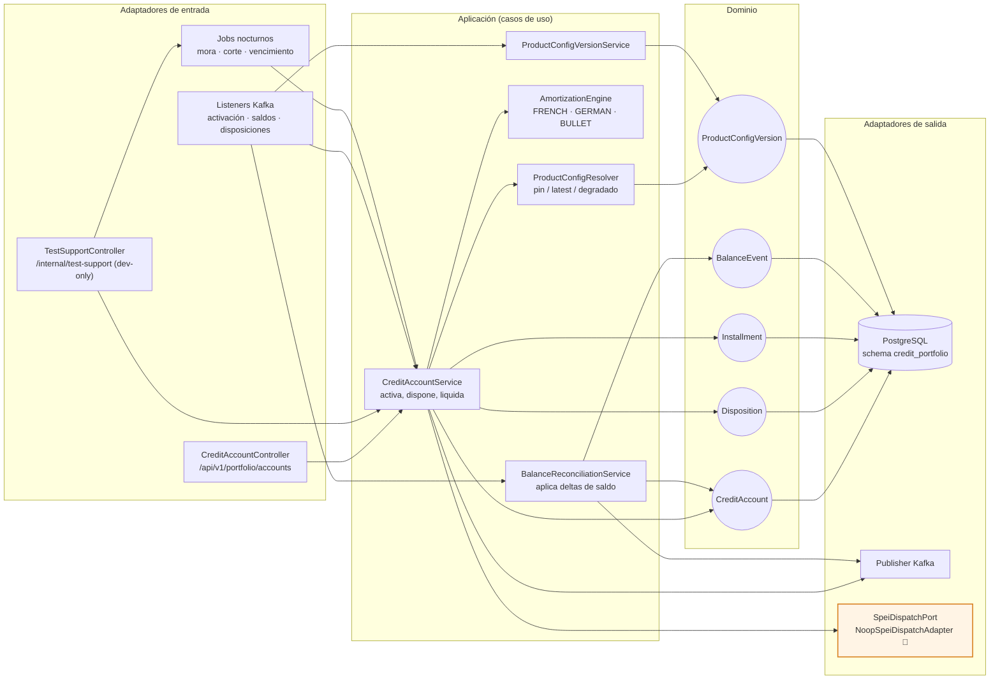
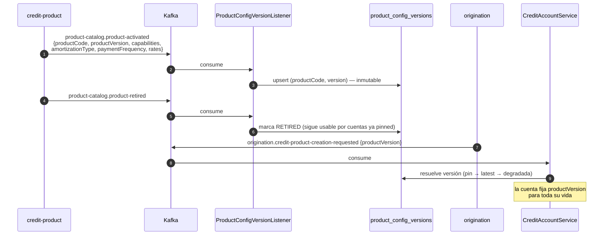
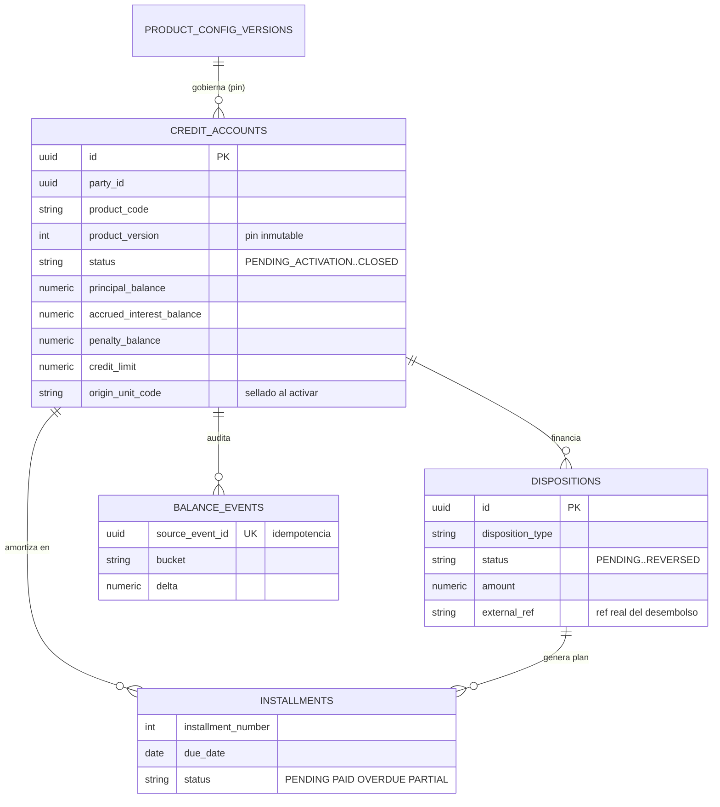
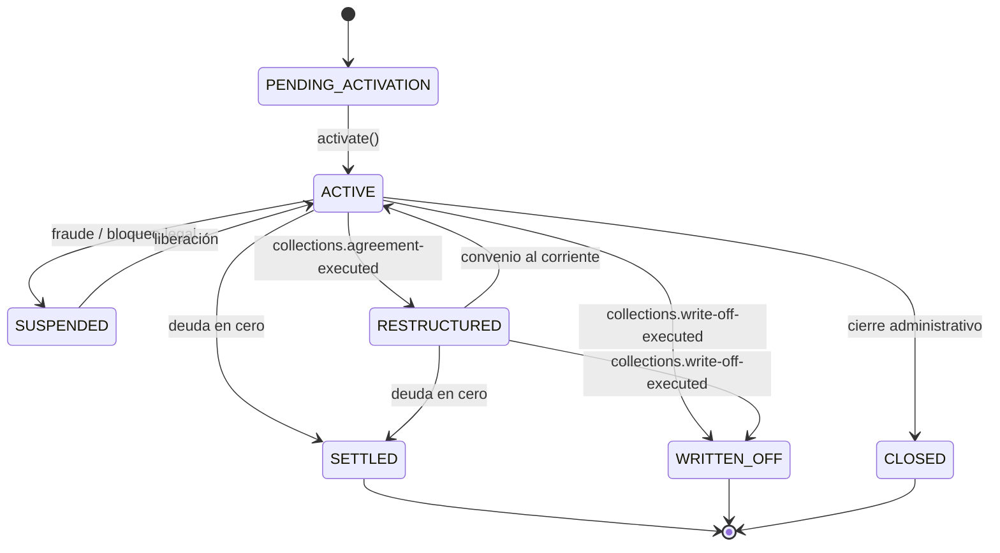
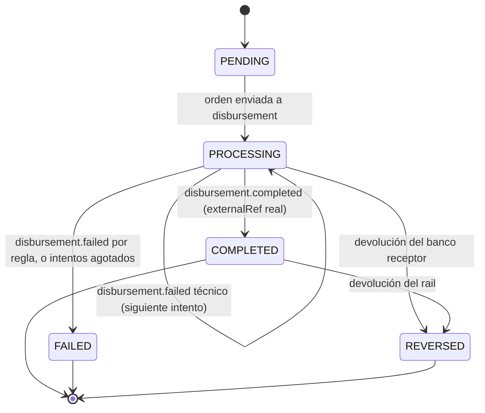
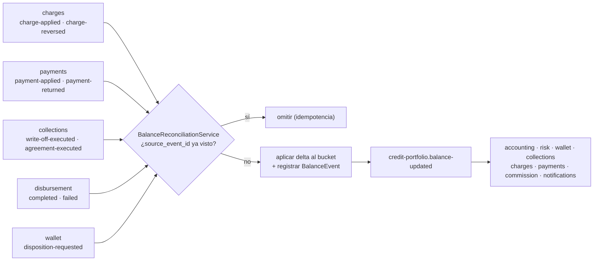
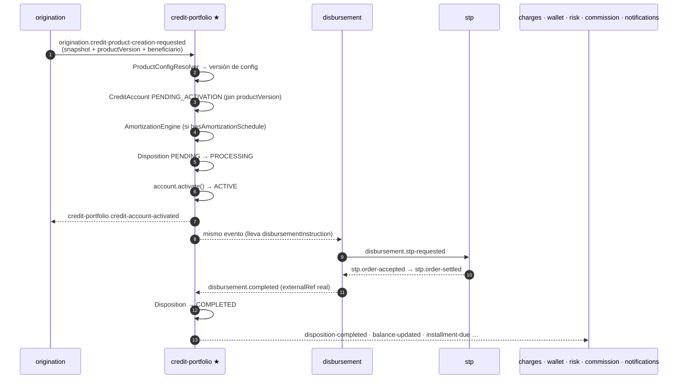
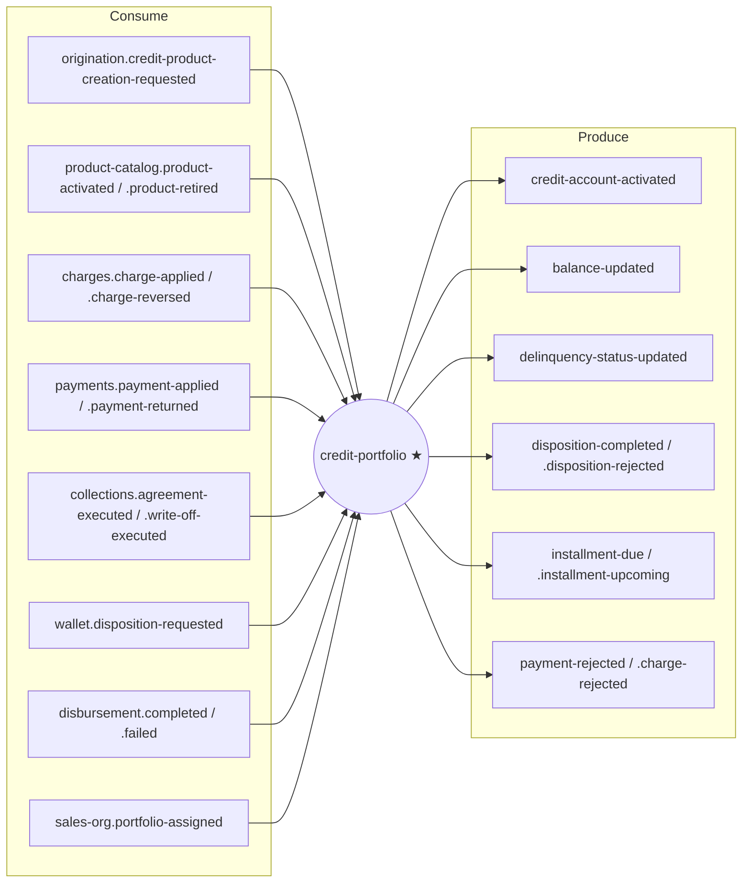
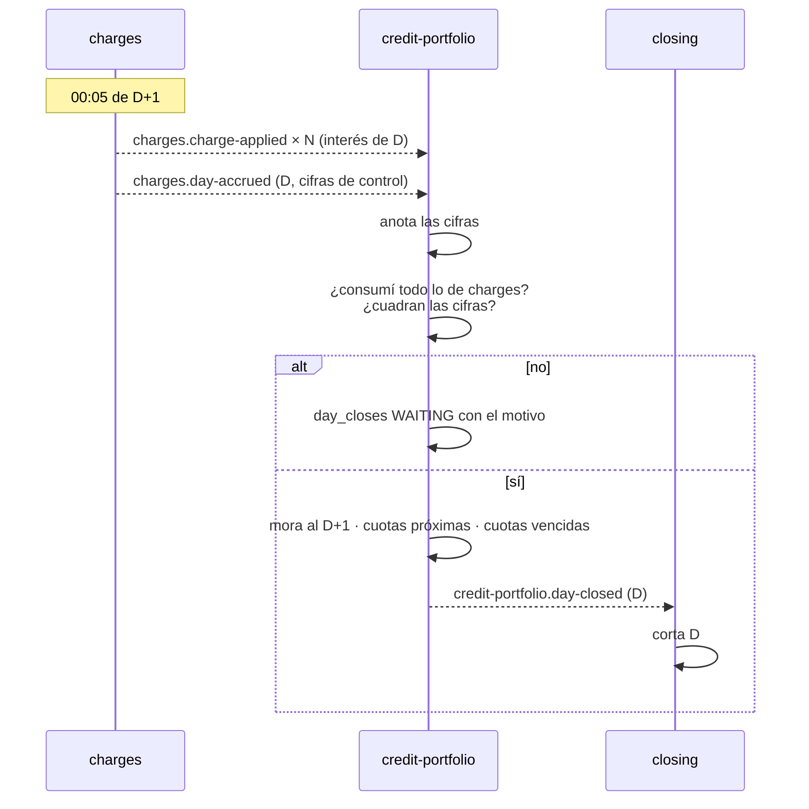
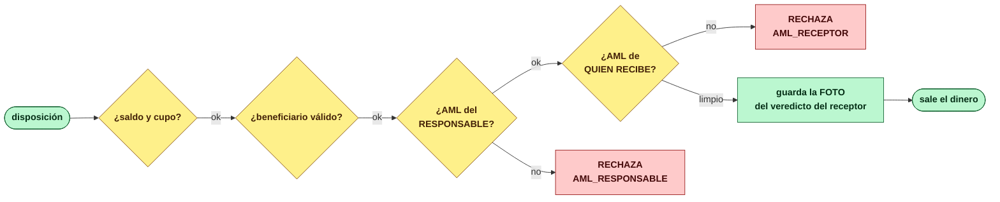

# credit-portfolio-service ★ (D4★)

**El corazón del core crediticio.** Única fuente de verdad de los saldos y dueño de la cuenta de
crédito viva: desde que se activa hasta que se liquida, se quebranta o se cierra. Es un **motor
config-driven**: lo que hace con una cuenta lo decide la configuración versionada del producto, no
una cadena de `if (productType == …)`.

> **No confundir con [credit-product-service](../credit-product-service/README.md) (D4).**
> credit-product define **qué es** un producto (catálogo, tasas, reglas de elegibilidad).
> credit-portfolio administra **las cuentas que ya existen** (saldos, disposiciones, amortización, mora).

| | |
|---|---|
| **Puerto** | `8087` (bootRun) · `:8080` interno en Docker |
| **Schema** | `credit_portfolio` |
| **Arquitectura** | Hexagonal + Spring Modulith |
| **Régimen Kafka** | Por defecto (sin DLT) — ver [README raíz §5.4](../../README.md#54-política-de-reintentos-y-dlt-kafka) |
| **Dominio** | [docs/dominios/04b_credit_portfolio_domain.md](../../docs/dominios/04b_credit_portfolio_domain.md) |

---

## 1. Mapa del servicio



🧪 = adaptador simulado en local. Ver [§7](#7-dependencias-externas-y-sus-simuladores-locales).

---

## 2. Modelo de configuración: propagación versionada

La config del producto **no se congela como copia** dentro de cada cuenta: se **propaga** desde
credit-product como versiones inmutables, y cada cuenta **fija** (`pin`) la versión con la que fue
originada. Es la aplicación de ADR-001 (read models locales, cero llamadas REST cross-dominio).



- Un cambio de configuración es una **versión nueva**; no toca las cuentas existentes.
- **Fallback degradado**: si la versión aún no propagó al momento de activar, se materializa una
  config degradada desde el snapshot de origination y se reconcilia (*clear degraded*) cuando llega
  el evento autoritativo. Se prefiere una cuenta activa marcada como degradada a una activación
  perdida.

### Motor por *capabilities*, no por `productType`

| Capability | Gobierna |
|---|---|
| `hasAmortizationSchedule` | Genera tabla de amortización al desembolsar |
| `hasCreditLimit` · `allowsMultipleDispositions` | Lógica revolvente (cupo, disposiciones múltiples) |
| `dispositionType` | `SELF_USE` · `THIRD_PARTY_CREDIT` · `PAYROLL` |
| `hasCutoffDate` · `hasMinimumPayment` | Estado de cuenta revolvente |
| `commissionsEnabled` · `requiresBeneficiaryPartyId` | Línea de distribuidor (T6) |

**Amortización config-driven:** métodos `FRENCH` (cuota fija), `GERMAN` (capital fijo) y `BULLET`
(interés periódico + capital al vencimiento), cruzados con frecuencias `WEEKLY` / `BIWEEKLY` / `SEMI_MONTHLY` / `MONTHLY`.
`SEMI_MONTHLY` es la quincena del producto: las cuotas vencen en sus dos días de corte (`cutoffDays` del ciclo de
facturación; la línea de distribuidora corta el 6 y el 21), en los cortes de la línea. La primera cuota de una colocación
cae en el primer corte después del día en que se coloca y lleva la parte de la quincena en que se tuvo el dinero
(colocada el 10, 11 de los 15 días que terminan el 21); la anualidad se resuelve sobre ese primer periodo, así que las
cuotas son iguales (12 pagos son 12 quincenas). Diferimientos, saltos de pago y apoyos mueven las cuotas por los mismos días.

**CAT de cada colocación (`PlanCost`, Circular 21/2009).** La vista del estado de cuenta trae el CAT del plan de cada
colocación: la tasa anual a la que sus pagos (capital e interés, sin IVA) valen lo que se entregó, en periodos uniformes
(24 quincenas al año). El primer pago se cuenta a la fracción de quincena que de verdad pasó: contarlo a una quincena
entera hacía ver una colocación del día anterior al corte más barata de lo que es ($1,000 a 6 quincenas leía 96.7 %).
Así, toda colocación al 95 % cuesta lo de su tasa, 153.9 %–154.3 %.

**IVA del periodo.** La foto diaria trae, junto al interés de los periodos que vencen el día, su IVA (`scheduled_tax`),
cuota por cuota y redondeado como lo paga cada cliente. charges cobra ese IVA: el 16 % del interés total redondeado una
vez quedaba a un centavo o dos de lo que pagan los clientes, y las filas del estado de cuenta no sumaban su total.

**La comisión de la distribuidora, neteada de su entrega.** Es configuración del producto (`distributorCommission`,
publicada con la versión): su parte de **todo lo que pagan sus clientes** (capital, interés e IVA de cada cuota;
18 %), la misma cada quincena, si entrega el estado a más tardar su fecha límite; menos cada día después (14 %, 11 %,
7 %) y nada desde el cuarto. Se escribe en el plan de cada colocación al colocar (`installments.scheduled_commission`,
`DistributorCommissionSchedule`): plana por cuota y **topada al interés del plan** —sale del interés, nunca del
capital—; como el interés francés viene cargado al principio, el interés acumulado de la colocación siempre alcanza
para la comisión acumulada, y la primera quincena corta (colocó la víspera del corte) carga sólo lo que su día de
interés permite y difiere el resto a la siguiente. Abajo de 12 quincenas el 18 % de lo cobrado rebasa el interés
(155 % a 6), por eso el producto coloca de 12 a 24. Al pagar un estado, la cartera lo netea
(`BalanceReconciliationService` → `CommissionNetting`): la comisión del estado al escalón del día en que entró el
dinero se aplica primero, al interés y luego al capital, como asiento `COMMISSION_NETTED` con su propia llave
(`COMMISSION_NETTED:<orden>:<ciclo>`), y después el efectivo paga IVA, moratorio, interés restante y capital; un
pago parcial no gana nada hasta que el estado se completa, y el que lo completa fija el escalón; una devolución del
pago revierte el neteo (`COMMISSION_NETTED_REVERSED`). El neteo cubre el estado como cubre el efectivo
(`StatementCoverage`, la foto diaria y el atraso lo cuentan). El evento `balance-updated` lleva `commissionSettlement`
y, en el neteo, `commission` (ciclo, fecha límite, días tarde, tasa, base, importe) para commission-service y
contabilidad. La vista del estado trae la escalera (`commissionLadder`) y los dos números de cada colocación: su
comisión por pago y lo que el total de la comisión es del interés del plan (`commissionShareOfInterest`, 86 % a 12
quincenas, 51 % a 24).

**Bloqueo en mora y rangos del producto.** Una línea que paga comisión a una distribuidora no coloca mientras un
estado de cuenta esté vencido sin pagar: desde el primer día de atraso hasta que paga lo vencido, el mismo día
(`PlacementGate`, calculado al momento sobre los estados y los pagos, no un estatus). La cuenta lo expone
(`placementBlocked`, `placementBlockReason`, `overdueStatementsAmount`), el canal lo niega en la puerta y la cartera
lo rechaza al autorizar (`LINE_BLOCKED_IN_ARREARS`). Una **quita** es la salida de la distribuidora: desde ese día
la compuerta rechaza toda colocación, al corriente o no (`LINE_CLOSED_AFTER_QUITA`), y al liquidar lo que resta la
cuenta pasa a `CLOSED` (`closure_reason = QUITA`, `closed_at`; migración 049), con lo que riesgo, cobranza, cargos y
cierre la dan por terminada. Monto y plazo se validan contra los límites del producto (`AMOUNT_BELOW/ABOVE_*`,
`TERM_*`): $1,000–$10,000 y 12–24 quincenas en pasos de 2; el paso de $500 del monto es del selector de la app, no
de cartera. La vista del estado (`statement-view`) trae la comisión de cada cuota (`InstallmentLine.commission`) y el
día en que una quita cerró la línea (`lineClosedOn`).

**La base del moratorio es el capital vencido.** En la línea de distribuidora el estado pide capital, interés e IVA;
la foto diaria toma como `overdue_principal` sólo el capital de las cuotas que ese estado facturó y sigue sin pagar
(proporcional si lo pagó en parte), y charges cobra el moratorio sobre eso. Cobrar sobre el importe del estado era
cobrar interés sobre interés.

**Lo que factura cada estado de cuenta.** Un estado factura una vez las cuotas de los planes que vencen hasta su fecha
límite, y desde entonces vencen en esa fecha. En la quincena, nunca una fechada en el corte siguiente aunque los días
inhábiles muevan la fecha límite hasta él: es del estado siguiente (`BillingCycle.lastBillableDay`). En Semana Santa el
estado del 6 de abril de 2025 se paga el 21, día del corte siguiente. Facturar hasta la fecha límite le pedía a la
distribuidora el capital de la cuota del 21 una quincena antes de que existiera su interés, y las filas del estado no
sumaban su total (E2E «dist2»). La facturación del corte (`CycleBillingService`) y la vista del estado
(`StatementViewService`) aplican la misma regla.

**Lo que paga una liquidación anticipada.** Pagar toda la deuda de una línea marca pagadas las cuotas de sus planes que
ningún estado facturó: se pagó su capital, no el interés de periodos que no corrieron. La foto no cuenta su interés en
su fecha. Contarlo le cobró a una distribuidora que liquidó en diciembre el interés de sus colocaciones viejas en enero,
en cuanto una colocación nueva le dio capital (D06). En un préstamo a plazo, una cuota adelantada sí pagó su interés y
lo sigue debiendo en su fecha: la regla es sólo de productos revolventes.

---

## 3. Dominio

| Agregado | Tabla | Rol |
|---|---|---|
| `CreditAccount` | `credit_accounts` | Cuenta viva: saldos, tasas, estado, CLABE, `product_version` fijada |
| `Disposition` | `dispositions` | Cada desembolso contra la cuenta (`SELF_USE`, `THIRD_PARTY_CREDIT`, `PAYROLL`) |
| `Installment` | `installments` | Renglón de la tabla de amortización |
| `BalanceEvent` | `balance_events` | Auditoría inmutable de cada delta de saldo + llave de idempotencia |
| `ProductConfigVersion` | `product_config_versions` | Read model versionado de la config del producto (capabilities JSONB) |



### Máquina de estados — `CreditAccount`



`SETTLED`, `WRITTEN_OFF`, `CLOSED` y `CANCELLED` son **terminales** (`CreditAccountStatus.isTerminal()`).
`CANCELLED` es el crédito a plazos cuyo único desembolso no pudo hacerse (D63): nunca prestó nada.

### Máquina de estados — `Disposition`



> Una línea revolvente que se paga **no** se liquida: vuelve a quedar disponible. El cierre a
> `SETTLED` sólo aplica cuando el producto no permite disposiciones múltiples.

### Desembolso que no se realiza (D63)

`DisbursementOutcomeService` lleva la saga. Dispersión dice si otro intento puede servir (`retryable`,
de su `FailureCode`):

- **Falla técnica** (enlace, orden que STP nunca registró, ruta o empresa sin configurar): se pide el
  siguiente intento, una orden nueva con la misma instrucción (el beneficiario queda guardado en la
  disposición), después de su espera (`credit-portfolio.disbursement.retry`: 3 intentos, el segundo a
  la hora y el tercero seis horas después: el acreditado sabe el mismo día si llega el dinero). El
  desenlace de un intento viejo se ignora.
- **Falla por regla** (PLD, cuenta inválida, cancelada), intentos agotados o **devolución** del banco
  receptor: se compensa de inmediato. El capital y el cupo vuelven (`DISPOSITION_FAILED` /
  `DISPOSITION_RETURNED`, con su desglose y su llave), el plan se cancela (cuotas `CANCELLED`) y un
  crédito a plazos queda `CANCELLED`. Publica `credit-portfolio.disposition-failed` (notificaciones,
  colocaciones) y, si canceló el crédito, `credit-portfolio.credit-account-cancelled`: cargos reversa
  lo que cobró, contabilidad reversa las cuentas de orden y deja la comisión fuera del CFDI, originación
  cierra la solicitud como desembolso fallido. Riesgo cierra el perfil y libera la reserva.

Una cuenta `CANCELLED` sólo acepta la reversa de sus cargos; un pago se rechaza (queda como saldo a favor)
y un cargo tardío también. La reversa de un cargo que nunca entró no se asienta: cargos puede mandarla al
compensar antes de oír el rechazo, y aplicada sacaba de contabilidad un ingreso que nunca se registró. La autoverificación `CANCELADAS_EN_CERO` exige que quede en cero y sin cuotas
vivas. D68: la guarda de disposición única cuenta también la que está en vuelo.

---

## 4. Balance engine ★

El patrón de ADR-001: **los demás calculan, portfolio aplica.** charges, payments y collections
nunca escriben saldos — emiten hechos. `BalanceReconciliationService` los aplica sobre la fuente de
verdad, los audita en `balance_events` y republica `balance-updated`.

```
totalDebt       = principalBalance + accruedInterestBalance + penaltyBalance
availableCredit = creditLimit − principalBalance − pendingDispositions      [revolventes]

Jerarquía de pago:  1) penaltyBalance → 2) accruedInterestBalance → 3) principalBalance
```



| Evento entrante | Efecto en el saldo |
|---|---|
| `charges.charge-applied` (`ORDINARY_INTEREST`) | `accruedInterestBalance +=` |
| `charges.charge-applied` (mora / comisiones) | `penaltyBalance +=` |
| `charges.charge-reversed` (reversa o condonación) | Revierte del bucket original, nunca por debajo de cero (**CP-02**) |
| `payments.payment-applied` | Reduce en jerarquía; en revolventes libera cupo; evalúa `settleIfClear` |
| `payments.payment-returned` | Restaura la deuda |
| `collections.write-off-executed` | Todos los saldos a cero → `WRITTEN_OFF` (terminal) |
| `collections.agreement-executed` | Reestructura el plan → `RESTRUCTURED` |
| `disbursement.completed` / `.failed` | Cierra la disposición con el `externalRef` real |

> **Idempotencia:** cada evento entrante trae un `eventId`; `balance_events.source_event_id` es
> único. Una reentrega (*at-least-once* de Kafka) se detecta y se descarta.

---

## 5. Flujo de activación y desembolso



---

## 6. API REST

**Base:** `/api/v1/portfolio/accounts` · Swagger local: `http://localhost:8087/swagger-ui.html`

| Método | Ruta | Descripción |
|---|---|---|
| `GET` | `/` | Listado paginado de cuentas |
| `GET` | `/search` | Búsqueda por criterios de cartera |
| `GET` | `/batch` | Resolución en lote por ids (evita N+1 desde los BFF) |
| `GET` | `/{creditAccountId}` | Detalle de la cuenta |
| `GET` | `/{creditAccountId}/amortization-schedule` | Plan de pagos de la cuenta |
| `GET` | `/{creditAccountId}/dispositions` | Disposiciones de la cuenta |
| `GET` | `/{creditAccountId}/dispositions/{dispositionId}/schedule` | Plan de pagos de una disposición |
| `GET` | `/stats` · `/summary` · `/product-mix` | Agregados de cartera |
| `GET` | `/stats/by-origin-unit` | Cartera agrupada por unidad **de origen** (ver §11) |
| `PUT` | `/{creditAccountId}/origin-unit` | Corrige la unidad de origen sellada |

### Endpoints de soporte (dev-only, `/internal/test-support`)

Apagados salvo `TEST_SUPPORT_ENABLED=true`; el gateway **no** enruta `/internal/*`.

| Método | Ruta | Para qué |
|---|---|---|
| `POST` | `/run-day-close?date=` | La parte de cartera en el cierre de un día, por las mismas compuertas: `CLOSED`, o `WAITING` con el motivo |
| `POST` | `/run-delinquency-job` | Sólo recalcular la mora al día de hoy |
| `POST` | `/run-upcoming-installment-job` | Disparar el aviso de cuota próxima |
| `POST` | `/run-installment-due-job` | Marcar cuotas vencidas |
| `POST` | `/accounts/{id}/installments/{n}/shift-due-date` | Mover la fecha de una mensualidad |
| `POST` | `/dispositions/{id}/age-schedule` | Envejecer un plan completo |

---

## 7. Dependencias externas y sus simuladores locales

| Dependencia real | Puerto de salida | Adaptador local | Comportamiento simulado |
|---|---|---|---|
| SPEI / BANXICO (camino heredado) | `SpeiDispatchPort` | `NoopSpeiDispatchAdapter` | Confirma el envío al instante y devuelve `SPEI-STUB-XXXXXXXX` |

> Este stub es el **camino heredado**. El camino vivo del dinero es
> `credit-account-activated → disbursement-service → stp-service`, que sí modela la orden, la firma
> y la conciliación (con su propio stub de red, ver [stp-service](../stp-service/README.md)). El
> `externalRef` que termina en la disposición es el **real** que devuelve disbursement, no el del stub.

---

## 8. Eventos Kafka



**Aún no emite** `credit-portfolio.disposition-authorized`: disbursement ya lo consume (camino
wallet `THIRD_PARTY`), pero el emisor es el entregable 2B.2. Hoy el desembolso se dispara sólo
desde `credit-account-activated`.

**Reintentos:** régimen por defecto de la plataforma (`DefaultErrorHandler`, reintento acotado y
*seek-past*; sin DLT). Deserialización tolerante: `USE_TYPE_INFO_HEADERS=false`,
`TRUSTED_PACKAGES=com.fintech.*`.

---

## 9. El cierre del día

La mora y las cuotas ya no tienen cron propio: corren en el **cierre del día**, que empieza a las 00:05
del día siguiente en charges y sigue aquí cuando llega su aviso —y sólo si el interés del día ya está
completo—.

**Antes de todo, la foto del día.** Cartera es la dueña de los saldos y las cuotas, así que el primer paso
de la noche es suyo: `DaySnapshotRunner` escribe cómo quedó cada cuenta **al terminar D**
(`credit_portfolio.account_day_snapshots`: capital, interés, IVA, mora, capital vencido, cuota más vieja sin
pagar y días de atraso al día D; `day_snapshots` es la bitácora). Lo aplicado con fecha valor posterior a D
se resta, reconstruyendo el delta de cada movimiento contra el anterior (`balance_events` guarda saldos
después, no deltas por rubro), así que la foto es la misma a las 00:05 que a las 03:00. Sus compuertas: D
terminó, D-1 cerrado aquí y los consumidores de pagos y cargos al día. La pide cargos
(`POST /api/v1/portfolio/day-snapshots/{date}`; 200 con la foto, 202 con el motivo), la lee por páginas
(`GET …/day-snapshots/{date}/accounts?after&size`) y closing busca las suyas
(`POST …/day-snapshots/{date}/accounts/lookup`). El cierre de D no pasa sin ella. Para contabilidad y
finanzas, la historia de una cuenta día por día: `GET /api/v1/portfolio/accounts/{id}/day-snapshots?from&to`.
Una foto de 5 000 cuentas con historia y cuotas tarda 79 ms (`DaySnapshotIT`).

**Lo que vence el mismo día va aparte.** Lo que vence en D no es atraso en D (lo es desde D+1), así que la foto de
D no lo cuenta como vencido. Pero un estado de cuenta cortado en D se emite cuando D ya terminó, y lo que el estado
anterior pedía pagar a más tardar ese día y no se pagó ya es atraso en él. En la línea de distribuidora la fecha límite
(el 18 o el 3) queda antes del corte siguiente; coincide con él sólo cuando los días inhábiles la empujan hasta ahí
(Semana Santa), y entonces pasa si la distribuidora no paga ese día.
La foto lo guarda en `statement_due_unpaid` (productos facturados por estado de cuenta, con la misma
`StatementCoverage`): el atraso del estado es `overdue_principal + statement_due_unpaid`, y la conciliación de la
cadena lo coteja (06b).

**La foto comprueba el libro.** Cada fila trae `ledger_total` (la suma de `balance_events` de la cuenta al día D) y
`ledger_gap` (libro menos deuda al día D); el resumen del día cuenta cuántas cuentas no cuadran (`ledger_gaps`) y
el runner lo avisa en WARN. Debe ser cero: el libro tiene que explicar cada saldo. Dos defectos lo rompían antes
del 2 de noviembre de 2026 —el alta no asentaba el capital prestado y la escritura de saldos no tenía candado—;
hoy el alta asienta `ACTIVATION_DISBURSEMENT` y `apply()` toma `SELECT … FOR UPDATE` sobre la cuenta.

El soporte de pruebas puede aplicar un pago sin pasar por payments
(`POST /internal/test-support/accounts/{id}/payments?amount=&reference=`) y desplazar el reloj de negocio
(`/internal/test-support/clock`), que es lo que usa el laboratorio (`tools/lab`).



**Las compuertas.** Se revisan siempre, venga el disparo del aviso, de la reanudación o del soporte de
pruebas:

| Compuerta | Por qué |
|---|---|
| Cargos avisó que devengó D | Sin el aviso no hay cifras de control: cerrar sería cerrar sin interés |
| D-1 está cerrado | Los días se cierran en orden |
| La foto de D existe | Cargos devenga sobre ella; si no está, lo que avisó no salió de ella |
| Cartera consumió todo lo que cargos publicó (`charge-applied`, `charge-reversed`) | El aviso y los intereses viajan por tópicos distintos: el aviso puede llegar primero |
| Los intereses ordinarios y moratorios **del lote del cierre de D** (`day_close_date`) aplicados, más los rechazados, son los que cargos dijo, en número y en importe, **sin las cuentas que cargos dejó fuera** (`heldAccounts`) | Si un mensaje se descartó, aquí se nota y el día espera a que cargos lo reenvíe. Se cuenta el lote y no la fecha valor: un interés del mismo día sembrado a mano no es parte del cierre |

**Cuentas fuera del lote.** Cargos cierra por cuenta: una cuenta que no pudo devengar queda en cuarentena
(o retenida, si le falta un día anterior) y viaja en `heldAccounts` del aviso. Cartera cuadra sin ellas,
las guarda (`charges_day_accruals.held_accounts`) y se las pasa a closing en `day-closed`, que retiene su
corte. Cuando una devenga tarde, cargos avisa `charges.account-accrued` con sus cifras; `AccountDayReleaser`
la suelta con las mismas compuertas en pequeño —el día ya cerró aquí, cartera consumió los cargos, y los
intereses de esa cuenta en el lote cuadran— y avisa `credit-portfolio.account-day-closed` después de
`flush()`. Si todavía no cuadra, queda en `account_day_releases` con el motivo y la retoma la reanudación.

**Compras diferidas: sólo el día de la compra.** Una compra que ya devengó no se parcializa:
`DispositionDeferralService` rechaza diferir una compra de un día anterior. Así nunca hay interés que
reversar, y la reversa parcial —la parte de un cargo diario de la línea que le toca a una compra, que
cargos guardaba con monto negativo y la tabla rechazaba— desapareció.

Si una no abre, el día queda `WAITING` en `day_closes` con el motivo (`waiting_for`). La reanudación
(`DayCloseRetryJob`, `0 10/15 * * * *`, `CREDIT_PORTFOLIO_DAY_CLOSE_RETRY_CRON`) vuelve a intentar los días
avisados y no cerrados, en orden. **Nunca cierra un día que cargos no avisó**; si a las 02:00 cargos sigue
sin avisar ayer, lo dice en el log.

**Los rechazos también cuentan.** Un interés para una cuenta castigada o cerrada se rechaza y se avisa a
cargos, como antes, y además queda en `charge_rejections`: llegó, y cuenta para cuadrar el día. Un reenvío
del mismo cargo no se vuelve a rechazar.

| Paso | Qué hace |
|---|---|
| `DelinquencyCalculationJob.runFor(D+1)` | `daysDelinquent` → `delinquency-status-updated`. **La mora corre desde las 00:00**: la cuota que vencía el 10 y no se pagó amanece el 11 con un día de atraso |
| `UpcomingInstallmentJob.runFor(D+1)` | Cuotas por vencer → `installment-upcoming` |
| `InstallmentDueJob.runFor(D+1)` | Cuotas que vencen hoy o ya vencieron → `installment-due` |
| aviso | `flush()` de todo lo publicado —saldos y mora— y después `credit-portfolio.day-closed` con el día, la fecha de la mora y cuántas cuentas |

**Una vez por día.** `day_closes` toma el día antes de empezar: si el aviso de cargos llega dos veces, la
segunda sólo vuelve a avisar a closing (y cargos lo toma como confirmación), sin recalcular la mora ni
republicar miles de eventos. Un cierre que falló o que se quedó a medias (más de `stale-after`, 2 h) se
retoma.

**Fecha valor.** Cada movimiento del libro (`balance_events.value_date`) lleva el día de negocio al que
pertenece: el devengo de D se aplica pasada la medianoche y es de D. El estado de cuenta arma su periodo
por esta fecha.

**`balance-updated` lleva la fecha valor** (`valueDate`). Con ella closing sella el corte de D con el saldo
al cierre de D, aunque corra después de un pago de las 00:07 de D+1.

Medido (`DayCloseIT`, Postgres y Kafka reales): **~300 cuentas en 0.5 s**, compuertas incluidas. Cada
cuenta en su propia transacción: una que revienta no detiene el barrido.

---

## 10. Persistencia

Schema `credit_portfolio`, 39 changesets Liquibase bajo `db/changelog/creditportfolio/`
(master YAML + SQL; nunca XML). Tabla adicional `event_publication` — outbox de Spring Modulith.

---

## 11. Cartera por unidad de origen

`GET /api/v1/portfolio/accounts/stats/by-origin-unit?unitCodes=E_PAC_1,S_PUE`

Agrupa por `origin_unit_code`: **la unidad que colocó el crédito, sellada al activarlo**. No cambia
aunque la cartera se reasigne — es la decisión del changeset 013, tomada para que la balanza de
marzo siga dando lo mismo en agosto.

**No es lo mismo que «la unidad del ejecutivo que lleva hoy al cliente».** Ésa la responde el
rollup comercial del BFF (`/dashboard/commercial`). Son dos preguntas distintas sobre la misma
cartera: mientras nada se reasigne coinciden, y en cuanto se reasigne una cartera dejarán de
hacerlo. Por eso viajan por endpoints separados y el cuerpo declara su `attribution`.

Devuelve los tres tramos IFRS-9 sin colapsar (`stage1/2/3`) y **no** una provisión ya calculada: la
escala de pérdida esperada vive en el canal, junto al resto del tablero, y duplicarla aquí
garantizaría que un día las dos se separen.

Las cuentas sin sellar se agrupan bajo `(sin unidad)` en vez de repartirse: un hueco visible se
corrige, uno repartido con una heurística no se detecta.

> **Nota de SQL:** el filtro va en **dos consultas** —con y sin `unitCodes`— y no con
> `(:codes IS NULL OR …)`. Ese truco funciona en JPQL pero en SQL nativo Postgres no infiere el
> tipo de una colección nula: `could not determine data type of parameter $1`.

---

## 11b. Las tres reglas que se corrigieron al verificar contra el stack

### BNPL es una solicitud, no una propiedad del producto

`bnplMaxDeferralDays` es un **tope** —el nombre lo dice— y se usaba como la cifra a aplicar, sin
mirar si alguien lo había pedido. Como `PL-IND-STD-V1` trae BNPL habilitado, **ningún préstamo
personal empezaba a pagar cuando debía**: el plan entero nacía corrido el máximo, para todos.

La regla vive ahora en `OpcionesDePago`, con la configuración: es la configuración quien sabe qué
significa cada uno de sus campos, y tenerla suelta en el servicio fue lo que permitió confundir un
límite con un valor.

- Sin solicitud, no hay BNPL. Nulo y cero significan lo mismo: nadie lo pidió.
- Un producto que no lo admite **ignora** la solicitud, no la aplica a la fuerza.
- Pedir de más se **recorta** al tope: el producto ya declaró hasta dónde espera, y negar el alta
  entera por pedir de más convierte un límite en un obstáculo.

Verificado vivo: el que no pide paga a **30 días**; el que pide 30 paga a **61** —treinta más un
período—, que es la regla del plan escrita tal cual.

### 🔴 El apoyo dejaba vencimientos en sábado, domingo y feriado

El programa de apoyo corría N períodos la fecha de pago que encontraba, ya movida al día hábil, y no volvía a pasar
el resultado por el calendario. El 1 de mayo de 2026 es feriado: un plan del día 1 vence el lunes 4, y dos meses
después del 4 es el **sábado 4 de julio**. La demo, con un apoyo de dos meses al préstamo personal, dejó 336 cuotas
en días inhábiles; quien pagaba el lunes siguiente quedaba en atraso, con mora y llamada de cobranza, que es lo que
la convención de día hábil siguiente evita. Además el día del plan se iba corriendo (del 1 al 4), y los cortes, que
salen de la cadencia del plan, dejaban de coincidir con los vencimientos.

Ahora hay **una sola forma** de mover cuotas por períodos del plan, `PlanDeferral`, y la usan el apoyo y el salto de
pago: cada cuota se mueve desde **la fecha de su plan** (la original, si lo único que la separa de la de pago es el
corrimiento al hábil) y el resultado se corre al día hábil siguiente. Dos meses después del 1 de mayo es el miércoles
1 de julio. Una cuota que ya movió un salto o un apoyo se mueve desde la fecha en que vence hoy, así que un segundo
movimiento no deshace el primero. Mover 108 000 cuotas toma 19 ms (`PlanDeferralTest`).

### 🔴 Un crédito no puede estar bajo dos apoyos a la vez

La guarda que existía era **por programa**: impedía reotorgar el mismo lote dos veces. No impedía lo
que pasó de verdad — dos programas **distintos**, cada uno autorizado a diferir tres períodos,
alcanzando la misma cartera. Cuarenta y dos cuentas recibieron los dos y se les corrió el
vencimiento **seis meses**: el doble de lo que nadie autorizó, sin más rastro que dos filas de
inscripción.

Ninguno de los dos programas era incorrecto por separado. **El invariante no es de programa sino de
cuenta.** Si hace falta extender el apoyo se otorga un programa con más períodos, no uno encima de
otro.

El padrón declara ahora `yaApoyadas` junto a `cuentasElegibles`: con sólo «0 elegibles» no se
distingue «el criterio no alcanza a nadie» de «toda esa cartera ya viene de otro programa», y quien
firma necesita esa diferencia **antes** de firmar.

### Las configuraciones de producto se contradicen entre sí, y ahora se dice

Un producto no se configura campo a campo: los campos **se condicionan entre sí**, y una combinación
puede ser inválida sin que ninguno de sus valores lo sea. `OpcionesDePago.incoherencias()` devuelve
cada contradicción con su frase — plazos de diferimiento en un producto que no difiere, huecos o
solapes entre bandas de tasa, un modo de salto declarado sobre un salto apagado, BNPL de cero días.

Cartera **avisa y guarda igual**. Rechazar aquí dejaría al catálogo y a la cartera discrepando, que
es el problema que esto viene a evitar. Con el `WARN`, el día que alguien pregunte «por qué este
producto no deja saltar pagos si el catálogo dice que sí», la respuesta está en el log del arranque
y no en una tarde de bisección.

## 12. Configuración

| Variable | Default | En producción |
|---|---|---|
| `SERVER_PORT` | `8087` | `8080` en Docker |
| `JWT_SECRET` | *(vacío — el filtro se omite si no se configura)* | Obligatorio, compartido con identity |
| `KAFKA_BOOTSTRAP_SERVERS` | `localhost:9092` | Obligatorio |
| `SPRING_DATASOURCE_URL` | `jdbc:postgresql://localhost:5432/fintech` | Obligatorio |
| `SPRING_DATASOURCE_USERNAME` / `_PASSWORD` | `fintech` / `fintech` | Obligatorio |
| `TEST_SUPPORT_ENABLED` | `false` | **Debe quedar en `false`** |

---

## 13. Tests y ejecución local

| Clase | Tipo | Cubre |
|---|---|---|
| `CreditAccountBalanceTest` | Unit | Jerarquía de pago, devengo, reversa, quebranto, cupo revolvente, guards |
| `BalanceReconciliationServiceTest` | Unit | Routing por evento, idempotencia, publicación |
| `AmortizationStrategyTest` | Unit | GERMAN/BULLET/FRENCH × frecuencias |
| `AmortizationEngineTest` | Unit | Plan FRENCH base |
| `CreditAccountServiceTest` | Unit | Activación config-driven |
| `ProductConfigVersionServiceTest` · `ProductConfigResolverTest` | Unit | Upsert/retire/degradado · pin/latest/fallback |
| `DelinquencyCalculationJobTest` · `InstallmentDueJobTest` | Unit | Barridos nocturnos y aislamiento de fallo |
| `CreditAccountActivationFlowIT` | Testcontainers + Kafka | Snapshot → ACTIVE + propagación de config |
| `BalanceReconciliationFlowIT` | Testcontainers + Kafka | Charge/payment → saldo + idempotencia |

```bash
./gradlew :credit-portfolio-service:test

# Local sin Docker
docker compose up -d postgres kafka zookeeper
./gradlew :credit-portfolio-service:bootRun     # → http://localhost:8087

# En el stack
docker compose up -d credit-portfolio-service
```

> **Testcontainers determinista:** el build fija `DOCKER_HOST=unix:///var/run/docker.sock` y
> `TESTCONTAINERS_DOCKER_SOCKET_OVERRIDE` para no depender de un `docker.host` obsoleto en
> `~/.testcontainers.properties`. Ver [README raíz §12](../../README.md#12-tests).

---

## AML en cada disposición — y por qué el KYC no se repite

Originar ocurre **una vez**. Disponer ocurre **decenas de veces durante años** —una revolvente
dispone cada mes, una de distribuidor en cada colocación— y las listas cambian entre una y otra.
Así que la originación es un control de punto en el tiempo y **la disposición es el recurrente**: el
último antes de que el dinero salga.



### Los dos papeles, y por qué son dos

**Toda disposición tiene un beneficiario.** Lo que cambia con el producto es quién es — y en una
línea de distribuidor **nunca** es el titular:

| Producto | Responsable de la línea | Quien recibe el dinero |
|---|---|---|
| `SELF_USE` · `PAYROLL` | el titular | **el mismo titular** — no es que falte beneficiario, es que es él |
| `THIRD_PARTY_CREDIT` | la distribuidora | **la beneficiaria colocada — nunca la distribuidora** |

Se comprueban **los dos**, por razones distintas:

* **al receptor**, porque es a quien se le va a pagar;
* **al responsable**, porque no tiene sentido mover dinero de la línea de alguien que está en listas
  por mucho que el destino sea un tercero — el crédito lo está usando esa persona.

En uso propio los dos papeles caen en la misma persona: una lectura, un veredicto, una comprobación.

Dos reglas previas lo sostienen, y sin ellas el control sería decorativo: una colocación de
distribuidor **exige** beneficiaria (`BENEFICIARY_REQUIRED`) y **prohíbe** que sea la propia
distribuidora (`BENEFICIARY_CANNOT_BE_OBLIGOR`). Sin la primera, una colocación sin beneficiaria
pasaría el AML habiendo mirado sólo a quien **no** recibe el dinero.

> **Una lectura por persona, no dos.** La compuerta y la foto del veredicto usan la **misma** fila:
> leerla dos veces podría devolver algo distinto —la proyección se actualiza por evento— y entonces
> se decidiría con un dato y se archivaría otro. El expediente hablaría de una comprobación que no
> fue la que ocurrió.

### Las dos compuertas son distintas, y esa diferencia es el diseño

```
ORIGINAR:  identidad VERIFIED  ∧  listas CLEARED

DISPONER:  autenticación del RESPONSABLE (NIP + OTP)     ← quien autoriza
         ∧ listas CLEARED del responsable
         ∧ listas CLEARED de QUIEN RECIBE                ← a quien se le paga
         ∧ identidad del responsable no revocada
```

Quien se autentica es **el responsable de la línea**, porque es quien autoriza el movimiento: el
titular en uso propio, la distribuidora en una colocación. **La beneficiaria recibe, no autoriza** —
no hay nada que pedirle en el momento de la disposición; a ella se la comprobó al darla de alta y se
le vuelve a comprobar en listas aquí.

El KYC es el **enrolamiento**; la autenticación es el **uso**. Repetir la biometría en cada
disposición sería pedir una selfie para sacar dinero de la propia línea cada mes: no añade seguridad
y garantiza que el producto se abandone. Lo que sí bloquea aquí es una identidad **revocada**, que es
un hecho distinto de «no verificada».

### La foto del veredicto

Cada disposición guarda qué decía el veredicto **en ese instante**: su estado, contra qué versiones
de lista se calculó y cuándo. No se actualiza nunca después.

Existe porque el negocio asumió la ventana entre que se activa una lista y que termina el re-cruce.
Sin la foto, mirando atrás se vería a una persona hoy señalada y un desembolso que pasó — y no habría
forma de distinguir *«no lo sabíamos»* de *«lo dejamos pasar»*.

## Convención de idioma

**Todo el código de este servicio se escribe en inglés** — clases, métodos, campos, enums, pruebas
y claves de configuración. Los **comentarios van en español**, que es donde vive el razonamiento.

Excepciones: los nombres que viajan en el contrato de un proveedor externo, y los términos
regulatorios sin equivalente (`CLABE`, `CURP`, `RFC`, `CEP`). Detalle y guía de migración en
[`docs/CONVENCION_IDIOMA.md`](../../docs/CONVENCION_IDIOMA.md).
