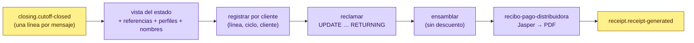

# receipt-service

**Recibos de pago de los clientes de las distribuidoras.** Un PDF por cliente y por estado de cuenta de la línea de su
distribuidora: lo que paga en la quincena por cada préstamo que tiene con ella, **sin el descuento por pronto pago**
(ése es de la distribuidora), cómo pagarlo (la CLABE de cobro de ella con la **referencia de él**) y con quién es la
obligación.

> **Servicio interno.** No está publicado en el gateway: el BFF del backoffice lo consulta por la red interna y decide
> quién puede ver un recibo (su cliente o su distribuidora, nunca un colaborador externo).

| | |
|---|---|
| **Puerto** | `8107` (bootRun) · `:8080` interno en Docker, sin puerto en el host (para poder escalar) |
| **Schema** | `receipt` · paquete `com.fintech.receipt` |
| **Diseño** | `material-kredius/analisis/2026-11-05-recibos-de-pago.md` |
| **Documentos** | [`shared-documents`](../../shared-documents/README.md): modelo, formatos, marca, motor Jasper, Inter y logotipo |

No depende de statement-service: lee el mismo `closing.cutoff-closed` en **su propio grupo de consumo**, al mismo
tiempo que los estados de cuenta, y un producto que no paga a una distribuidora tiene estados y no tiene recibos.

---

## Cómo funciona



1. **Leer una vez por línea.** La vista del estado de cuenta en cartera (`statement-view`, la misma que usa el estado),
   las referencias de pago de sus clientes, sus perfiles (tipo NUEVO / REVOLVENTE y lista roja) y los nombres en party.
2. **Un recibo por cliente con algo facturado.** Los clientes con colocaciones vivas que cobran algo en este estado; el
   que colocó después del corte no tiene recibo todavía. Por construcción, la suma de los recibos de un estado es su
   fila «Pagos de tus clientes».
3. **Registrar, reclamar, generar.** Llave natural `(línea, ciclo, cliente)`: el mismo corte entregado dos veces es el
   mismo recibo. El reclamo atómico reparte el trabajo entre réplicas; uno atorado más de `stale-after` lo toma otra.
4. **Guardar.** El PDF en `receipt_documents` (con su SHA-256) y la **foto** de lo que se imprimió en `snapshot`: una
   regeneración imprime las mismas cifras con el diseño vigente sin preguntar a nadie.

## El recibo

- **Cabecera**: cliente (nombre, RFC, **tipo**: «Cliente revolvente · 2 préstamos pagados»), distribuidora, periodo,
  corte, fecha límite (la del estado de ella) y folio `RC-<corte>-<referencia>`.
- **Tres cifras**: total a pagar (capital + interés + IVA de sus cuotas, sin descuento), fecha límite y préstamos vigentes
  con su distribuidora.
- **Cómo pagar**: la CLABE de cobro de la distribuidora (la de STP, `collectionClabe` de la vista de cartera; nunca la
  CLABE de desembolso de la cuenta) a nombre del emisor, igual que en el estado de cuenta de ella, y la referencia del
  cliente; un depósito así se aplica directo a sus préstamos (payments lo reconoce como `BENEFICIARY`). También puede
  entregarle el pago a ella.
- **Lista roja**: si tiene una marca, la advertencia y qué la quita.
- **Sus préstamos** (n, colocado, monto, pago k de m, capital, interés, IVA, a pagar, saldo insoluto, vencidos) con el
  total, y los que terminó de pagar en el periodo.
- **Quién te presta**: lo genera Kredius; la obligación es con su distribuidora; si no cumple, Kredius puede marcarlo
  para que otras distribuidoras conozcan su comportamiento de pago. Aclaraciones, UNE y la leyenda SOFOM ENR.

La plantilla `reports/recibo-pago-distribuidora.jrxml` la genera `tools/estados-de-cuenta/gen_plantillas.py` (segundo
argumento); no se edita a mano.

## API

| Método | Ruta | Qué |
|---|---|---|
| `GET` | `/api/v1/receipts?creditAccountId=&cycle=&partyId=` | Por línea y ciclo, o de una persona (como distribuidora o como cliente) |
| `GET` | `/api/v1/receipts/{id}` · `/{id}/pdf` | Uno, y su PDF |
| `POST` | `/api/v1/receipts/retry` | Reintenta los fallidos o atorados (también cada 2 min, con ShedLock) |
| `POST` | `/api/v1/receipts/regenerate` | Reimprime desde la foto, con el diseño vigente (`{creditAccountId?, cycle?}`) |
| `GET` | `/api/v1/receipts/status` | Recibos por estado |

## Escalar

`docker compose up -d --scale receipt-service=3`: las particiones de `closing.cutoff-closed` se reparten entre réplicas.
Palancas: `RECEIPT_PARTITIONS` (12) y `RECEIPT_CONCURRENCY` (4 líneas a la vez por réplica). Medido: 53 ms y 72 KB por
recibo (prueba de rendimiento de 200 recibos).

## Entradas / Salidas

| | |
|---|---|
| Consume | `closing.cutoff-closed` (grupo `receipt-service`) |
| Publica | `receipt.receipt-generated` (llave = línea) |
| Lee | credit-portfolio (`statement-view`, `beneficiaries/by-line/{id}/references`, `beneficiaries/profiles`), party (`parties/batch`) |

## Correr

```bash
./gradlew :receipt-service:test        # ensamblador, PDF leído con PDFBox, rendimiento, generación e integración (Postgres + Kafka)
docker compose up -d receipt-service
```

Las muestras de las pruebas quedan en `build/recibos-muestra/`.
