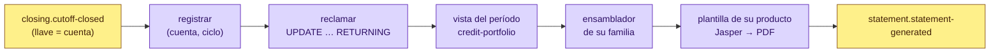

# statement-service (D19)

**Estados de cuenta.** Un PDF por cada corte sellado, con **la plantilla de su producto**, generado con
JasperReports y repartido entre pods por Kafka.

> **Servicio interno.** No está publicado en el gateway: los BFF lo consultan por la red interna y son
> ellos los que deciden si un usuario puede ver el documento de una cuenta.

| | |
|---|---|
| **Puerto** | `8106` (bootRun) · `:8080` interno en Docker, **sin puerto en el host** (para poder escalar) |
| **Schema** | `statement` · paquete `com.fintech.statement` |
| **Diseño** | [docs/CORTE_Y_ESTADOS_DE_CUENTA.md](../../docs/CORTE_Y_ESTADOS_DE_CUENTA.md) |

---

## Cómo funciona



1. **Registrar.** El corte crea su documento por la llave natural `(cuenta, ciclo)`. El mismo corte
   entregado dos veces encuentra el mismo documento.
2. **Reclamar.** Un `UPDATE … RETURNING` atómico: entre dos pods, o dos entregas del mismo mensaje, sólo
   uno lo genera.
3. **Leer.** `GET /api/v1/portfolio/accounts/{id}/statement-view?from&to&dueUntil` en cartera: la cuenta,
   el libro del período (los devengos sumados y los hechos listados), el plan y las colocaciones. Los
   nombres salen de party, por lote.
4. **Ensamblar y llenar.** El ensamblador de la familia convierte todo a texto es-MX y Jasper llena la
   plantilla del producto, ya compilada.
5. **Guardar y avisar.** El PDF se guarda con su SHA-256, la foto de los datos con que se armó queda junto
   a él, y sale `statement.statement-generated`.

Si cartera no responde o la plantilla falla, el documento queda `FAILED` con la causa. El reintento
(cada 2 min, en una réplica) lo vuelve a generar con lo que dijo el corte, que se guardó al registrarlo.

## Una plantilla por producto

Cada producto tiene **su** JRXML: su título, su color, su tabla de detalle y su recuadro de «lo que debes
saber». Se edita por separado en Jaspersoft Studio; cambiar el de la tarjeta no toca el de nómina.

| Producto | Plantilla | Familia | Lo propio |
|---|---|---|---|
| Préstamo personal | `estado-cuenta-prestamo-personal` | plazo | Plan de pagos; cómo se aplica cada pago |
| Préstamo de nómina | `estado-cuenta-prestamo-nomina` | plazo | «Descuentos programados»; qué hacer si el descuento no se aplicó |
| Préstamo grupal | `estado-cuenta-prestamo-grupal` | plazo | «Calendario de pagos del grupo»; el grupo responde en conjunto |
| Microcrédito | `estado-cuenta-microcredito` | plazo | Pagos frecuentes de monto fijo |
| Crédito PyME | `estado-cuenta-credito-pyme` | plazo | «Plan de amortización»; a nombre de la empresa |
| Tarjeta de crédito | `estado-cuenta-tarjeta-credito` | revolvente | Pago mínimo y pago para no generar intereses; la advertencia del pago mínimo |
| Línea revolvente | `estado-cuenta-linea-revolvente` | revolvente | Disposiciones y disponible |
| Línea empresarial | `estado-cuenta-linea-empresarial` | revolvente | «Movimientos de la línea»; a nombre de la empresa |
| Línea de distribuidora | `estado-cuenta-linea-distribuidora` | distribuidora | **Total a pagar en el periodo**: las cuotas de sus clientes que vencen; colocaciones por cliente |

La **familia** decide qué datos se llenan —el ensamblador— y la plantilla, cómo se ven:

| Familia | Lo que destaca | Detalle del producto |
|---|---|---|
| **Plazo** | **Pago a realizar** (lo exigible hasta la fecha límite, atrasos incluidos) o, si la cuota del periodo ya se pagó, **Tu próximo pago (n de m)** con su fecha; saldo insoluto; pagos realizados *n de m*, pagos vencidos y desde cuándo; el pago del periodo desglosado en capital e intereses + IVA. Un crédito liquidado lo dice y hace constar que no hay adeudo | Plan de pagos con las cuotas del periodo marcadas |
| **Revolvente** | **Pago para no generar intereses**, **pago mínimo + compras a meses**, el mínimo sin compras a meses, en cuántos meses se liquida pagando sólo el mínimo y el pago fijo para liquidar en 12 meses | Compras y disposiciones a plazos vigentes: pago *n de m*, lo del periodo y saldo insoluto. Las liquidadas en el periodo, en su propia tabla |
| **Distribuidora** | **Total a pagar en el periodo** | **Colocaciones vigentes** —sólo las que deben al corte—: pago *n de m*, pagos vencidos y «vencido desde», a pagar, saldo insoluto y el CAT de cada una. Las liquidadas en el periodo van aparte, una sola vez, en **Colocaciones liquidadas en el periodo**: plazo, el día en que se liquidaron y si fue por **pago anticipado** o al vencimiento |

El plan de cada colocación o compra a meses se lee **como estaba al corte**: una cuota pagada después del corte
todavía se debía, y una colocación hecha después es del siguiente estado. «Liquidada en el periodo» quiere decir
pagada por completo dentro del periodo, según el día en que se pagó su última cuota (`installments.paid_on`). Con
la fecha de vencimiento de la última cuota, una colocación pagada por adelantado en abril salía como «liquidada en
el periodo» en todos los estados hasta 2027 (DIST0005, cortes 3 a 15), y debajo de «Colocaciones vigentes».

### Lo que la norma exige en cada estado de cuenta

Una SOFOM ENR emite estados de cuenta conforme a las *Disposiciones de carácter general en materia de
transparencia aplicables a las SOFOM ENR* de CONDUSEF (DT-ENR, DOF 11-08-2015), la LTOSF y las circulares de
Banxico. Todas las plantillas llevan, en este orden:

| Qué | Dónde | Fuente |
|---|---|---|
| Denominación con «SOFOM, E.N.R.», RFC, domicilio y contacto | encabezado | DT-ENR 35-I; LGOAAC 87-B |
| Titular, contrato, periodo, corte, fecha límite y aviso de día inhábil | encabezado | 35-II/III; LTOSF 18 Bis 4 |
| Detalle del producto (plan, compras a meses o colocaciones con pago *n de m* y saldo insoluto) | tabla 1 | 36-VI; 37 |
| **Movimientos del periodo** con fecha y descripción (todos los productos) | tabla 2 | 35-IV |
| **Comisiones cobradas** con fecha y concepto, y el **recuadro con su total** aunque sea cero | tabla 3 | 35-V/VI |
| **Costos de tu crédito**: CAT «Sin IVA» con un decimal, tasas ordinaria y moratoria anuales, intereses e IVA del periodo y su base de cálculo | recuadro | 36-IV/IX; 37; LTOSF 9; Banxico C21/2009 |
| Cómo pagar (la **CLABE de cobro** del titular, la de STP que cartera manda como `collectionClabe`, con la referencia del crédito); **aclaraciones** (90 días naturales, folio) y el **aviso UNE/CONDUSEF** | cierre | 35-VII/VIII; LTOSF 23 |
| Leyendas: incumplimiento, historial crediticio (consumo), pago mínimo (revolvente de consumo), obligado solidario (grupal) | cierre | 36-X; 6-IV |
| Leyenda de SOFOM ENR (sin autorización de SHCP; supervisión de CNBV sólo para el art. 56) | pie | LGOAAC 87-J |
| No es comprobante fiscal: el CFDI de intereses y comisiones se emite aparte | pie | CFF 29; RMF 2.7.1.13 no aplica a ENR |

**Pago mínimo de tarjeta (Banxico C13/2011).** El del producto, pero nunca menor que el mayor de *1.5 % del
saldo revolvente sin intereses ni IVA + intereses e IVA* y *1.25 % de la línea*, ni mayor que el saldo. Cartera
lo factura y este servicio lo imprime con la misma regla (`CardMinimumPayment` en los dos).

**CAT.** El del contrato que firmó el cliente (viaja desde la oferta de originación a la cuenta). Para las
cuentas que no lo traen, el de su plan sin comisiones, `(1 + tasa / pagos al año)^pagos al año − 1`, señalado
como «estimado». Cada colocación de una distribuidora trae el de su propio plan (cartera lo calcula con la
Circular 21/2009: capital e interés sin IVA, 24 quincenas al año). Se imprime siempre como porcentaje con un
decimal y «Sin IVA»: llega como fracción, y antes se adivinaba —hasta 1, fracción; arriba, ya porcentaje—, así
que todo CAT de más de 100 % salía como «1.5 %» (la línea de distribuidora al 95 % cuesta 153.9 %).

**Distribuidora: arriba, lo que paga y su descuento.** El estado abre con las tres cifras que lee primero:
**Total a pagar en el periodo**, **Tu descuento por pronto pago** (18 % de lo que pagan sus clientes en este estado)
y **Entregas a más tardar el …** (el total menos ese descuento). Debajo va **Tu pago con descuento por pronto
pago**, la tablita de lo que entrega según el día en que paga: la fecha límite con el descuento completo, cada uno
de los tres días siguientes con menos (14 %, 11 %, 7 %) y, desde el cuarto, el total sin descuento; cuenta el día en
que entra el dinero, domingos incluidos (parámetros `LADDER1..5_*` de la plantilla, desde la escalera de la vista de
cartera). Sin descuento neteado la tabla tiene una fila, el total a la fecha límite, y las cajas vuelven a ser fecha
límite y disponible. El diseño sale de `tools/estados-de-cuenta/gen_plantillas.py` (`ladder=True` sólo en la
plantilla de distribuidora); una sección del cuerpo no empieza al pie de una hoja sin sus filas.

**Distribuidora: su pago, su descuento y cómo se forma el total.** En **Colocaciones vigentes** cada cliente
trae:
- **Pago** *n de m*: el número del pago que cobra este estado. Antes decía cuántos iban pagados, así que una
  colocación nueva salía «0 de 8» en el estado que cobraba su primer pago, y otra vez en el siguiente si no
  se había pagado.
- **A pagar**: capital, interés e IVA de su cuota.
- **Tu descuento** (en el documento la comisión se llama «descuento por pronto pago»; en el sistema sigue siendo
  comisión): la comisión plana que el plan de la colocación fija en las cuotas que **este** estado factura (el 18 %
  de lo que paga el cliente, menos en la primera quincena corta), cuota por cuota desde la vista de cartera
  (`InstallmentLine.commission`). Un pago de un estado anterior que sigue en la tabla (fecha límite movida al día del
  corte, o vencido) se rige por la escalera de su propio estado y va con «—». Cuando la comisión se paga por lote (no
  neteada) la columna es el 18 % del interés, repartido al centavo entre las filas.
- **CAT** de la colocación.

**Cómo se forma tu total a pagar** suma los pagos de sus clientes y, aparte, los moratorios y lo pendiente
de cortes anteriores: al corriente, los pagos de sus clientes son el total, al centavo; la escalera ya no se repite
aquí, está arriba. Si el periodo trae una quita, la línea que resta de las filas dice «Lo que condonó el convenio de
quita del …».
**Tu descuento por pronto pago** muestra los dos números de este estado —su 18 % de los pagos que este estado
factura y lo que eso es del interés del estado, con lo que se queda Kredius— y lo ya aplicado en sus entregas del
periodo, cada una con el día en que pagó y el escalón que ganó (de los registros `COMPENSATED` de
commission-service). Con días de atraso al corte, la nota del producto abre con el aviso de que la línea está
bloqueada para colocar y cuánto debe pagar; tras una quita, con el de que quedó cerrada para colocar
(`lineClosedOn` de la vista). Cuando la comisión se paga por lote muestra lo de antes: lo ganado con los pagos
recibidos, su IVA y lo que falta por depositarle.

Lo lee de commission-service (`GET /api/v1/commissions/accounts/{id}` y `/policies`), y queda en la foto del
estado para regenerarlo igual.

**No se omite ningún estado de cuenta.** La norma no permite dejar de generarlo aunque no haya saldo ni
movimientos (DT-ENR 33-I).

**Datos del emisor** (`fintech.statement.issuer.*`, variables `STATEMENT_ISSUER_*`): denominación, RFC,
domicilio, teléfono, correo y domicilio de la UNE. **El domicilio y los teléfonos no tienen valor real por
omisión**: imprimen «por configurar» hasta que se pongan los de la empresa, en vez de inventar unos.

**Un producto sin plantilla no sale con una genérica.** Su documento queda `FAILED` con «No hay plantilla de
estado de cuenta para el producto X», sin consultar a cartera, y el reintento lo genera en cuanto se
despliegue la suya. Agregar un producto es agregar su JRXML y su renglón en `StatementTemplate`.

Las cifras del recuadro —saldo al corte, pago mínimo, pago para no generar intereses— **son las que
selló el corte**: el documento las presenta, no las recalcula. El «saldo anterior» es el saldo al corte
del estado anterior.

### Las plantillas

`src/main/resources/reports/estado-cuenta-<producto>.jrxml`, formato **JasperReports 7**, editables en
Jaspersoft Studio 7. Lo que es del producto —título, color, recuadro, encabezados de la tabla— es texto
de la plantilla; las cifras llegan por parámetros con el texto ya formateado y la tabla es la fuente de
datos. Se compilan al arrancar: una plantilla rota hace que el pod no arranque. Cada documento
guarda la versión de la plantilla con que salió (`nombre@sha256`).

**Se compilan con JDT (Eclipse), no con el JDK.** Jasper convierte las expresiones de la plantilla en
Java al arrancar, y la imagen corre con un JRE, que no trae `javac`: con el compilador por omisión el pod
no arrancaba, y en las pruebas —que sí tienen JDK— no se notaba. `jasperreports.properties` fija JDT en
todos los ambientes (ECJ 3.40, que conoce Java 21) y `TemplateCompilerTest` compila con él la plantilla de cada producto.

### La marca

El modelo, los formatos, la paleta, el motor Jasper, Inter y el logotipo viven en
[`shared-documents`](../../shared-documents/README.md), que comparte con receipt-service (los recibos de pago de los
clientes de las distribuidoras); las plantillas de los estados siguen aquí.

Las nueve plantillas comparten una sola composición, la del **design system de Kredius**: logotipo arriba a
la izquierda, azul Kredius `#0D47A1` en títulos y reglas, el verde del logo `#00B894` como único acento,
tinta `#0F1A2E`, papel `#EBF0F7`, y **Inter** (Regular, Bold y ExtraBold para la cifra principal). Las genera
`tools/estados-de-cuenta/gen_plantillas.py`; lo que distingue a cada producto es su título, su tabla y su
recuadro, no su color.

**Logo y paleta son configurables** sin tocar las plantillas (`fintech.statement.branding`, variables
`STATEMENT_BRANDING_*`):

| Propiedad | Por omisión | Qué es |
|---|---|---|
| `branding.logo` | `classpath:branding/kredius-logotipo-azul.png` | Recurso de Spring (classpath, archivo, URL), PNG o JPEG. Si no se puede leer, se imprime el nombre del emisor |
| `branding.palette.primary` | `#0D47A1` | Títulos, reglas, el recuadro principal |
| `branding.palette.accent` | `#00B894` | El acento (la regla bajo el logo, la barra del aviso) |
| `branding.palette.ink` / `muted` | `#0F1A2E` / `#7A8296` | Texto / texto secundario |
| `branding.palette.paper` / `soft` / `line` | `#EBF0F7` / `#F6F8FC` / `#EDEFF3` | Rellenos de sección / cebra y tarjetas / divisores |
| `branding.palette.primary-container` / `on-primary-container` | `#D6E4FF` / `#001A42` | Los dos recuadros de contexto y su texto |

Las plantillas están escritas con los valores por omisión; al arrancar, el servicio sustituye cada uno por
el configurado antes de compilar (`JasperStatementRenderer.applyPalette`). Así el JRXML sigue abriéndose
en Jaspersoft Studio tal cual y el color sigue siendo configuración. La versión de plantilla que guarda
cada documento se calcula ya con la paleta aplicada: cambiar un color también cambia la versión.

Inter viaja embebida en el PDF (`fonts/kredius-fonts.xml`, extensión de fuentes de Jasper, `Identity-H`):
el documento se ve igual en cualquier visor y la imagen no necesita la fuente instalada. DejaVu sigue
empaquetada (`jasperreports-fonts`) como respaldo. En Alpine, AWT necesita además `freetype` y
`fontconfig`; el `Dockerfile` los instala sólo para este servicio. `StatementGalleryTest` deja una muestra
de cada producto en `build/estados-muestra/` para revisar el diseño.

### Regenerar lo ya emitido

Cada documento guarda la foto con la que se armó (el corte y la vista de cartera). Cuando cambia el diseño,
`POST /api/v1/statements/regenerate` vuelve a producir los PDF desde esa foto —uno (`?statementId=`), los de
una cuenta (`?creditAccountId=`) o todos— sin volver a cortar ni a consultar a cartera; sólo los nombres se
piden otra vez a party. La fecha de emisión, el folio y las cifras no cambian, y no se vuelve a publicar
`statement-generated`. Un documento que no se pueda regenerar conserva el anterior.

> `jasperreports-pdf` 7 pide un fork de OpenPDF que sólo está en el repositorio de Jaspersoft. Se
> sustituye por OpenPDF 1.3.43 de Maven Central (misma línea y mismo paquete), así la construcción no
> depende de un repositorio externo.

## Escalar

| Palanca | Dónde | Efecto |
|---|---|---|
| Réplicas | `docker compose up --scale statement-service=N` · `replicas` en k8s | Kafka reparte las particiones de `closing.cutoff-closed` entre los pods |
| Hilos por pod | `STATEMENT_CONCURRENCY` (4) | Cada hilo llena y exporta un PDF a la vez |
| Particiones | `STATEMENT_PARTITIONS` / `CLOSING_CUTOFF_PARTITIONS` (12) | El techo: `paralelismo = min(particiones, réplicas × hilos)` |

Medido en las pruebas: **~6–10 ms por PDF** en un hilo con la plantilla compilada, y **~200 PDF/s** con 4
hilos en un pod con la cartera simulada. En producción manda la latencia de la vista de cartera: es la
llamada que hay que vigilar.

## API

| Método | Ruta | Qué hace |
|---|---|---|
| `GET` | `/api/v1/statements?creditAccountId=` · `?partyId=` | Estados de cuenta, del más reciente al más viejo |
| `GET` | `/api/v1/statements/{id}` | Metadatos: forma, período, cifras, estado, plantilla |
| `GET` | `/api/v1/statements/{id}/pdf` | El PDF (`inline`), con `X-Content-SHA256` |
| `GET` | `/api/v1/statements/batches/{runId}` · `?businessDate=` | Avance de un corte: esperados, generados, fallidos, en curso, sin llegar, por producto |
| `POST` | `/api/v1/statements/retry` | Reintenta ahora lo fallido |
| `POST` | `/api/v1/statements/regenerate` · `?statementId=` · `?creditAccountId=` | Vuelve a producir los PDF ya emitidos con la plantilla de hoy y los datos de entonces; devuelve regenerados / saltados / fallidos |

Todas piden `X-User-Id` (lo pone el BFF o el servicio que llama).

## Entradas / Salidas

**Consume:** `closing.cutoff-closed` (el trabajo) · `closing.cutoff-run-planned` (cuántos se esperan) ·
`closing.cutoff-run-completed` (cómo terminó el corte).

**Llama:** credit-portfolio `statement-view` · party `parties/batch`.

**Produce:** `statement.statement-generated` — a quién, de qué período, cuánto, para cuándo y la ruta
del PDF.

## Qué falta

| | |
|---|---|
| ⏳ | **Almacén de objetos.** El PDF vive en `bytea`, como el resto de los documentos de la plataforma. `StatementDocumentStore` es el puerto donde entra S3/GCS sin tocar la generación |
| ⏳ | **Avisar al cliente.** `statement-generated` ya sale; notifications todavía no lo escucha (necesita su plantilla y política) |
| ✅ | **En el backoffice:** el expediente del cliente y del distribuidor lista y descarga sus estados (`/clients/{id}/statements`) |
| ⏳ | **En la app** del cliente |
| ⏳ | **Gráfico** del Anexo 2 de las DT-ENR (tarjeta y plazo): hoy la proyección va en texto (meses pagando sólo el mínimo y pago fijo a 12 meses) |
| ⏳ | **Establecimiento y lugar** de cada compra con tarjeta (35-IV): wallet todavía no los manda |

## Correr

```bash
./gradlew :statement-service:bootRun     # 8106
./gradlew :statement-service:test        # la plantilla de cada producto leída del PDF, compilación con JDT, Kafka + Postgres, rendimiento
docker compose up -d statement-service
```
