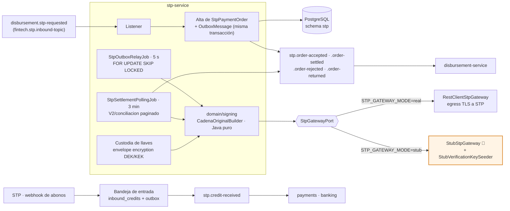
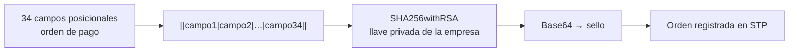
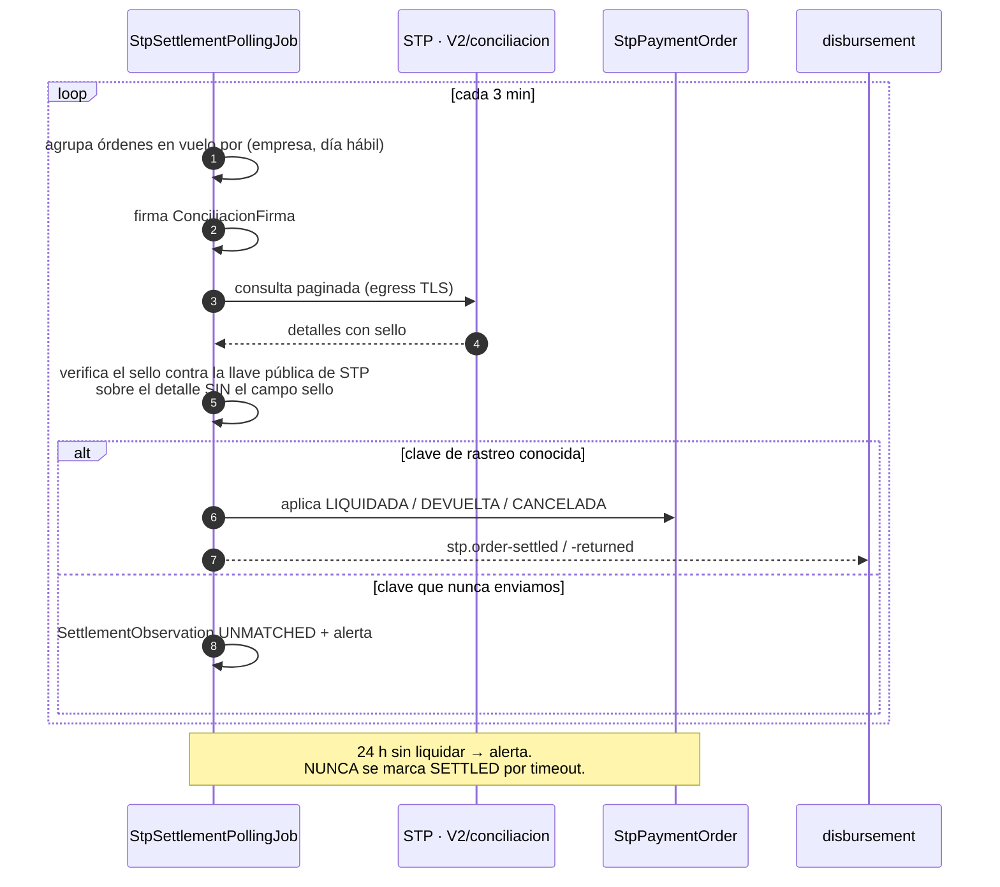
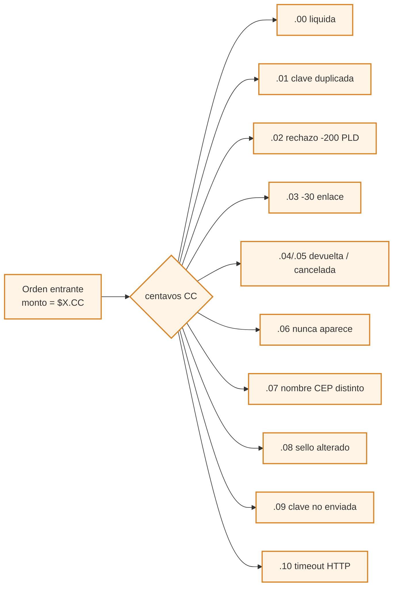

# stp-service (D12) — conector SPEI

**Anti-corruption layer con STP**, el proveedor de dispersión SPEI. Traduce órdenes de pago
genéricas al protocolo de STP: arma la cadena original, la firma con la llave de la empresa,
registra la orden y **consulta activamente** su liquidación.

> **Servicio interno, sin exposición a internet.** STP nunca llama a la plataforma. La única
> dirección hacia afuera es *egress* TLS iniciado por este servicio. **No hay webhooks**, no hay
> puerto abierto, no hay superficie de ingreso que proteger.

| | |
|---|---|
| **Puerto** | `8101` (bootRun) · `:8080` interno en Docker |
| **Schema** | `stp` · paquete `com.fintech.stp` |
| **Régimen Kafka** | **Backoff exponencial + DLT** — mueve dinero ([§5.4 raíz](../../README.md#54-política-de-reintentos-y-dlt-kafka)) |
| **Dominio** | [docs/dominios/11_stp_connector_domain.md](../../docs/dominios/11_stp_connector_domain.md) |

---

## Mapa del servicio



### Ciclo de una orden

```mermaid
stateDiagram-v2
    [*] --> PENDING : orden persistida + outbox
    PENDING --> SENT : el relay la entregó y firmó; o se rindió sin respuesta de STP
    PENDING --> FAILED : no se pudo firmar / datos inválidos / -30 agotado
    SENT --> ACCEPTED : STP registró la orden (código positivo)
    SENT --> REJECTED : código negativo (p. ej. -200 PLD)
    SENT --> FAILED : sin respuesta y fuera de la conciliación de su día ya cerrado
    SENT --> SETTLED : sin respuesta, pero la conciliación la trae liquidada
    ACCEPTED --> SETTLED : conciliación LIQUIDADA (LQ TLQ CCO CXO CCE)
    ACCEPTED --> RETURNED : conciliación DEVUELTA (D TD)
    ACCEPTED --> CANCELLED : conciliación CANCELADA
    SETTLED --> [*]
    REJECTED --> [*]
    RETURNED --> [*]
    CANCELLED --> [*]
    FAILED --> [*]
```



`SENT` y `ACCEPTED` son los estados **en vuelo** (`isInFlight()`): los que el poller sigue
consultando. Todo lo demás es terminal.

**Cada desenlace se oye río arriba, y ninguno arriesga pagar dos veces** (D58–D59, demo del 2026-11-04):

- **Lo transitorio lo reintenta el conector, y sólo él.** Un `-30` sostenido agota los intentos del outbox y la orden
  termina `FAILED` con un rechazo **definitivo**. Antes salía como «reintentable»: la dispersión reintentaba la misma
  solicitud, la guarda de idempotencia la descartaba sin contestar y la orden esperaba para siempre.
- **Sin respuesta no es un no.** Si la llamada misma falla (timeout, conexión caída) y se agotan los intentos, STP
  pudo haber registrado la orden en un intento cuya respuesta se perdió; fallarla dejaría pagar dos veces. Queda
  `SENT` y la decide la conciliación de su fecha de operación: si la trae, sigue su desenlace (liquidada, devuelta,
  cancelada); si el día ya cerró (corte más la retención) y su listado completo no la trae, STP nunca la registró:
  `FAILED` y `NO_REGISTRADA` hacia la dispersión, que puede volver a pagar sin pagar dos veces.
- **Una orden que ni salió** (empresa sin llave de firma, por ejemplo) falla al agotar los intentos y también avisa.
  Antes se fallaba en silencio.
- **Una aceptada que nunca aparece** no se toca al cerrar el día: STP dijo que la tomó (SO-06). Alerta y revisión.

---

## Qué NO sabe

No sabe qué es un desembolso, ni un crédito, ni una disposición. Consume una **orden de pago SPEI**
de un topic configurable (`fintech.stp.inbound-topic`) y publica el resultado. Puede extraerse a
otro repositorio **sin borrar un solo archivo**; lo verifica `StpDecouplingTest`.

---

## La firma — la pieza de mayor riesgo

`CadenaOriginalBuilder` construye la cadena posicional que STP firma. Es la parte donde un error de
un carácter significa que ningún pago sale, y por eso vive en `domain/signing` como **Java puro**:
sin Spring, sin JPA, probable sin levantar un contexto.



Para consulta de saldo son **3 campos**, y para conciliación **3** — mismo constructor, distinta
plantilla posicional.

Decisiones que no son negociables y están cubiertas por pruebas de vector dorado:

- **34 campos** para orden de pago, 3 para saldo y 3 para conciliación, en orden posicional exacto.
- Montos con `DecimalFormat("0.00")` y `Locale.ROOT` — el legado dependía del locale de la JVM.
- Fechas `yyyyMMdd`. Nulos → cadena vacía, nunca `"null"`.
- `nombreBeneficiario` se **trunca a 40 al construir la orden**, y se guarda el valor truncado
  aparte del completo. El legado firmaba el truncado y guardaba el completo, lo que después rompía
  la comparación contra el nombre del CEP.

## Bugs del legado que quedan cerrados

| | Qué pasaba | Qué lo cierra |
|---|---|---|
| **B1** | `-200` (`RECHAZO_POR_PLD`) pasaba como éxito porque el código comprobaba `length() == 4` | `BanxicoResponseCode.isAccepted()` usa el signo |
| **B7** | Nombre firmado truncado vs. nombre guardado completo | Se persisten los dos: `beneficiary_name` y `beneficiary_name_sent` |
| **B8** | Mapeo de estados incompleto (`TLQ`, `CCO`, `CXO`, `CCE`, `TD`, `TCL`) | `StpOrderStatusCode`, única fuente de verdad |

---

## Confirmación de liquidación: consulta, no webhook

Sin exposición a internet, la liquidación se confirma **preguntando**: un poller agrupa las órdenes
en vuelo por `(empresa, día hábil)`, firma una `ConciliacionFirma` y pagina `V2/conciliacion`.

Esto elimina toda la superficie de ingreso y hace gratis la autenticación del canal: somos nosotros
quienes abrimos la conexión TLS contra un host conocido.

Reglas que se aplican a cada observación:

- El **sello entrante se verifica** contra la llave pública de STP, sobre el detalle **sin el campo
  `sello`** — verificar contra un payload que contiene su propia firma es imposible por construcción.
- Una clave de rastreo que nunca enviamos entra como `UNMATCHED` y alerta. No se ignora.
- A las 24 h sin liquidar se alerta. **Nunca** se marca `SETTLED` por timeout.




---

### Punto abierto, dicho sin adornos

**La cadena exacta que STP firma en la respuesta de conciliación no está confirmada contra su
especificación.** Lo que hay implementado verifica contra el detalle serializado sin el `sello`, que
es una hipótesis razonable — probablemente STP firme una cadena posicional, como en el resto de su
API.

Por eso la política por defecto es `WARN`: se intenta verificar, y si falla (o no hay llave
registrada) la observación queda marcada `SIGNATURE_UNVERIFIED` y **el cambio de estado sí se
aplica**. La alternativa —bloquear contra una suposición— sería peor: dinero que ya salió del banco y
que este servicio nunca confirmaría.

**Antes de producción hay que pedirle a STP la especificación de ese sello, ajustar la cadena y
pasar la política a `ENFORCE`.** Es el único punto del diseño que depende de información que no
estaba en el repositorio legado.

---

## Cobro por CLABE: los abonos que entran

Cada persona que paga tiene **su** CLABE de cobro: `646` (STP) + `180` (plaza) + el prefijo de cliente de 4 dígitos
que STP asigna a la empresa + un consecutivo de 7 dígitos + el dígito verificador (pesos 3, 7, 1). La emite el
conector cuando payments la pide (`stp.collection-account-requested`, al activarse el primer crédito de la persona);
es una por persona y **nunca se recicla**, ni cerrada: quien la guardó en su banca pagaría el crédito de otro.
La CLABE dice **quién** paga; la referencia numérica del SPEI (7 dígitos con dígito Luhn, una por crédito) dice
**cuál** crédito.

STP avisa cada abono por webhook (`POST /api/v1/stp/abonos`) y **espera la respuesta**: `200
{"mensaje":"confirmar"}` se queda con el dinero; `400 {"mensaje":"devolver","id":<causa>}` hace que STP lo devuelva
al ordenante con la causa de Banxico. Decide una cadena de reglas (*Chain of Responsibility*), la primera que
rechaza manda:

| Regla | Causa Banxico |
|---|---|
| Faltan datos obligatorios (clave de rastreo, importe, CLABE) | 14 falta información |
| Tipo de pago no permitido | 15 tipo de pago erróneo |
| La CLABE no es nuestra | 1 cuenta inexistente |
| La CLABE está bloqueada / cerrada | 2 bloqueada · 3 cancelada |

La decisión se guarda **antes** de responder, en la bandeja de entrada (`stp.inbound_credits`), idempotente por el
id de STP y por (clave de rastreo, fecha de operación): el reintento del mismo abono recibe la misma respuesta. En
la misma transacción, el outbox (`PUBLISH_EVENT`) encola `stp.credit-received`, con las **dos fechas del dinero**:
`receivedAt` (cuándo llegó: la fecha de cartera) y `operationDate` (la fecha de operación SPEI: la del banco). Un
abono de las 19:00 del 30 de noviembre es de cartera el 30 y del banco el 1 de diciembre. payments lo aplica
(referenciado al crédito de la referencia; sin ella, por prelación al más antiguo; lo que sobra, saldo a favor) y
tesorería lo lleva al libro de caja en su fecha de operación.

Para el E2E, `POST /internal/test-support/spei/abonos` simula a STP llamando al webhook con el payload que se le
dé (cuenta inexistente, bloqueada, tipo de pago, duplicados): las pruebas de borde son de nuestro sistema, con
cargas de un tercero simuladas.

## Custodia de llaves — multi-empresa desde el día uno

Cada empresa tiene su cuenta ordenante, su prefijo de clave de rastreo y su llave de firma. Las
llaves privadas se guardan con **envelope encryption**: una DEK AES-256-GCM por llave, cifrada con
una KEK que **nunca vive en la base de datos ni en el repositorio** (`STP_KEK_<id>`, gestor de
secretos en producción).

`StpCompanyKey` tiene un `toString()` deliberadamente pobre: ningún log accidental puede filtrar
material criptográfico.

---

## Stub para ambientes bajos

En local, CI y ambientes bajos no se habla con STP — pero el sustituto **no es un `return true`**.

**El stub devuelve lo que se le envió**, más lo único que sólo el banco puede saber (`estado`,
`tsLiquidacion`, `urlCEP`, `nombreCep`, `sello`). Y firma de verdad, con su propio par de llaves:
así la orden saliente ejercita `CadenaOriginalBuilder` completo y la observación entrante ejercita
la verificación de sello. Si alguien rompe la firma, revienta en local, no en producción.

Su llave pública se registra sola al arrancar como llave `VERIFICATION` de cada empresa
(`StubVerificationKeySeeder`). Sin ese paso el stub no serviría de nada: la verificación fallaría
siempre y ninguna orden llegaría nunca a liquidada en local.



Doce escenarios deterministas **por los centavos del monto**:

| Centavos | Escenario | Qué ejercita |
|---|---|---|
| `.00` | Liquida | Camino feliz |
| `.01` | Clave de rastreo duplicada | Éxito idempotente, no error |
| `.02` | `-200` PLD | El bug B1 — debe terminar en rechazo |
| `.03` | `-30` enlace en consultas | Reintento del outbox; agotado, rechazo definitivo |
| `.04` / `.05` | Devolución / cancelación | Cierre por camino no feliz |
| `.06` | Nunca aparece | Alerta a 24 h, y **nunca** `SETTLED` |
| `.07` | Nombre del CEP distinto | Comparación de nombres |
| `.08` | Sello alterado | Verificación de firma |
| `.09` | Clave que nunca enviamos | `UNMATCHED` + alerta |
| `.10` | Timeout HTTP | Reintento desde el outbox; agotado, espera a la conciliación del día cerrado |
| `.11` | `-30` la primera vez | La primera orden de una cuenta y un monto agota el `-30`; el siguiente intento del mismo pago (otra clave) se liquida (D63) |

**Qué importes eligen escenario** (`fintech.stp.gateway.stub.scenario-amounts`, `STP_STUB_SCENARIO_AMOUNTS`):
- `ANY` (por omisión, las pruebas del conector): los centavos de todo importe eligen.
- `ARMED` (el stack local): sólo los importes que una corrida arma con
  `PUT /internal/test-support/stub/scenario-amounts` (`{"amounts": ["4000.02", "3000.04"]}`; responde cada uno
  con su escenario) juegan el suyo, y cualquier otra orden se liquida.

La plataforma calcula importes propios —un lote de comisiones, un pago de fondeo— y once de los cien centavos
son fallas. La suite de distribuidoras del 2026-11-04 perdió así tres lotes:
- $754.10 dio timeout cada mes;
- $721.05 se canceló dos veces;
- $529.06 se aceptó y nunca se liquidó.

Los importes armados viven en `stp.stub_scenario_amounts` (migración 018), como las órdenes del stub, para que
una réplica o un reinicio vean lo mismo.

> **Guarda de arranque:** el stub sólo arranca con perfiles de ambiente bajo
> (`local`, `dev`, `test`, `ci`, `docker`, `qa`, `staging`). Cualquier otro perfil —o ninguno—
> impide el arranque. Es lista blanca y no lista negra a propósito: el compose de este repo levanta
> con perfil `docker`, así que una lista negra de "prod" no habría protegido de promover ese mismo
> compose a producción. Un stub de
> pagos silenciosamente activo en producción es la peor clase de incidente: todo se ve verde y no
> sale un peso.

---

## Outbox transaccional

**Nunca** se llama a STP dentro de la transacción que persiste la orden. El relay toma lotes con
`FOR UPDATE SKIP LOCKED` y firma fuera de la transacción de persistencia. El legado tapaba la misma
carrera publicando todo con dos minutos de retardo programado.

Un `CLAVE_RASTREO_DUPLICADA` se trata como **éxito idempotente**, no como error: es exactamente la
respuesta que da STP cuando ya recibió la orden, y tratarla como fallo provocaría una doble
dispersión.

Con el soporte de pruebas encendido, el outbox se declara como **trabajo pendiente** (`PendingWork`):
los mensajes que el relay enviaría ahora. Un mensaje sigue `PENDING` hasta que confirma la
transacción que lo envía, así que el conteo lo ve todo el tiempo. Una orden retenida por el corte no
vence hasta que pasa su espera: no cuenta hasta entonces (`OutboxPendingWorkIT`).

Cada reintento espera el doble que el anterior, desde `fintech.stp.outbox.base-backoff` (5 s;
`STP_OUTBOX_BASE_BACKOFF`) hasta 128 veces esa base. El stack local la pone en cero, como la espera del
simulador y la gracia del poller, porque el simulador contesta al instante. Así el relay vuelve a tomar el
mensaje en la misma pasada y los seis intentos de un `-30` ocurren en el momento simulado en que se
registró la orden. Con espera, el reloj del E2E (que corre en tiempo real entre movimientos) los repartía
según lo que tardara cada movimiento, y con ellos el siguiente intento de la saga (D63, `UnansweredOrdersIT`).

---

## API REST (operación interna)

No está publicada en el gateway: se consume desde la red interna, con el mismo modelo
*header-trust* del resto de servicios internos.

| Método | Ruta | Descripción |
|---|---|---|
| `GET` | `/api/v1/stp/payment-orders` | Órdenes, con filtros de operación |
| `GET` | `/api/v1/stp/payment-orders/{paymentRequestId}` | Detalle de una orden y su bitácora |
| `GET` | `/api/v1/stp/settlement-observations` | Observaciones de conciliación (incluidas las `UNMATCHED`) |
| `POST` | `/api/v1/stp/poll` | Forzar una vuelta del poller |
| `POST` | `/api/v1/stp/abonos` | Webhook de abonos de STP: confirmar o devolver (cabecera `X-Webhook-Token`) |
| `GET` | `/api/v1/stp/collection-accounts/by-party/{partyId}` | La CLABE de cobro de una persona |
| `GET` | `/api/v1/stp/collection-accounts/by-party/{partyId}/credits` | Los abonos recibidos en ella |
| `POST` | `/api/v1/stp/collection-accounts/by-party/{partyId}/block` · `/reactivate` | Bloquear o reactivar la CLABE |
| `POST` | `/internal/test-support/run-settlement-poll` | Una vuelta del poller a demanda (sólo con `TEST_SUPPORT_ENABLED`) |
| `POST` | `/internal/test-support/spei/abonos` | Simula un abono de STP al webhook (sólo con `TEST_SUPPORT_ENABLED`) |

### Administración de empresas y llaves — `/api/v1/stp/companies`

| Método | Ruta | Descripción |
|---|---|---|
| `POST` · `GET` | `/` | Alta y listado de empresas |
| `POST` | `/{companyId}/ordering-accounts` | Cuenta ordenante de la empresa |
| `POST` · `GET` · `DELETE` | `/{companyId}/keys` · `/keys/{keyId}` | Custodia de llaves de firma y verificación |

---

## Configuración

| Variable | Default | Para qué |
|---|---|---|
| `STP_GATEWAY_MODE` | `stub` | `real` sólo en producción |
| `STP_INBOUND_TOPIC` | `disbursement.stp-requested` | Topic de entrada, configurable a propósito |
| `STP_CURRENT_KEK_ID` + `STP_KEK_<ID>` | `local` | Custodia de llaves. El material nunca se commitea |
| `STP_ACCOUNT_HASH_SALT` | — | Salt del HMAC con que se enmascara la cuenta antes de persistirla |
| `STP_POLLING_ENABLED` | `true` | Apagar el poller no pierde órdenes: quedan en vuelo |
| `STP_SIGNATURE_POLICY` | `WARN` | `ENFORCE` \| `WARN` \| `OFF` — ver abajo |
| `TEST_SUPPORT_ENABLED` | `false` | Publica `/internal/test-support/*` (reloj, poller a demanda, simulador de abonos): el E2E mueve el día de operación. Nunca en producción |
| `STP_SPEI_CUTOFF` · `STP_SPEI_HOLD` | `18:00` · `PT10M` | Corte del día de operación SPEI y la retención de órdenes salientes alrededor de él |
| `fintech.stp.collection.webhook-token` | — | El secreto que STP manda en `X-Webhook-Token`. Vacío sólo en el stack local |
| `fintech.stp.collection.allowed-payment-types` | `1,5,19,20,21,22` | Tipos de pago SPEI que se aceptan; otro se devuelve con causa 15 |

Generar una KEK: `openssl rand -base64 32`.

**Fecha de operación.** La orden se fecha con el día Banxico del reloj de negocio (`BusinessClock`, zona
`America/Mexico_City`), no con la zona del contenedor: en UTC, una orden de las 19:00 quedaba fechada mañana. Desde
el corte (`STP_SPEI_CUTOFF`, 18:00), o en día inhábil del calendario bancario, la fecha es el siguiente día hábil; una
orden registrada a menos de `STP_SPEI_HOLD` del corte espera a que pase (`SpeiOperatingDay`). Es la fecha con que
viaja a STP, con la que el banco la reporta y con la que el libro de caja de tesorería la lleva; `stp.order-settled`
lleva además `registeredOn`, el día en que se registró (la fecha de cartera). El conector tiene **un solo reloj**,
la vista del reloj de negocio: outbox, poller y stub siguen al E2E cuando mueve la hora.

---

## Correr

```bash
./gradlew :stp-service:test          # firma (vectores dorados) + dominio + ArchUnit
./gradlew :stp-service:bootRun
docker compose up stp-service
```

---

## Sacarlo a otro repositorio

1. Copiar el módulo.
2. Apuntar `fintech.stp.inbound-topic` al topic del comprador.
3. Copiar `DomainException` en vez de depender de `:shared`.
4. Sustituir `JwtAuthenticationFilter` por el mecanismo de auth del comprador.

**Cero archivos borrados.**

---

Análisis completo, decisiones y plan: [`docs/ANALISIS_Y_PLAN_disbursement_stp.md`](../../docs/ANALISIS_Y_PLAN_disbursement_stp.md)

---

## Convención de idioma

**Todo el código de este servicio se escribe en inglés** — clases, métodos, campos, enums, pruebas
y claves de configuración. Los **comentarios van en español**, que es donde vive el razonamiento.

Excepciones: los nombres que viajan en el contrato de un proveedor externo, y los términos
regulatorios sin equivalente (`CLABE`, `CURP`, `RFC`, `CEP`). Detalle y guía de migración en
[`docs/CONVENCION_IDIOMA.md`](../../docs/CONVENCION_IDIOMA.md).
